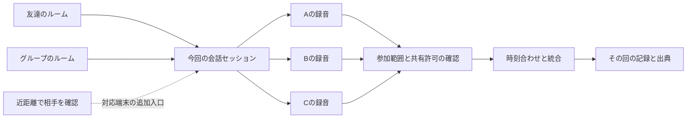

# 友達・グループから会話を始める実装設計案

2026-09-15 / 主担当による設計。方針変更の正本は[MVP_SPEC §19](../product/MVP_SPEC.md#friends-groups-sessions)。この文書の画面・データ・API案は未実装で、細部の採用待ち事項を含む。実装順・担当境界は[ロードマップ](MULTIPLATFORM_DELIVERY_PLAN.md#friends-groups-plan)へ集約する。

統合時の前提：当日のASRは[MVP_SPEC §9.0](../product/MVP_SPEC.md#contracts)の端末直接呼出を優先する。下記のサーバー/workerは共有・統合の論理的な処理役を示す設計案であり、Windowsへの音声中継を再採用するものではない。共有保存/2入力統合/AI会話の配置と担当は未決定。§9.0.1のログイン不要の声の登録準備を、友達/グループの認証や共有許可へ流用しない。

## 1. 今回の結論

友達またはグループを選び、開始前に「今回の会話」を作る。参加端末の録音を同じ会話セッションIDへ紐付け、許可範囲の記録を統合する。相手を毎回音声全体から探す処理を通常経路の前提から外す。録音の時刻合わせ・重複/相違の処理・話者の確認は引き続き必要。

| 位置付け | 内容 |
|---|---|
| ユーザー決定 | 友達登録とグループ作成から会話を開始できるようにする。未知の相手を録音内容から自動発見する方式は通常経路から外し、アイデアとして保存する |
| 近距離の採用範囲 | Bluetooth等の対応端末で、友達未登録の今回限り参加を可能にする。初期は双方がアプリ前面で発見/参加。方式・対応端末の実測は未完 |
| 本設計の推奨 | 友達/グループを共通の会話セッションへ接続する。近距離方式も同じ参加処理へ合流させる。最初の近距離版はアプリを開いて相手を確認する方式 |
| 維持する境界 | 各人の明示的な録音開始、複数端末統合、通常共有とグループ共有の違い、出典、不明の表示、D17の閲覧範囲 |

## 2. 利用者の流れ（提案）

### 友達と始める

1. 「ルーム」から「友達を追加」。本人の追加コードまたはQRを相手が読み取り、プロフィールを確認して申請・承認する。コード/QR方式を採用し、電話帳取込や全利用者の名前検索は初期対象に含めない。
2. 友達のルームで「会話を始める」。サーバーが今回のセッションを作り、相手のアプリ内に参加待ちを表示する。初版はアプリ内の取得で成立させ、OSプッシュ通知は独立した拡張とする。
3. 相手が今回の共有を許可して参加する。録音する人が「自分の録音を開始」。録音しない参加者も認証と今回の許可を行う。相手の操作で自分のマイクが起動することはない。録音の開始は同時でなくてよい。
4. 各自が停止・保存し、本人の処理開始操作から端末直接ASRへ進む。共有用の入力登録/保存は§9.0の残る契約として別に接続する。ルーム/セッション選択だけでは送信や共有許可を成立させない。
5. サーバーが同じセッションの入力を集める。本人・参加範囲と参加時許可の有効性を確認し、1入力なら単独の記録、複数入力なら統合記録を作る。参加時と同じ条件の共有許可を停止後に取り直さない。有効な継続承認がある場合は既存の省略条件を適用する。
6. ルームにその回の記録カードを表示。原文/出典を確認し、本人用AI会話へ進む。友達登録は相手の過去の記録を読む権利にならない。

友達申請の承認は継続共有の承認と別データとする。参加時に今回の共有を許可することはユーザー回答で確定。相手/今回の会話/共有規則を示し、同じ許可の二重取得を避ける。本人/区間の不明や許可条件の拡大時の再確認は維持する。[採用範囲](../product/MVP_SPEC.md#friends-groups-answers)を参照。

### グループで始める

1. 「グループを作成」から名前を付け、作成者が管理者になる。管理者が友達を招待し、招待された人の承認でメンバーになる。初期上限は管理者を含む4人。
2. グループのルームで「会話を始める」。各メンバーは今回の共有を許可して参加するか選び、録音する人は自分の端末で開始する。1人だけの録音でも記録を作成できる。
3. 参加した端末の入力を同じセッションへまとめる。欠席メンバーを録音待ち・共有回答待ちの人数へ混ぜない。
4. 「誰が録音したか」「誰が発言したか」「誰が閲覧できるか」を別管理する。グループに属しているだけで、個人録音をこのグループへ流さない。
5. グループ用として明示的に提供した記録をグループルームへ蓄積する。日が異なる会話は別のセッション/記録カードになる。

既存S04を維持するため、グループ用の記録は、その場にいなかった現メンバーも加入期間内の範囲を閲覧できる。途中加入者は加入後の区間、退出者は過去も含めグループ経由の閲覧を停止する。「今回の会話への参加/離脱」と「グループへの加入/退出」は別操作。本人入力の別経路や再加入は§10の判断事項。

### 画面の配置

「録音」「ルーム」の2タブを維持する案。配置の具体変更は製品実装前の見本で確認する。

| 画面 | 追加/変更する内容 |
|---|---|
| U16 ルーム | 自分の記録＋友達のルーム＋グループのルーム。追加メニューから友達追加/グループ作成。友達がいて記録0件の状態も表示 |
| U17 相手のルーム | 「会話を始める」、参加待ち/録音中の状態、回ごとの記録カード。「記録/AI」は維持 |
| グループルーム（配置は新規案） | グループ名・メンバー・今回の参加者・開始・履歴。グループ記録を各自の本人用ワークスペースで使うことは確定。質問/回答/参照選択は本人専用とし、D17を適用 |
| 参加画面（新規案） | 相手/グループ、閲覧対象、今回参加する人、本人の録音開始。招待と録音中と送信済みを分ける |
| U02 録音 | ルームから来た場合は相手/グループを表示。個人録音の入口は維持。途中で別ルームに付け替えず、停止後の明示操作へ |
| U04/U05 確認 | 終了後の既存手動持ち寄りを移行経路として残す。新経路では開始前に決まった相手/セッションを引き継ぎ、本人/範囲/共有の不足を確認 |

## 3. 設計の中心：継続する関係と今回の会話を分ける

- ルームは人/グループの履歴の入れ物。セッションは一回の現実の会話。録音は端末ごとの入力。統合記録はその入力から作った結果。
- 既存`conversation_id`は統合結果側の識別子として維持し、新しい`session_id`を開始前に発行する。別の日の会話をroom/group IDだけで混ぜない。
- 同じsession IDは入力候補を特定するための情報。別の会話を誤って録音した場合や無関係な音声を添付した場合には、照合不成立/確認待ちにできるようにする。
- 端末のログイン情報で録音所有者を確定しても、全発言を所有者の発言にはしない。話者ラベルと人物の対応は別の根拠付き情報とする。

## 4. データ構成案

名前は説明用の候補。正式JSON/OpenAPI/永続化契約はK01で確定し、schemaからTS型を生成する。

| 要素 | 主要な内容 | 境界 |
|---|---|---|
| FriendRequest / Friendship | 申請者、相手、状態、相互関係の一意な組、版 | 申請中は友達未成立。Friendshipと既存continuing grantを分ける |
| Group / GroupMembership | グループ、役割、招待、加入/退出の時刻と版 | 現在の所属だけで過去全期間の権利を計算しない |
| Room | direct/groupの種別、友達の組またはgroup参照 | 表示用。独立テーブルが必要かは既存取得APIとの設計で決める |
| PersonalWorkspace（追加設計） | owner_user_idとgroup_id/相手の組、本人用のAI会話/参照選択 | 共通の元記録を現在の権限で参照し、AI履歴を他のメンバーへ返さない。個人の参照解除/AI履歴削除でグループ記録を削除しない |
| ConversationSession | 作成者、room、通常/グループ、受付/収集中/確認中/終了、版、結果ID | 作成時に対象を固定。人の招待や端末参加だけで公開しない |
| SessionParticipation | session、user、招待/参加/離脱、端末、capture状態 | 会話への接続記録。発言の開始境界とは別 |
| SessionSharingConsent（追加設計） | session、本人、共有先/規則の版、今回の対象条件、許可/取消時刻 | 録音IDの確定前に今回許可を保存し、終了後の入力/区間へ対応付ける。同じ条件では取り直さず、条件拡大は再確認する |
| SessionRecording | session、既存recording、所有者、入力版、利用区間 | 同じ録音を重複登録しない。録音単位の5分上限は維持 |
| SpeakerBinding / ParticipationEvidence | 話者ラベルと人物、発言区間、根拠、確認状態、版 | 不明/争いを表現。friend/group/BLEだけで確定しない |
| ShareScope / AudiencePolicy | 許可された入力/区間、閲覧者規則、同意/所属の参照版 | 通常の双方許可とグループ規則を別扱い。取消で生成/表示も失効 |
| NearbyInvite（追加案） | 期限付き一時token、session/招待との対応、使用者、使用済み状態 | 公開する端末名やMACアドレスを本人認証にしない |

既存`private.app_entities`/transaction境界は人工検証の追加要素に再利用できる。現PostgresStoreは全entity読込と共通ロックの方式なので、大人数/大量履歴への性能を保証しない。利用規模を拡大する時点で、対象だけを読むクエリ・一意制約・索引を持つ保存方式へ移行する。今回の設計ではDB変更を実行しない。

## 5. API・状態遷移案

| 用途 | 新しい操作の候補 |
|---|---|
| 友達 | `POST /friend-invites`、`POST /friend-requests`、申請accept/reject、`GET /friends`、関係remove |
| グループ | `POST /groups`、メンバーinvite/accept、`GET /groups/{id}`、leave。管理者の招待/名前変更/除外/引継ぎは§19.7の採用条件で追加 |
| 開始 | `POST /conversation-sessions`。対象roomとrequest_keyで作成し、重複押下は同じ結果を返す |
| 参加/状況 | sessionのjoin/leaveとsnapshot取得。サーバーが招待/関係/所属の有効性を検証する |
| 入力の登録 | sessionへ既存recordingを登録。所有者・版・所属するセッション・共有対象区間を検査 |
| 確認/統合 | 既存confirmation/scope/revisionの考え方を引き継ぐ。groupはN人/区間別の契約へ拡張し、workerへ渡す前に確認 |
| 近距離（追加） | 発見tokenの作成/解決/参加。ネットワーク参加経路と同じサーバー認証・認可へ合流 |

URLは候補で、現在の`/v1`に同名の実APIがあるという意味ではない。追加可能なAPIと、2人固定の構造変更を分ける。既存v1の受理形を黙って変えず、変更が必要な契約は版を上げ、旧fixtureも保持する。

### 競合・停止・通信断

- 同じ2人が同時に開始を押した場合、進行中セッションを検出して「参加する」を案内する。別の会話を無条件に一つへ結合しない。ルームの同時開催数は採用待ち。
- 招待未回答者/欠席者と、実際に録音を開始した人を分ける。入力不足なら「1件のみ」「相手の送信待ち」を表示し、複数統合済みと称しない。
- 自分の停止で止まるのは自分の録音。先行退出後も他の人は継続でき、録音していた全員の停止を確認して会話全体を閉じる。開始者の退出や通信断で他端末の保存成功/停止を推定しない。停止未確認の待機期限/手動終了、後着入力の受付期限の具体値は残件。
- 会話終了と後着入力の受付終了は別に管理する。届いた1入力で記録を作り、期限内の後着分は同じsessionの結果を更新する。閉じた会話を再開する操作は新しいsessionを作り、同じルームの別カードにする。
- 初版の新規共有セッション作成/参加はオンラインを推奨。通信断後も各端末は本人の録音を保存し、復帰時にセッション/所属/許可を再取得する。古いメンバー情報で公開しない。既存のオフライン個人録音は維持する。
- 録音終了後のアップロード再送はchecksum/request_keyで重複を抑え、workerは入力版/権限版を固定して実行する。後着入力は新しい結果版とし、旧許可外を自動で足さない。

## 6. 統合と閲覧権限

1. セッション内の提出済み入力を取得し、現在有効な提供許可と入力区間を確定する。
2. 時刻情報と共通発言を使い録音を対応付ける。開始がずれても、対応する区間だけ統合する。波形/ASR時刻の方式と精度は音声選定側で検証する。
3. 重複は対応する出典をまとめ、片側にだけある発言はその出典を保持する。相違は消さず、不明を勝手に正解へ補完しない。
4. 話者ラベルを人物へ対応付ける。不明はラベルのまま残し、人物/閲覧範囲が確定できない場合は共有を保留する。
5. 閲覧者ごとの許可区間から本文・要約・AI入力・出典音声を作る。単一の全員向け要約を、画面の非表示だけで制限しない。

通常共有は実際の発言/参加区間と双方許可を維持する。グループは明示したグループ用入力だけを対象とし、現在の所属＋記録当時の加入期間＋有効な提供範囲をサーバー側で照合する。後から加入した人に加入前を渡さず、退出の後にはその経路の本文・派生物・生成中の回答を提供しない。membership/scope/sourceの版変更時は、生成終了時にも再検査する。

グループを2人ずつの組に分解し、その共有結果を単純に足して実装しない。A/BとB/Cの許可からA/Cへの共有許可は導けず、グループの閲覧規則とも異なる。最低3人の人工ケースでN人の入力と閲覧規則を確認する。

参加時の許可で示した同じグループのS04規則は、規則内の加入/退出にも適用する。別グループへの提供や規則自体の拡大は同じ許可として流用しない。各自のワークスペースへは現在許可された元記録を参照させ、物理的な音声/全文の個人コピーを前提にしない。

## 7. Bluetooth等を使う入口

### 推奨する追加段階

最初は「近くの人と始める」を双方のアプリ前面で開き、相手候補/照合コードを確認して今回の共有を許可し、セッションへ参加する。友達登録を省略する一時参加と前面での初期対応はユーザー回答で確定。通常の友達関係やグループ所属を勝手に作らない。方式と対応端末は実測で選ぶ。グループ未所属者の参加/閲覧は管理の詳細で決める。

近距離通信は一時的な参加情報を渡す用途に限定して試す。ASRは§9.0の端末直接呼出に従い、共有用音声の保存/配信は別契約で具体化する。BLEで原音を全転送することを初期条件にしない。近距離での発見自体がオフラインでも、サーバーへ参加を確定しAI処理するにはこの構成では通信が必要。

| 候補 | 評価する内容 |
|---|---|
| Google Nearby Connections | Android/Swift SDKで発見・接続・短い参加情報の交換を試す第一候補。Bluetooth/BLE/Wi-Fiを組み合わせるため、Bluetoothだけの方式と説明しない |
| 共通BLEプロトコル | Core BluetoothとAndroid側の広告/探索を共通serviceで実装する比較候補。各OS/端末の広告・探索能力と相互接続の検証が必要 |
| コード/QR | 全対象端末の代替入口。近距離非対応・権限拒否・検出失敗でも同じセッションへ参加できる |

公式資料：Nearbyの[概要](https://developers.google.com/nearby/connections/overview)、[iOS導入/権限](https://developers.google.com/nearby/connections/swift/get-started)、[相手の照合](https://developers.google.com/nearby/connections/swift/manage-connections)、[Androidの前提/権限](https://developers.google.com/nearby/connections/android/get-started)。両OSのSDKがあることと、このRNアプリの組み合わせで動作確認済みであることは別。

RN側に`NearbySessionAdapter`を置き、`availability/startDiscovery/stopDiscovery/requestJoin`等を共通化する案。必要なSwift/KotlinコードはExpo Modules/専用development buildへ追加する。Expo Goでは任意のネイティブコードを追加できない。[Expo公式](https://docs.expo.dev/workflow/customizing/)

まず両アプリが前面のケースを対象にする。iOSの背景探索は遅延/広告の制約があり、iPhone同士とiPhone/Androidを別に検証する。iPhoneであることだけで背景自動発見を有効にしない。未検証の組合せ、Bluetoothオフ、権限拒否ではコードへ戻す。[Apple公式](https://developer.apple.com/library/archive/documentation/NetworkingInternetWeb/Conceptual/CoreBluetooth_concepts/CoreBluetoothBackgroundProcessingForIOSApps/PerformingTasksWhileYourAppIsInTheBackground.html)

一時tokenは期限・使用先・認証済みアカウントと結び付け、再使用を拒否する。発見時の表示名/電波強度は本人認証や発言の証拠にしない。Bluetooth切断だけで会話終了/退席/共有取消を確定しない。

## 8. 既存実装との差分

| 確認した実装 | 再利用/変更の考え方 |
|---|---|
| [sharing.py](../../services/backend/app/sharing.py)のcreate_connection | 処理済みrecording_idが必須なので、録音前のsession作成は別操作を追加。既存コードのhash/期限/再送/認可の考え方は再利用 |
| [models.py](../../services/backend/app/models.py)のParticipation/MatchConfirmation | self/peerとonly_two_peopleの2人固定。グループではuserごとの配列と根拠/区間へ拡張し、旧形式も契約版で区別 |
| [sharing.py](../../services/backend/app/sharing.py)のscope/継続許可/会話取得 | 2人のpartiesによる認可から、通常/グループの閲覧規則を分岐。友達テーブルで上書きしない |
| [schema.mjs](../../contracts/schema.mjs)と[models.py](../../services/backend/app/models.py) | schemaにgroupの値はあるが、録音APIはnormalだけを受理する。group enumの存在を機能完成と扱わない |
| [store.py](../../services/backend/app/store.py) | 同一transaction内の承認/権限/再送を再利用。friend/group/sessionを追加する保存方式と規模の限界を分ける |
| [contexts.py](../../services/backend/app/contexts.py)と生成処理 | 現在の個人中心のContextを、許可済み共有入力へ接続する工程が残る。グループルームを表示しただけでAI参照完了にしない |
| [LiveSharing.tsx](../../apps/client/src/screens/LiveSharing.tsx)、[LiveApp.tsx](../../apps/client/src/screens/LiveApp.tsx)、[useLiveWorkspace.ts](../../apps/client/src/data/useLiveWorkspace.ts) | 友達/グループ/参加待ちと新APIを接続し、既存録音adapter、確認、詳細、出典を再利用する |

## 9. 正常・境界・失敗の受入候補

以下は設計用チェックID（FG）。既存AC/A/CやM15の受入を置き換えず、正式採用時にK01で対応付ける。

| ID | 入力/操作 | 期待する結果 |
|---|---|---|
| FG01 | AがBへ友達申請、Bが未回答/拒否/承認 | 承認時だけ相互関係成立。同時再送で重複せず、記録や継続許可は自動付与されない |
| FG02 | 友達のルームから開始、Bが参加、開始時刻の違う2入力 | 同じsessionの別recordingへ紐付き、共有条件成立後に出典付き統合。別の日の入力は混ざらない |
| FG03 | Bが未回答、マイク拒否、またはアップロード失敗 | Bを録音済みと表示しない。Aの端末保存を維持し、単独/待機/失敗を区別 |
| FG04 | A/B/Cのグループ、録音はA/B、Cは欠席現メンバー | group指定の許可済み記録はCの加入期間の範囲で閲覧可。Aの個人録音はCへ流れない |
| FG05 | 途中でDがグループ加入、Cがグループ退出 | Dに加入前の本文/要約/AI入力/原音を渡さない。Cへ退出後にそのグループ経由で過去も提供しない |
| FG06 | グループ3人以上の録音に重複/相違/話者不明 | N入力の根拠を保持し、話者を端末所有者で埋めない。2人組の許可を連結しない |
| FG07 | 同時開始、二重join、同じ録音の再送、古い版 | 二重セッション/入力/公開を抑止し、競合を409等の決定した結果へ。勝手に別会話を統合しない |
| FG08 | 録音中通信断→保存→退出/許可取消→復帰 | 原音保存と共有権限を分け、古い許可でアップロード公開/生成結果表示しない |
| FG09 | 生成中に所属/共有/出典が失効 | 終了時に再検査し、失効区間入りの結果・古いjob・AI履歴から漏らさない |
| FG10 | BLE非対応/拒否/相手未発見/接続切断 | コードで参加でき、切断だけで録音停止/退出/共有成立にしない |
| FG11 | 近距離token再送/期限切れ/別ユーザーによる利用 | 有効な招待と本人確認を満たさなければ参加不可。相手の本文を先に返さない |
| FG12 | 参加時に今回共有を許可し、停止後も相手/規則が同じ | 同じ許可を取り直さない。本人/範囲不明は別の確認にし、相手/範囲の拡大を黙って許可しない |
| FG13 | A/Bが参加許可、録音はAの1入力だけ | 成立した共有範囲で記録を作成できる。Bの録音を必須にせず、2入力統合とは表示しない |
| FG14 | 同じグループのA/BがそれぞれAIへ質問・参照変更 | 元記録は権限内で利用可。質問/回答/参照/draftは本人のワークスペース内だけに保存し、他人の操作/履歴へ影響しない |
| FG15 | 友達未登録のA/Bが前面で近距離参加 | 一時参加として今回共有を許可でき、友達登録/グループ所属を自動作成しない。背景発見を初期の成功条件にしない |
| FG16 | Aが先に退出しB/Cは録音を継続、最後の録音者が停止 | Aだけ録音/参加終了。録音していた全員の停止確認で会話を閉じる。欠席/非録音者を待たず、通信断を停止確認に置き換えない |
| FG17 | 1入力が到着し、同じ会話の入力が遅れて届く | 許可範囲の1入力で記録を作成。期限内の後着分だけ新しい結果版へ反映し、二重送信/期限後で勝手に変えない。期限値確定後に直前/直後を検証 |
| FG18 | 終了した会話の後に同じ人が再び開始 | 新しいsessionと記録カードを作る。前回向け後着録音を新しい会話へ混ぜず、今回の参加時共有許可を取得する |
| FG19 | 友達申請/グループ招待の未承認、非管理者の管理、管理者退出 | 承認前に友達/メンバーにしない。管理者だけ招待/名前変更/除外可能。他メンバーがいれば引継ぎ後に退出し、最後の退出ではグループを終了。元録音を一括削除しない |
| FG20 | 管理者を含む4人のグループへ5人目が加入、招待承認が同時に届く | サーバーでも加入上限4人を守る。3人時の同時承認でも5人にしない。4人の入力処理/性能は別の検証対象とする |

精度/性能は別に観測する。同じ会話の各単独入力と統合結果で発言欠落・話者取り違え・相違を比較する。発見時間、誤候補数、参加までの操作数、電池、同時入力数ごとの処理時間も測る。値を測る前に改善・即時・常時発見を保証しない。実音声の利用は[VALIDATION](VALIDATION.md#音声の利用処理条件)の該当条件を確認してから行う。

## 10. 採用待ちの判断

2026-09-15追加回答で、参加時共有、1入力の記録作成、各自のグループAI、友達未登録の近距離一時参加/前面対応を[正本§19.6](../product/MVP_SPEC.md#friends-groups-answers)へ反映。後続の了承により③終了/④管理も[§19.7](../product/MVP_SPEC.md#friends-groups-end-management)で採用した。話者判定と時刻合わせは継続検討、⑤解除/再加入時の過去記録は未回答。S04の欠席/加入/退出の閲覧規則は維持する。

| 判断 | 推奨する案 / 決める必要がある点 | 依存する工程 |
|---|---|---|
| 後着入力の期限 | 届いた1入力で記録を作り、期限内の後着録音で更新することは確定。受付期限の具体値/起点を決める | session終了/取得UI/統合開始 |
| 友達解除 | 新規招待を止め、継続共有も解除する案。過去共有の取消は別操作。未回答申請の期限/拒否後の再申請も決める | 正式friend API/認可 |
| グループ管理の詳細 | 管理者の招待/名前変更/除外、本人承認、退出前の引継ぎ、最後の退出で終了は確定。再加入/本人原音の別経路、引継ぎ/招待の詳細を決める | group API/退出UI/公開 |
| 同時開催と停止未確認 | 初期グループ上限4人、先行退出でも他者継続、全録音者の停止確認で終了は確定。同時セッション数、停止確認未着の待機期限/手動終了を決める | K01/N人統合/運用 |
| 共有の具体契約 | 参加時の今回許可は確定。session/共有規則の版と本人/範囲確認の接続、取消/条件変更時の再確認を具体化する | 開始/確認UIとscope契約 |
| グループAIの保持等 | 本人別のワークスペースは確定。現行保持の枠内でM15の履歴期限/失効/入力上限を具体化する。長期保存の追加は不要という判断を維持 | M15/共有Context/AI生成 |
| 近距離の方式/端末 | 友達未登録の一時参加と前面での初期対応は確定。方式/端末/SDK版を測定後に選ぶ。グループ未所属者の扱いは管理で決める | ネイティブ接続/配布 |

判断者は企画者。今回の仕様変更は設計の依頼であり、正式契約・製品実装・実データ送信の一括開始にはしない。未決定に依存しない状態モデル/人工画面の具体化は進められる。

### 10.1 ③終了と④管理の採用仕様（2026-09-15承認）

「自分の録音を止める」「その人が会話から退出する」「今回の会話全体を閉じる」「後着の録音の受付を締め切る」は別の出来事。既存§7では録音者の通常共有を本人停止までに制限しており、停止しても聞き続ける扱いへ変更する場合にはその規則の見直しが必要。

| 項目 | 具体的に考える場面 / 選択肢 | 採用した初期仕様 |
|---|---|---|
| ③-1 自分だけ終了 | Aが先に帰り、B/Cは会話を続ける。Aの停止で全体も閉じるか | Aの録音/参加だけ終了しB/Cは継続。他人の端末を止めない既存条件を維持 |
| ③-2 全体の終了 | 誰が一回の会話を閉じるか。開始者が明示終了するか、最後の録音者の停止で閉じるか | 録音が始まった会話は録音者全員の停止確認で閉じる。非録音者/欠席者を待たず、通信断を停止扱いにしない。待機期限/手動終了の詳細は残件 |
| ③-3 後着の録音 | Aだけ送信済みで、Bが通信断のまま帰宅する | 届いた1入力で記録を作り、同じ会話の後着入力で更新する。受付期限の具体値は残件。期限後は勝手に旧結果へ追加しない |
| ③-4 終了後の再開 | 一度終了し、10分後にまた話し始める | 新しい会話として開始する。継続するルーム内に別カードで残す |
| ④-1 友達追加 | 名前検索・電話帳・コード/QRのどれを使い、相互承認を必要にするか | コード/QRから申請し、相手が承認する。全利用者検索/電話帳は初期対象外 |
| ④-2 招待/管理権限 | 誰がグループへ人を招待し、名前変更やメンバー除外をできるか | 作成者を管理者にし、管理者が招待/名前変更/除外、招待された本人が加入を承認する。メンバー除外と録音自体の削除は別 |
| ④-3 管理者の退出 | 管理者が抜ける、最後の1人が抜ける | 他の人がいれば管理者を引き継いでから退出。最後の1人ならグループを終了扱いにし、新規開始を止める。元記録を一括削除しない |
| ④-4 人数上限 | 4人、10人、人数無制限のどこまで対応するか | 初期は管理者を含む最大4人。2人→3人→4人と検証してから拡張を検討する。4人の性能は未検証 |

ユーザーの「3,4はすべて上記の提案してくれた仕様でok」により、表の初期案を採用。人数上限は提示した4人とした。⑤友達解除後の過去共有やグループ再加入、グループ未所属者の一時参加権限、待機/受付期限等は残件。通常のグループ退出後に過去も閲覧不可とするS04を未決定へ戻さない。

## 11. 保存する元のアイデアと再開条件

元の案は、各自が独立して録音し、時刻/発言の音響特徴から同一会話を発見し、候補録音のアカウントをたどって統合するもの。必要に応じて近距離の一時IDで探索対象を絞る。[前回の説明記録](../history/WORKFLOW_20260915.md#conversation-discovery-without-friends)は保持する。

通常の開発対象から外す理由は、候補探索に加えて「同じ音を拾った端末の持ち主が本当の参加者か」という問題が残るため。あらゆる条件で技術的に不可能と結論したものではない。

再開条件：明示参加型の会話が動き、探索対象・照合情報の保持/送信・本人帰属方式を決めたうえで、隣席、別会話、短い発言、途中参加、誤候補の実測を行えること。近距離の候補提示と、本人確認なしの自動統合/共有は別段階にする。
