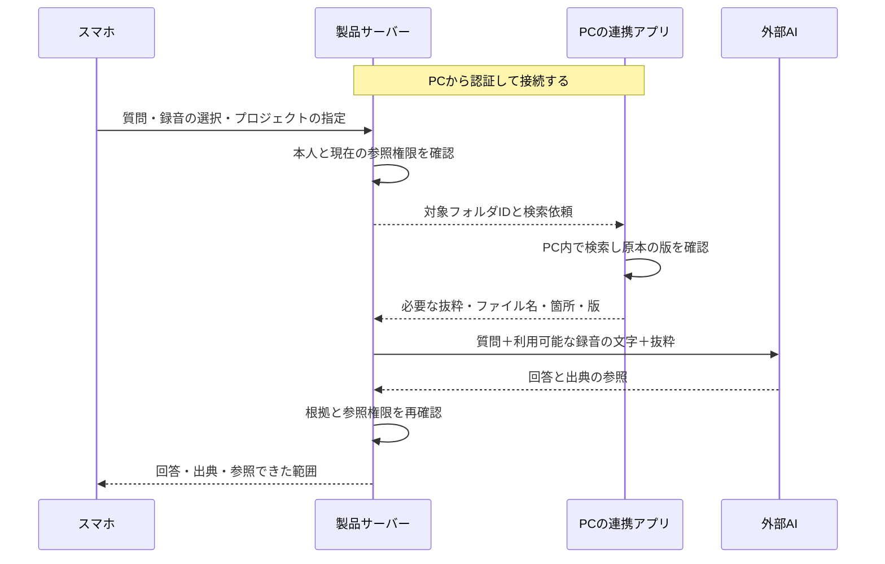

# PCローカル資料と録音を使うAI会話：仕組みの案

2026-09-15。ユーザーの「もう少しどのような仕組みか考えて」への設計案。**未採用・未実装**。現行仕様は[MVP_SPEC §16](../product/MVP_SPEC.md#saved-context-chat)、作業状態は[WORKFLOW](WORKFLOW.md)。既存の人ごとのルームや参照選択の決定を、この案で変更しない。

## 1. 提案する体験

PCに小さな連携アプリを入れ、本人が選んだプロジェクトフォルダを検索可能にする。スマホでは、録音の記録と参照するプロジェクトを選んでAIへ質問する。

例は人工の説明用：「今日の打合せを踏まえて、企画書の変更点と次の作業を出して」。AIは録音の発言とPCの企画書を比較し、両方の出典を付けて更新案を返す。PCの資料を読む権限と元ファイルを書き換える権限は別にする。

初期案ではプロジェクトを本人用の参照セットとして扱い、相手のルームやグループへの共有とは切り離す。新しいトップレベル画面の追加はこの設計で確定しない。どのAI会話に参照セットを保持するかは§16の判断と合わせる。

## 2. 4つの役割と質問の流れ

図の検索依頼は論理的なメッセージ。家庭のPCへサーバーから新規の着信接続を作る前提ではない。

### 初回だけ行う準備

1. PCの連携アプリで同じアカウントへログインし、本人のスマホから短い有効期限のコードで端末登録を確定する案。PCにはその端末だけの資格情報を保存し、解除可能にする。
2. PCで参照するフォルダを選び、表示名を付ける。サーバーにはプロジェクトID・端末ID・フォルダの識別子・設定版を登録し、絶対パスとフォルダ全体の内容はPCで管理する。
3. PC内でファイルを読み、検索用の目次を作る。これはファイル名・見出し・本文の検索用データであり、全文を外部AIへ送って準備する方式を基本にしない。
4. 対応形式と除外項目を表示する。最初はMarkdown/テキストを対象とする候補。本文を抽出できるPDF、画像の文字認識、表計算は順に評価し、フォルダ内の全形式を読めると表示しない。

### 質問するたびに行う処理

1. サーバーは本人の質問、選択した録音、指定プロジェクトから検索依頼を作る。PCへは質問と必要な検索語を渡し、録音全文の配布は前提にしない。「今日の話」のような質問には、利用可能な録音から検索語を補う処理を検討する。
2. PCは許可フォルダだけを検索する。初期はファイル名・見出し・本文の語句検索、意味が近い文章の検索を足すなら検索用のモデルとデータもPCに置く案。日本語の言い換え検索の品質は実測する。
3. 検索で見つかった箇所の前後を読み、ファイル識別子・版・見出し/行/ページ等と一緒に返す。原本を再確認し、古い検索用データだけから削除済み本文を返さない。
4. 返却する件数・合計文字数・検索回数に上限を設ける。例として「数件の関連箇所」を返す設計で、具体値は未決定。見つからない/読み取れない/上限に達した場合も状態を返す。部分検索を「フォルダ全体を確認した」と表現しない。
5. サーバーは録音の文字と資料の抜粋を、別々の出典を持つ入力としてAIへ渡す。資料内の命令文は資料として扱い、ファイル操作や送信の権限を与えない。
6. 回答には「録音のこの発言」「企画書のこの箇所」を表示する。回答の出典IDが実際の入力に存在するか確認し、必要なら閲覧権限とファイル版を再照合する。これは意味の正確性の保証とは別。

## 3. 何をどこに置くか

| データ | 提案する置き場所 | サーバー容量への影響 |
|---|---|---|
| 元ファイル、絶対パス、検索用の目次/意味検索データ | PC | フォルダ総容量に比例する保存を製品サーバーに追加しない |
| 端末・プロジェクトの登録、対象設定版、接続状態 | 製品サーバー | 小さな管理情報。利用者・登録数に応じて増える |
| 検索依頼と取得した抜粋 | 処理中のメモリ、必要な場合だけ期限付きの一時保存 | 1質問あたりの量・保持期限・同時実行数で制御する |
| 質問・AI回答・出典情報・必要な引用 | 採用するAI会話の保存先 | 履歴として増える。引用や生成文にも資料内容が残るため、原本を保存しないだけでゼロにはならない |
| 既存の録音・文字起こし | 現行仕様の保存先 | ローカル資料連携とは別に継続する |
| AIへ渡した抜粋 | 外部AIで処理 | 製品サーバーの保存とは別。外部提供者の保持条件も別管理 |

概算の考え方は「追加の永続保存＝管理情報＋採用した会話履歴/引用＋設定したキャッシュ」。瞬間的なメモリは「同時処理数×1件の入力量」等に左右される。ファイル検索の保存負担はPCへ移る。通信量・AI入力費用・PCのCPU/ディスクも測定対象であり、無料/無負荷とはしない。

参照した抜粋本文を永続保存せず、PCの原本を再取得する方式では、PC停止や元ファイル変更後に当時の出典本文を再表示できないことがある。引用の版別保存を追加すると再現性が上がる一方、保存量と削除/保持の設計が増える。**履歴に残す本文の範囲は採用前の判断事項**とする。

## 4. PCとサーバーをつなぐ方法

初期検証は、PCから認証付きHTTPSで検索仕事を受け取り、結果を返す専用APIの案。短い周期のポーリング/長めに応答を待つ方式を比較し、待ち時間とサーバー負荷を計測する。継続接続が必要になればWebSocketを候補にする。いずれもPCが外向きに接続し、公開ポート設定を利用者の必須操作にしない。

同じWi-Fiへの所属を本人確認の代わりにせず、端末とアカウントを照合する。検索jobには本人・対象端末・フォルダ設定版・期限・キャンセル状態・依頼IDを持たせる。再接続による結果の二重採用や解除後の結果受付を防ぎ、期限切れの質問を無期限に自動実行しない。具体的なAPI/schema/上限は採用後にK01で定義する。

MCPは検索機能を他のAI環境とも共有したい場合の選択肢。基本の接続、端末登録、検索、権限、履歴保存は別途設計する必要があり、初回導入の必須条件にはしない。将来クラウド資料も追加するなら「検索する」「出典を開く」「現在の版/利用可否を確認する」という共通の窓口にPCとクラウドを接続する案とする。

## 5. 普段の利用で必要な状態

| 状況 | 提案する動作 |
|---|---|
| PC接続済み、資料の準備完了 | 参照先と録音を表示して質問を実行 |
| 準備中・一部形式を読めない | 検索できる範囲と未処理を表示。全件を読んだとしない |
| PC停止・スリープ・通信断 | 「PCの資料を参照できません」。録音だけで回答する操作、または接続後の再試行を用意。無断で参照範囲を変えない |
| ファイルの更新・削除 | PCの検索用データを更新し、送信前に原本を照合。更新通知だけに依存せず、起動時/復帰時の再確認も行う |
| 該当箇所なし・入力上限 | 見つからなかった/範囲が限られたことを返し、資料指定や検索語の変更へつなぐ |
| 参照解除・端末解除・録音の共有取消 | 新しい検索/生成への利用を停止。進行中の結果も設定版と権限を照合。過去回答からの再混入を防ぐ |
| 過去回答を開くがPCが停止 | 録音は現行D17/§16に従う。PC資料由来の本文をどこまで残し再表示するかは保持方針の判断事項。未確認の原本を最新と表示しない |

PCがオフラインの間のローカル削除はサーバーから観測できない。常時最新の権限/版を保証するという説明はしない。新しい生成への再利用ではPCへ照会できることを条件とする案。引用の過去表示・削除の意味は録音の現行契約と分けて決める。

## 6. 会話の成果をプロジェクトへ戻す

初期候補は「追記案を作る」「タスク案をコピーする」。原本の自動更新は別段階。

PCへの保存を追加する場合は、本人が対象ファイルと変更前後の差分を確認し、許可した内容だけをPC側で反映する案。提案時の版と原本が違えば更新せず差分を作り直す。依頼IDで再送時の二重反映を防ぎ、元に戻せる保存方法を検討する。ファイル全体の置換や任意コマンド実行をAIへ包括的に渡さない。

検索対象は本人が選んだフォルダ内に限定する。実際に解決したパスを確認し、リンク経由で外へ出ることも防ぐ。資格情報ファイル、リポジトリ管理情報、依存物等は初期の除外候補としてPC側で管理する。プロジェクトへの関連付けだけで相手へ共有しない。

## 7. 最初に試す範囲と確認項目

人工データ・1台のPC・1フォルダ・Markdown/テキスト・参照専用を試作候補とする。製品への採用・実データ処理はまだ指示されていない。iOS/Android製品版への接続や当日のMVP必達を、この試作の成功で代替しない。

| 確認する条件 | 期待する結果（受入候補） |
|---|---|
| 人工の企画書と録音に異なる納期がある | 両方の出典を示し、どちらを採用したかを創作しない |
| 指定外フォルダに同じ語句がある | 検索結果・AI入力に含まれない |
| 選択から外した録音が過去回答にある | 過去回答経由で新しい回答へ混ざらない |
| PCが停止している | PC資料の参照失敗を表示し、勝手に録音だけへ切り替えない |
| ファイルが検索後に変更/削除される | 取得版を区別し、更新済みを旧内容で最新と表示しない |
| 生成中に端末/資料連携を解除する | 解除した依頼の結果を新しい回答として採用しない |
| 再接続で同じ結果が届く | 同じ質問に回答や後続処理を重複作成しない |

測定項目：初回準備時間・PC側ディスク使用量・日本語検索の取りこぼし・質問から応答までの時間・送信文字量・一時メモリ・保存された本文量・AI利用量。同じ検索語の文書を大量に置く場合や、「全体で矛盾はないか」という網羅的な質問は別評価とする。現時点の性能値や工数は未測定。

## 8. 既存実装との接点と採用待ち

既存の[生成adapter](../../services/backend/app/openai_generation.py)は渡されたcontextsを入力としtoolsは空。[Context処理](../../services/backend/app/contexts.py)の録音の権限/版の境界を維持し、外部資料には別の出典型・版・失効の契約が必要。録音Sourceを外部文書で流用しない。

採用後の分担候補はK01が端末/参照/出典契約、K09が選択/接続状態/回答の出典、K10が検索と生成の接続。PC連携アプリの担当は別途決定する。既存の担当へ自動割当しない。

企画者が決める点：PC連携を初回範囲に入れるか、PC側の対応OS、資料の参照設定を保存する単位、抜粋/回答の保持と削除、PC停止中に必要な機能、外部AIへの処理条件、書き戻しの採否。判断後にMVP_SPECへ採用条件を反映する。今回は案を説明できるところまでで完了とする。

## 9. 技術資料と証拠の限界

2026-09-15に一次資料を閲覧。技術選択肢の根拠であり、製品の実接続/性能の証拠ではない。

- [MCPの構成](https://modelcontextprotocol.io/docs/2026-07-28/learn/architecture)：ローカル/リモートのツール・資料の接続と、アプリ側の文脈管理を区別。
- [WebSocket API](https://developer.mozilla.org/en-US/docs/Web/API/WebSockets_API)：継続した双方向通信の選択肢。
- [Node.jsのファイル監視の制約](https://nodejs.org/api/fs.html#caveats)：ファイル監視の環境依存を考慮し、復帰時や送信前の再確認を組み合わせる設計根拠。Node製PCアプリの採用を意味しない。
