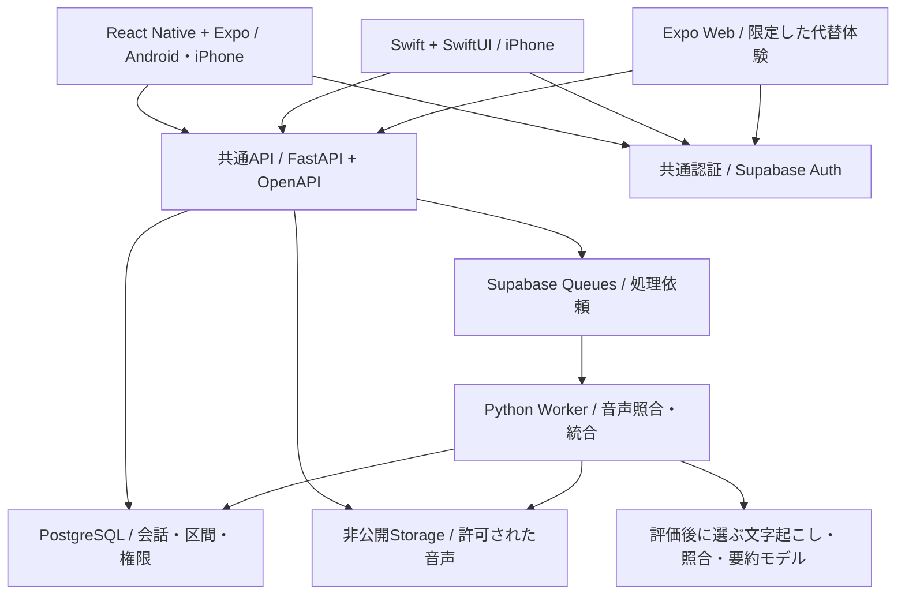

# React Native主軸・Swift並行開発の全体計画

作成日: 2026-09-12。状態: ユーザーの開発・提出方針を反映した計画案。製品実装・環境導入・外部送信・公開は未実施。

## 1. 決まった方針と計画の前提

- ユーザー決定: React NativeでAndroid・iPhoneに対応するアプリを第一に開発する。SwiftによるiPhoneアプリも並行して検討・開発し、ハッカソンに間に合えばSwift版、難しければReact Native版を提出する。
- 計画上の解釈: Swift版は独立したSwiftUIクライアント。Swift採用時もAndroidはReact Native版を維持する。React Nativeもネイティブアプリであり、比較はReact Native版とSwift版で行う。
- 前の会話の意向: Web版を保険にする。専用の第三プロジェクトを一から作らず、ExpoのWeb出力で共通画面を早期に動かす案を推奨する。
- 仕様根拠: [PRODUCT_CORE](../product/PRODUCT_CORE.md)のD01〜D17、S01〜S05、O01〜O10。今回具体化したのはO02の開発方針。音声処理場所O03、照合・本人帰属O04、近距離通信O06、保持O07、MVPと品質基準O01/O10は別判断。
- 開発基盤資料では2人。実稼働人数・時間、提出日時、大会の提出形式・利用可能サービス・事前開発条件、Mac利用可否は未確認。既存の検証準備にはPixel 8／iPhone 16の記載があるが、開発用の署名・インストール可能状態は未確認。
- 以下のクラウド構成、担当配分、期限割合、最初の画面・機能範囲は推奨案。MVP確定や外部音声処理の許可にはしない。

## 2. 全体構成



図のサーバー処理はO03でクラウド処理を選ぶ場合の構成。端末内限定を選んだ場合は音声ワーカーの配置と推論方式を再設計し、同じ工数で済むとはしない。画面とAPI契約の人工データによる準備は独立して進められる。

### 共通化の境界

- 共通: アカウント・データ・API契約・統合処理・権限の最終判定・デザイン規則・人工データの受入ケース。
- React NativeとWebで共有: 対応する画面部品、TypeScriptのAPI型・画面状態ロジック。録音、ファイル操作、通知、近距離通信は環境別に実装する。
- Swift版はAPIクライアント・画面・端末内状態をSwiftで実装する。TypeScriptの画面コードをそのまま共有できるとは考えない。
- 同じアカウントで両iPhoneアプリにログインできる設計にするが、ログインセッションや未送信の端末内録音はアプリ間で自動共有されない。提出切替は新規デモ開始前に行い、録音中にアプリを切り替えない。
- アプリ識別子・URL scheme・OAuth redirectをRN版とSwift版で分け、同居可能にする。認証先と製品データは共通、開発環境と提出用環境は分離する。

## 3. 推奨技術スタックと選定理由

| 領域 | 第一候補 | 今回の理由・制約 |
|---|---|---|
| RNアプリ | React Native、Expo、TypeScript、Expo Router | 両OSの画面・ロジックを共通化し、Web出力も持つ。最初からDevelopment Buildを使う [1][2] |
| RNの録音・保存 | expo-audio、expo-file-system、expo-sqlite、expo-secure-store | バックグラウンド録音、音声ファイル、再送台帳、認証情報を役割別に管理。録音先をキャッシュのままにしない [3] |
| RNの追加OS機能 | Expo Modules API、Swift、Kotlin | 不足する録音・通信機能を局所的に追加。ネイティブ追加時には再ビルドが必要 [4] |
| Swiftアプリ | Swift、SwiftUI、Swift Concurrency、Swift Package Manager | iPhoneの標準UI・画面遷移・操作感を直接調整する。Mac＋Xcodeが必要 |
| Swift録音・保存 | AVFAudioのAVAudioRecorder／AVAudioSession、Foundationファイル、SQLite、Keychain | 録音・中断・保存・認証情報を分離。録音エンジンを最初から自作せず、PCM等が必要と判明した時にAVAudioEngineを評価 [5] |
| 認証 | Supabase Auth、supabase-js、supabase-swift | RN・Web・Swiftで同じ認証基盤を利用できる。UIとredirect設定は各版で必要 [6] |
| API | Python、FastAPI、Pydantic | 音声処理と同じ言語でサービスをまとめ、OpenAPIを生成。最初から別のTypeScript API層を追加しない [7] |
| APIクライアント | openapi-typescript＋openapi-fetch、Swift OpenAPI Generator＋URLSession transport | 同じAPI定義から両言語の型・通信部分を生成し、変更の食い違いを減らす [8][9] |
| DB・音声保存 | Supabase PostgreSQL、非公開Supabase Storage | 会話・参加区間・共有関係を管理。APIで認可し、RLS・Storage policyも設定する [10] |
| 非同期処理 | Supabase Queues（pgmq）＋Python worker | Postgresベースの永続キューで受付と処理を分離。再配信を想定した冪等処理を実装する [11] |
| クラウド実行 | RenderのWeb Service＋Background Worker、Docker | FastAPIと常駐ワーカーを別プロセスで動かす第一候補。クラウド・予算承認後に選定し、無料で常時稼働できるとは仮定しない [12] |
| Webの配信 | Expo Web静的出力＋Render Static Site | クライアント画面中心の保険を既存構成から出力。SSR・独立Next.jsアプリは初期に増やさない [2][12] |
| デザイン | 共通tokens.json＋画面見本、RN StyleSheet／必要なExpo UI、SwiftUI | 色・余白・文字階層を共通化。Expo UIは各部品のOS/Web対応を確認して限定利用 [13] |
| テスト・CI | jest-expo＋React Native Testing Library、pytest、Swift Testing／XCTest、Maestro、GitHub Actions | API・権限ケースと各クライアントの画面を別々に確認。SwiftのCIはmacOS実行環境を使う [14] |
| ビルド・提出 | EAS Build、Android Studio、Xcode、TestFlight／大会指定配布方式 | RNとSwiftを早期に署名・実機配布。提出形式と規約は大会情報を確認して選ぶ [1][15] |

最初のビルドで互換性の確認できた安定版を固定する。各パッケージの最新バージョンを独立に混ぜず、Expo推奨の組み合わせを使う。開発環境はNode/pnpm、Python/venv、Xcode/SwiftPMを役割別に用意する。Dockerはサーバー再現用で、UI着手の必須前提にはしない。

### AI・音声処理で残す選定ゲート

文字起こし、時間対応、同一会話判定、話者分離、話者と端末所有者の対応、重複・欠落の統合、要約を別ステップとして入出力と証拠を記録する。すべてを一つのLLMプロンプトで処理したことを本人確認の証拠にしない。

[既存の音声検証計画](AUDIO_VALIDATION_PLAN.md)と[最初の音声検証](FIRST_AUDIO_CHECK.md)を再利用する。O03/O07の条件を満たしてから、候補モデルについて日本語・短い相槌・重なり発話・時刻情報・費用・待ち時間を同じ入力で比較する。利用条件や処理先が不明な現在、特定モデルの採用・精度・処理費を断定しない。初期の画面/APIは人工データの代替処理で開発できるが、模擬であることを表示する。

### 近距離通信

BLE方式は未採用。候補端末の発見と会話照合・本人帰属・共有許可を分ける。一般的なreact-native-ble-plxはスマホ同士の通信に必要なPeripheral対応をサポートしないため、そのまま採用しない [16]。Core Bluetooth／Android BLEを使う場合は、iOS同士・Android同士・混在で広告／検出／接続／画面ロック／一時切断を測る。SwiftとRNに共通のサービス識別子・メッセージ形式を定義するが、方式成立前に実装を二重化しない。

## 4. API・データ契約の先行設計

最初にAPI v1の人工データ契約を作り、FastAPI/Pydanticを唯一の定義元としてOpenAPIの出力を管理する案。RN/Swift両クライアントで生成・コンパイルできる小さいschemaから始める。生成クライアントだけで実行時入力検証や認可が済むとはしない。

| 対象 | 契約案 |
|---|---|
| 記録 | recording_id、device_installation_id、入力所有者（認証から確定）、形式・sample rate・duration、取得開始時刻、停止・中断状態 |
| 時間対応 | 元録音ごとのsample offsetまたは相対時間、推定offset/drift、信頼度。端末時計だけで会話区間・参加権限を確定しない |
| 送信 | 録音IDとupload ID、完了確認、checksum、再試行key。初期は録音終了後の送信案を評価し、録音中分割送信は必要性が判明してから |
| 処理 | queued／processing／needs_confirmation／completed／failed。認識・統合の進捗と共有許可の状態は別フィールド |
| 閲覧 | 会話ID、発言区間、根拠参照、通常/グループ、閲覧者に許された区間。元音声全体のURLを途中参加者に渡さない |
| 共有 | 今回許可・継続許可・双方の状態・解除を区別。未回答を許可とせず、グループ加入期間と通常参加区間を別に評価 |
| エラー | 再試行可否・権限変更・入力不備・中断を機械判定できるcodeで返し、クライアント別の文言で扱う |

APIは認証トークンを検証し、client送信のuser_idを権限根拠にしない。業務上の書込・共有判定はAPIへ集約する。サービス権限でDB/RLSを迂回できるワーカーも、出力公開・検索・要約入力では明示的な権限検査を通す。共有範囲外の文脈をAI入力に入れてから出力だけ隠す構成にはしない。ジョブは入力IDと処理版で重複結果を抑制し、権限変更後の遅着結果を再評価する。

## 5. 推奨するリポジトリ構成

以下は将来の配置案で、今回はディレクトリや製品コードを作成しない。

```text
apps/mobile/          Expo：Android・iPhone・限定Web
apps/ios-swift/       SwiftUIの独立iPhoneアプリ
services/backend/    FastAPIと共通ドメイン、workerの別起動入口
packages/api-ts/     OpenAPIから生成したTypeScript型・クライアント
packages/ios-core/   必要になった場合だけRN/Swift間で再利用するSwift package
contracts/           OpenAPI出力、人工データ、エラー契約
design/              tokens.json、画面見本、状態別文言
supabase/            DB migration・RLS・Storage policy・queue設定
tests/contracts/     同じケースをAPIと各クライアントで確認する素材
```

Swift package共通化は録音/通信の独自実装が本当に必要な場合だけ行う。expo-audioと同じ機能を先に作り直さない。API/DBは一系統、画面は二系統として管理する。

## 6. デザイン方針と最初の範囲案

共通の色・余白・角丸・文字階層・状態名を先に決め、録音、履歴、会話詳細、共有確認の4画面で比較する。仕様上必要な状態を先に揃え、その後にSwiftUIの標準ナビゲーション・sheet・触覚等を調整する。Swift版の見た目だけを優先し、録音/共有の状態を省略しない。

RN版も提出品質のデザインを作る。Swift版を作ること自体が品質向上の証明ではない。大きな文字、VoiceOver/TalkBack、暗色表示、録音中の可読性、片手操作を確認する。Androidはブランド表現を揃えつつ戻る操作等の慣習に合わせる。

最初の一連の体験候補: 本人開始 → 2台が独立録音 → 各自停止・保存 → 許可された経路で処理 → 会話と本人帰属を確認 → 共有条件成立 → 許可区間の統合結果を閲覧。通常の会話開始に部屋作成・相手選択を必須化しない。グループの全管理画面や通知・検索の実装順はMVP選択時に決め、既存のグループ方針を削除しない。

Webの保険案は、許可された音声のファイル取込、履歴、共有確認、統合結果閲覧。ブラウザ録音は対応確認後の追加。背景録音・BLEの同等性は約束しない。手動で入力組を指定するデモを採用する場合、自動候補発見が未実装と明示し、ユーザーが妥協範囲を選ぶ。

## 7. 開発順序・担当案

残り開発期間をTとする。以下は経過率であり、工数保証ではない。締切と稼働時間が分かれば日付に変換する。Swiftの全面開発を最初から固定の1人に割り当てると、共通基盤が足りずRNも未完成になり得るため、主軸到達条件を設ける。

| 時点 | 主軸: RN＋共通基盤 | 並行: Swift／Web | 到達条件・分岐 |
|---|---|---|---|
| 開始〜10% | 大会条件・環境確認、API人工契約、共通4画面の見本、RNの最初の実機ビルド | MacでSwiftの署名・実機起動、人工API結果の一覧、Expo Web初回表示 | 両OS RNが起動。Swift環境未準備ならその枝だけ保留しRNを継続 |
| 10〜35% | RN両OSで録音→停止→保存。共通認証/API、人工データで権限ケース。条件が整えば既存音声検証 | Swiftは同じ4画面・API契約を模擬入力で実装。Webは既存画面の動作確認 | RN録音・保存とAPI接続、方式選定に必要な観測。未達ならSwift工数を主軸へ戻す |
| 35〜60% | 採用した処理方式をRNから一連に接続。Android/iPhone混在で確認 | 主軸が進んだ場合、Swiftで録音・認証・同じ処理結果を接続。Web取込が採用されたら接続 | RNで選んだデモが実データを通る。模擬成功と分ける |
| 60〜80% | RNの提出候補を保存、失敗・中断・共有境界・配布を確認 | Swift/iPhone＋RN/Androidの同じデモ、見た目・操作・安定性の比較 | Swift採用条件を判定。不合格ならRN提出を確定し、Swift新機能追加を止める |
| 80〜100% | 提出版固定、当日端末・ネットワークで再確認、提出資料・説明・必要なデモ記録 | 採用版の不具合修正のみ。RN予備ビルドとWebの許可された代替経路を保持 | 当日使うものがインストール・ログイン・実行可能。新規アーキテクチャ変更をしない |

2人の担当案: AはRN/Webと共通デザイン、Bは共通API/音声評価を優先し、最初はSwiftの起動・画面を時間枠付きで進める。基盤が通った後にBの一部時間をSwiftへ移す。Mac利用者や得意分野により交代する。全体の目安は共通基盤＋RN＋その検証へ70%以上、Swift固有作業は最大20%、追加のWeb固有作業は最大10%。日次で主軸が遅れていれば任意の枝を縮小する。この配分はユーザー提案用であり担当者の確約ではない。

## 8. 提出版の切替基準

最終判断は経過80%までを推奨。ただし大会の提出締切、署名・審査・配布の締切が早ければ、その前に置く。外部TestFlightは審査があるため最後に初回配布しない [15]。

Swiftを選ぶ条件（すべて満たす案）:

1. 選定済みのデモ必須機能がRN版と同じ範囲で動き、模擬部分は両版とも明示されている。
2. Swift/iPhone＋RN/Androidで独立録音から統合・共有まで確認できる。
3. 今回許可・継続許可・未回答・途中参加・グループ閲覧等、採用範囲の権限ケースが同じ期待結果になる。iPhoneのUIだけで共有条件を緩めない。
4. ロック、着信等の中断、オフライン停止、再送、重複操作の選んだケースを確認し、保存失敗を成功表示しない。
5. 実際の提出・デモ端末へ署名済みアプリを配布できる。SwiftとRNの認証redirectが混線しない。
6. 初期状態をリセットしたデモを異なる入力で3回通す（少数回の提出準備確認であり品質保証ではない）。録音内容の採用・処理条件を満たす。
7. デザイン・操作感を比較し、RN提出候補を置き換えるだけの利点がある。

Swift不合格ならRN版を提出し、Android対応も維持する。Swift合格ならiPhone側はSwift、Android側はRNを使う方針で提出形式を大会条件に合わせる。RNも未達なら「Webなら完成」とはしない。Webの採用範囲・大会条件・実際の完成度を確認し、縮小提出か説明用デモかをユーザーが選ぶ。共通AI/APIが未完成の場合は全クライアントに影響する。

## 9. 検証・費用・運用

- CI: APIの認証・区間権限・遅着・重複処理をpytestで確認。OpenAPI生成差分とTS/Swiftクライアントのコンパイル、人工ケースの整合を確認。RNはJest、SwiftはSwift Testing/XCTest、操作はMaestroまたはXCUITest。必要な端末内録音の長時間・電池・BLE検証は実機で別に実施する。
- 混在確認: RN Android↔RN iPhone、RN Android↔Swift iPhone、必要時RN iPhone↔Swift iPhone。機種・OS・ビルド・入力ID・条件を記録する。1台のiPhoneに2アプリを入れただけでは2台同時録音の代替にならない。
- ログ: recording/job/requestの匿名ID、処理時間、状態遷移、エラーコードを残す。音声・全文転記・トークンを通常ログに出さない。初期はホストの構造化ログを用い、追加監視SDKは必要時に検討する。
- 費用枠: Apple開発者登録、必要ならGoogle Play登録、EASビルド、MacまたはmacOS CI、Supabase容量・転送、API/常駐ワーカー、AIの音声分数と文字量を別項目で見積もる。最新料金と無料枠は採用時確認。録音2台分の入力、再処理、保持期間が費用に効く。定額・無料を保証しない。
- 現行の実験音声条件を製品クラウド送信許可へ読み替えない。[VALIDATION](VALIDATION.md)の条件を守り、O03/O07が決まるまでは人工データで準備する。
- 当日: 使用するバイナリとバックエンド版を記録し、ネットワーク・認証・配布経路を事前確認。必要な公開・送信は別途ユーザーの明示範囲で行う。

## 10. 次に必要になる判断

| 判断 | 推奨・不足情報 | 必要な時点 |
|---|---|---|
| 日程・体制 | 提出日時、各人の稼働時間、Mac/Xcode、追加端末の利用可否 | 日付付き計画・担当割り当て前 |
| 大会条件 | 公式URLと提出形式。事前開発・指定AI/クラウド・複数アプリ提出条件を確認 | 外部サービス選定・提出準備前 |
| 処理・保持 O03/O07 | クラウド許容なら本書の共通API/worker案。送信先・対象・保存期間を具体化 | 実音声の外部処理と保存実装前 |
| MVP O01/O10 | 検証後に、実データで見せる一連の体験と観測条件を選ぶ | 両クライアントの機能範囲固定前 |
| 本人帰属・発見 O04/O06 | 入力一致・近接・本人・権限を個別検証。未達の自動化を隠さない | 自動照合・共有・離脱判定の実装前 |

この計画は開発の依存関係を示す。未決定を理由に画面・API人工契約・ビルド準備の独立作業まで停止する必要はない。一方、期限の経過やモデル出力を人間の判断の代用にはしない。

## 11. 一次資料（2026-09-12確認）

- [1] [Expo Development Builds](https://docs.expo.dev/develop/development-builds/introduction/?buildenv=build-with-eas): 任意OSからのクラウドiOSビルドとネイティブ開発環境の違い。
- [2] [Expo Web](https://docs.expo.dev/workflow/web/): Web出力とReact Native for Web。
- [3] [Expo Audio](https://docs.expo.dev/versions/latest/sdk/audio/): 録音・背景録音・キャッシュ保存の注意。
- [4] [Expo Modules API](https://docs.expo.dev/modules/overview/): Swift/Kotlin拡張。
- [5] [Apple AVAudioSession record](https://developer.apple.com/documentation/avfaudio/avaudiosession/category-swift.struct/record): 背景録音・中断の条件。
- [6] [Supabase Swift SDK](https://github.com/supabase/supabase-swift)、[Expo連携](https://supabase.com/docs/guides/getting-started/quickstarts/expo-react-native): 両クライアント向けSDK。
- [7] [FastAPI Features](https://fastapi.tiangolo.com/features/): OpenAPI・Pydantic。
- [8] [openapi-typescript](https://openapi-ts.dev/introduction): TypeScript型生成。
- [9] [Swift OpenAPI Generator](https://www.swift.org/blog/introducing-swift-openapi-generator/): Swiftクライアント生成。
- [10] [Supabase RLS](https://supabase.com/docs/guides/database/postgres/row-level-security)、[Storage Access Control](https://supabase.com/docs/guides/storage/security/access-control): データ・ファイルのアクセス制御。
- [11] [Supabase Queues](https://supabase.com/docs/guides/queues): Postgresベースの永続キュー。
- [12] [Render Service Types](https://render.com/docs/service-types)、[Background Workers](https://render.com/docs/background-workers): API・worker・静的Webの配置候補。
- [13] [Expo UI Universal](https://docs.expo.dev/versions/latest/sdk/ui/universal/): OS/Web別に部品を実装する共通API。
- [14] [Expo Unit Testing](https://docs.expo.dev/develop/unit-testing/)、[Maestro](https://docs.expo.dev/eas/workflows/examples/e2e-tests/): テスト構成。
- [15] [Apple TestFlight](https://developer.apple.com/testflight/): 外部配布前の審査。
- [16] [react-native-ble-plx](https://github.com/dotintent/react-native-ble-plx): Peripheral／スマホ同士通信の非対応。

## 12. 今回の成果と限界

ユーザー決定・技術提案・未決定を区分し、共通基盤、二つのネイティブクライアント、Webの限定した保険、工程と切替基準を文書化した。公式情報と既存仕様を机上照合した計画であり、実機・API・AI精度・署名・配布・費用の実測は未実施。独立レビューは行っていない。関連D01〜D17/S01〜S05/O01〜O10、既存Vの必要範囲は採用MVPに合わせて選ぶ。

文書確認: 本書・PRODUCT_CORE・WORKFLOWのローカル参照38件は欠落0件。追跡済み差分のgit diff --checkで空白エラーなし（改行変換の警告あり）。既存の未コミット変更を残し、本書の追加、O02の1行更新、WORKFLOWへの現在地追記のみ実施。製品テストの成功を示す確認ではない。
