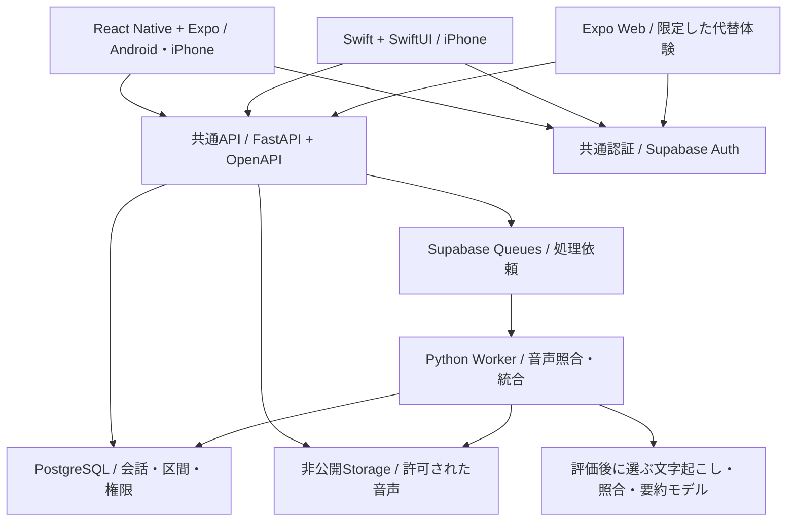

# React Native主軸・Swift並行開発の全体計画

最新の実装に渡すMVP仕様は[MVP_SPEC](../product/MVP_SPEC.md)。機能/UI・具体契約・着手順K01〜K10を一本化した採用提案。下記の広いクラウド候補と工程は背景として維持し、方式は新仕様§9のローカル開発構成を候補として絞った。RN/Swiftの担当・提出方針は不変で、採用・導入・公開は未実施。

作成日: 2026-09-12。状態: Mac担当の依頼者・Windows担当のGo君に向けたロードマップ。開発・提出方針はユーザー決定、下記の作業分割は今回の計画。MVP・処理方式の未決定は維持。この文書更新では製品実装・環境導入・外部送信・公開を行っていない。

## 1. 決まった方針と計画の前提

- ユーザー決定: React NativeでAndroid・iPhoneに対応するアプリを第一に開発する。SwiftによるiPhoneアプリも並行して検討・開発し、ハッカソンに間に合えばSwift版、難しければReact Native版を提出する。
- 計画上の解釈: Swift版は独立したSwiftUIクライアント。Swift採用時もAndroidはReact Native版を維持する。React Nativeもネイティブアプリであり、比較はReact Native版とSwift版で行う。
- 前の会話の意向: Web版を保険にする。専用の第三プロジェクトを一から作らず、ExpoのWeb出力で共通画面を早期に動かす案を推奨する。
- 仕様根拠: [PRODUCT_CORE](../product/PRODUCT_CORE.md)のD01〜D17、S01〜S05、O01〜O10。今回具体化したのはO02の開発方針。音声処理場所O03、照合・本人帰属O04、近距離通信O06、保持O07、MVPと品質基準O01/O10は別判断。
- 2026-09-12ユーザー決定: 依頼者本人（以下「あなた」）がMacでSwiftUI、Go君がWindowsでReact Nativeを開発する。各人の稼働時間、提出日時、大会条件、Xcode/署名/開発用実機の準備状況は未確認。Macの有無や開発者のOSを再質問しない。検証用のiPhone 16／Pixel 8は既存資料で確認済みだが、開発用配布の成立とは分ける。
- このロードマップで具体化するのは担当範囲・受け渡し・進行順と観測可能な完了条件。クラウド構成、期限割合、最初の製品画面・機能範囲は提案であり、MVP確定や外部音声処理の許可にはしない。Go君の稼働時間や作業完了を本人確認済みとは扱わない。
- 適用FWは[採用済みAIDD-Lite](../decisions/AIDD_FW_ADOPTION.md)。本書は技術構成と実装ロードマップ、開発開始ガイド（別作業の未共有資料: `aidd-lite/DEVELOPMENT_START.md`）は作業入口、音声検証計画（別作業の未共有資料: `AUDIO_VALIDATION_PLAN.md`）は検証手順、[WORKFLOW](WORKFLOW.md)は最新状態を担当する。同じ手順・採点規則を本書へ複製しない。

## 2. 全体構成



図のサーバー処理はO03でクラウド処理を選ぶ場合の構成。端末内限定を選んだ場合は音声ワーカーの配置と推論方式を再設計し、同じ工数で済むとはしない。画面とAPI契約の人工データによる準備は独立して進められる。

### 共通化の境界

- 共通: アカウント・データ・API契約・統合処理・権限の最終判定・デザイン規則・人工データの受入ケース。
- React NativeとWebで共有: 対応する画面部品、TypeScriptのAPI型・画面状態ロジック。録音、ファイル操作、通知、近距離通信は環境別に実装する。
- Swift版はAPIクライアント・画面・端末内状態をSwiftで実装する。TypeScriptの画面コードをそのまま共有できるとは考えない。
- 同じアカウントで両iPhoneアプリにログインできる設計にするが、ログインセッションや未送信の端末内録音はアプリ間で自動共有されない。提出切替は新規デモ開始前に行い、録音中にアプリを切り替えない。
- アプリ識別子・URL scheme・OAuth redirectをRN版とSwift版で分け、同居可能にする。認証先と製品データは共通、開発環境と提出用環境は分離する。

## 3. 推奨技術スタックと選定理由

| 領域 | 第一候補 | 今回の理由・制約 |
|---|---|---|
| RNアプリ | React Native、Expo、TypeScript、Expo Router | 両OSの画面・ロジックを共通化し、Web出力も持つ。最初からDevelopment Buildを使う [1][2] |
| RNの録音・保存 | expo-audio、expo-file-system、expo-sqlite、expo-secure-store | バックグラウンド録音、音声ファイル、再送台帳、認証情報を役割別に管理。録音先をキャッシュのままにしない [3] |
| RNの追加OS機能 | Expo Modules API、Swift、Kotlin | 不足する録音・通信機能を局所的に追加。ネイティブ追加時には再ビルドが必要 [4] |
| Swiftアプリ | Swift、SwiftUI、Swift Concurrency、Swift Package Manager | iPhoneの標準UI・画面遷移・操作感を直接調整する。Mac＋Xcodeが必要 |
| Swift録音・保存 | AVFAudioのAVAudioRecorder／AVAudioSession、Foundationファイル、SQLite、Keychain | 録音・中断・保存・認証情報を分離。録音エンジンを最初から自作せず、PCM等が必要と判明した時にAVAudioEngineを評価 [5] |
| 認証 | Supabase Auth、supabase-js、supabase-swift | RN・Web・Swiftで同じ認証基盤を利用できる。UIとredirect設定は各版で必要 [6] |
| API | Python、FastAPI、Pydantic | 音声処理と同じ言語でサービスをまとめ、OpenAPIを生成。最初から別のTypeScript API層を追加しない [7] |
| APIクライアント | openapi-typescript＋openapi-fetch、Swift OpenAPI Generator＋URLSession transport | 同じAPI定義から両言語の型・通信部分を生成し、変更の食い違いを減らす [8][9] |
| DB・音声保存 | Supabase PostgreSQL、非公開Supabase Storage | 会話・参加区間・共有関係を管理。APIで認可し、RLS・Storage policyも設定する [10] |
| 非同期処理 | Supabase Queues（pgmq）＋Python worker | Postgresベースの永続キューで受付と処理を分離。再配信を想定した冪等処理を実装する [11] |
| クラウド実行 | RenderのWeb Service＋Background Worker、Docker | FastAPIと常駐ワーカーを別プロセスで動かす第一候補。クラウド・予算承認後に選定し、無料で常時稼働できるとは仮定しない [12] |
| Webの配信 | Expo Web静的出力＋Render Static Site | クライアント画面中心の保険を既存構成から出力。SSR・独立Next.jsアプリは初期に増やさない [2][12] |
| デザイン | 共通tokens.json＋画面見本、RN StyleSheet／必要なExpo UI、SwiftUI | 色・余白・文字階層を共通化。Expo UIは各部品のOS/Web対応を確認して限定利用 [13] |
| テスト・CI | jest-expo＋React Native Testing Library、pytest、Swift Testing／XCTest、Maestro、GitHub Actions | API・権限ケースと各クライアントの画面を別々に確認。SwiftのCIはmacOS実行環境を使う [14] |
| ビルド・提出 | EAS Build、Android Studio、Xcode、TestFlight／大会指定配布方式 | RNとSwiftを早期に署名・実機配布。提出形式と規約は大会情報を確認して選ぶ [1][15] |

最初のビルドで互換性の確認できた安定版を固定する。各パッケージの最新バージョンを独立に混ぜず、Expo推奨の組み合わせを使う。開発環境はNode/pnpm、Python/venv、Xcode/SwiftPMを役割別に用意する。Dockerはサーバー再現用で、UI着手の必須前提にはしない。

### AI・音声処理で残す選定ゲート

文字起こし、時間対応、同一会話判定、話者分離、話者と端末所有者の対応、重複・欠落の統合、要約を別ステップとして入出力と証拠を記録する。すべてを一つのLLMプロンプトで処理したことを本人確認の証拠にしない。

既存の音声検証計画（別作業の未共有資料: `AUDIO_VALIDATION_PLAN.md`）と最初の音声検証（別作業の未共有資料: `FIRST_AUDIO_CHECK.md`）を再利用する。O03/O07の条件を満たしてから、候補モデルについて日本語・短い相槌・重なり発話・時刻情報・費用・待ち時間を同じ入力で比較する。利用条件や処理先が不明な現在、特定モデルの採用・精度・処理費を断定しない。初期の画面/APIは人工データの代替処理で開発できるが、模擬であることを表示する。

### 近距離通信

BLE方式は未採用。候補端末の発見と会話照合・本人帰属・共有許可を分ける。一般的なreact-native-ble-plxはスマホ同士の通信に必要なPeripheral対応をサポートしないため、そのまま採用しない [16]。Core Bluetooth／Android BLEを使う場合は、iOS同士・Android同士・混在で広告／検出／接続／画面ロック／一時切断を測る。SwiftとRNに共通のサービス識別子・メッセージ形式を定義するが、方式成立前に実装を二重化しない。

## 4. API・データ契約の先行設計

最初にAPI v1の人工データ契約を作り、FastAPI/Pydanticを唯一の定義元としてOpenAPIの出力を管理する案。RN/Swift両クライアントで生成・コンパイルできる小さいschemaから始める。生成クライアントだけで実行時入力検証や認可が済むとはしない。

| 対象 | 契約案 |
|---|---|
| 記録 | recording_id、device_installation_id、入力所有者（認証から確定）、形式・sample rate・duration、取得開始時刻、停止・中断状態 |
| 時間対応 | 元録音ごとのsample offsetまたは相対時間、推定offset/drift、信頼度。端末時計だけで会話区間・参加権限を確定しない |
| 送信 | 録音IDとupload ID、完了確認、checksum、再試行key。初期は録音終了後の送信案を評価し、録音中分割送信は必要性が判明してから |
| 処理 | queued／processing／needs_confirmation／completed／failed。認識・統合の進捗と共有許可の状態は別フィールド |
| 閲覧 | 会話ID、発言区間、根拠参照、通常/グループ、閲覧者に許された区間。元音声全体のURLを途中参加者に渡さない |
| 共有 | 今回許可・継続許可・双方の状態・解除を区別。未回答を許可とせず、グループ加入期間と通常参加区間を別に評価 |
| エラー | 再試行可否・権限変更・入力不備・中断を機械判定できるcodeで返し、クライアント別の文言で扱う |

APIは認証トークンを検証し、client送信のuser_idを権限根拠にしない。業務上の書込・共有判定はAPIへ集約する。サービス権限でDB/RLSを迂回できるワーカーも、出力公開・検索・要約入力では明示的な権限検査を通す。共有範囲外の文脈をAI入力に入れてから出力だけ隠す構成にはしない。ジョブは入力IDと処理版で重複結果を抑制し、権限変更後の遅着結果を再評価する。

## 5. 推奨するリポジトリ構成

以下は将来の配置案で、今回はディレクトリや製品コードを作成しない。

```text
apps/mobile/          Expo：Android・iPhone・限定Web
apps/ios-swift/       SwiftUIの独立iPhoneアプリ
services/backend/    FastAPIと共通ドメイン、workerの別起動入口
packages/api-ts/     OpenAPIから生成したTypeScript型・クライアント
packages/ios-core/   必要になった場合だけRN/Swift間で再利用するSwift package
contracts/           OpenAPI出力、人工データ、エラー契約
design/              tokens.json、画面見本、状態別文言
supabase/            DB migration・RLS・Storage policy・queue設定
tests/contracts/     同じケースをAPIと各クライアントで確認する素材
```

Swift package共通化は録音/通信の独自実装が本当に必要な場合だけ行う。expo-audioと同じ機能を先に作り直さない。API/DBは一系統、画面は二系統として管理する。

## 6. デザイン方針と最初の範囲案

UIデザインはユーザー決定によりGo君が担当する。あなたは共通デザインをSwiftUIで実装し、iOS固有の制約や操作上の調整をGo君へ返す。OSごとに画面全体を別デザインにする必要はない。

| 対象 | 共通にする部分／調整する部分 |
| --- | --- |
| 共通デザイン | 色、余白、文字階層、アイコン素材、カード、画面の情報構造、録音・処理・共有の状態表現をGo君が管理する |
| iOS／Androidの操作 | 戻る操作・ジェスチャー、ナビゲーション、sheet・共有メニュー、キーボード、safe area、権限ダイアログとの接続を各OSに合わせる。標準部品で吸収できる範囲も実機で確認する |
| RNのiOS／Android | UIコードを原則共通化し、必要な差だけPlatformや.ios/.androidファイルへ分ける。Windowsで開発してもAndroid専用の見た目になるわけではない |
| RN／SwiftUI | デザイン仕様・素材・API契約は共有するが、RNのTSXをSwiftUIへそのまま流用はできない。あなたがSwiftUIのViewとして別実装する |
| Web | 共通デザインを使い、ブラウザ幅・ポインター／キーボード操作を調整する。録音等の機能制約は§5に従う |

RNの分岐方法は[公式のPlatform-Specific Code](https://reactnative.dev/docs/platform-specific-code)を参照。まず履歴・会話詳細の一組をGo君のデザインから両実装へ展開し、文字拡大と各OSの戻る操作まで確認してから画面数を増やす。

共通の色・余白・角丸・文字階層・状態名を先に決め、録音、履歴、会話詳細、共有確認の4画面で比較する。仕様上必要な状態を先に揃え、その後にSwiftUIの標準ナビゲーション・sheet・触覚等を調整する。Swift版の見た目だけを優先し、録音/共有の状態を省略しない。

RN版も提出品質のデザインを作る。Swift版を作ること自体が品質向上の証明ではない。大きな文字、VoiceOver/TalkBack、暗色表示、録音中の可読性、片手操作を確認する。Androidはブランド表現を揃えつつ戻る操作等の慣習に合わせる。

最初の一連の体験候補: 本人開始 → 2台が独立録音 → 各自停止・保存 → 許可された経路で処理 → 会話と本人帰属を確認 → 共有条件成立 → 許可区間の統合結果を閲覧。通常の会話開始に部屋作成・相手選択を必須化しない。グループの全管理画面や通知・検索の実装順はMVP選択時に決め、既存のグループ方針を削除しない。

Webの保険案は、許可された音声のファイル取込、履歴、共有確認、統合結果閲覧。ブラウザ録音は対応確認後の追加。背景録音・BLEの同等性は約束しない。手動で入力組を指定するデモを採用する場合、自動候補発見が未実装と明示し、ユーザーが妥協範囲を選ぶ。

## 7. Mac・Windowsの開発ロードマップ

### 今回の担当と編集境界

役職を固定するものではなく、このロードマップの仕事を割り当てる。担当者のOSがサーバーの実行OSや処理先を決めるわけではない。

| 仕事 | 主担当 | 受け渡すもの・協力範囲 |
|---|---|---|
| RNのAndroid/iPhone、限定Web | Go君／Windows | 同じAPI契約を使う画面・録音・保存・再試行。あなたはRNのiPhone実機・Xcode調査を支援 |
| SwiftUIのiPhone | あなた／Mac | 同じデモのSwiftクライアント。UI仕上げはRNの提出可能状態を損なわない時間枠で行う |
| 共通API、認証、DB、ジョブ受付、権限制御 | Go君 | API契約、認可テスト、migration、job状態。RNの一つの操作からAPI・DBまで通す単位で実装 |
| 音声方式の検証、採用後の処理ワーカー | あなた | 既存検証の結果・限界、人工入出力、採用後の処理実装。APIやDB schemaを独自に変更せずGo君へ契約変更を渡す |
| 共通デザイン・状態別の表示案 | Go君 | 録音/履歴/詳細/共有確認の見本、文字・色・余白の規則。あなたはSwiftUIへ反映し、iOSの制約をGo君へ共有 |
| API定義・処理job契約の取りまとめ | Go君 | Pydantic/OpenAPIの定義元を一つに保つ。あなたはSwift生成・ワーカー入出力から適合を確認 |
| iOS署名・配布、提出比較 | あなた | RN/Swift両方のiOS起動・配布結果。Go君はAndroidとWebを確認 |

先の配置案を採用する場合、Go君はapps/mobile、design、services/backendのAPI/domain、packages/api-ts、contracts、supabaseを主に編集し、あなたはapps/ios-swift、services/backendのworker/processingを主に編集する。共通設定・依存ファイル・DB定義・WORKFLOWはその作業の担当者一人が編集する。配置はまだ製品コードとして存在せず、API/domainとworker/processingの具体的な境界は着手する単位で定める。

共通処理が未成立の間、あなたの優先順位は音声検証/処理→RNのiPhone支援→SwiftUIの追加演出。Go君はRNの一操作と必要なAPIを一緒に仕上げ、RN全画面とAPI全機能を同時に抱えない。手が足りなければSwift固有の新機能・Web固有機能を止め、主軸の未達項目へ時間を戻す。

### 順序と完了条件

日付が未確定のため、経過割合を進行許可として使わず、下表の完了条件で接続する。独立する画面・人工契約の準備は検証と並行可能。現在はロードマップの文書化までで、下記の環境・製品作業は未実施。既存音声検証の進行中の結果はWORKFLOWから引き継ぐ。

| 段階・依存 | Go君／Windows | あなた／Mac | 利用者から確認する成果・次へ進む条件 |
|---|---|---|---|
| 1. 同じ資料・起動条件を揃える | 共有版の資料、RN/Androidの環境・実機配布条件を確認 | 同じ資料、Xcode・RN/SwiftのiPhone配布条件を確認。既存音声検証の現在地を確認 | 対象版・必要資料・不足が両PCで一致。締切/稼働/大会条件の未確認を特定。資料不在を推測で補わない |
| 2. 同じ会話見本が見える（段階1の必要条件） | 共通デザイン見本を作ってMac側へ渡し、小さいAPI人工契約からRNの履歴→詳細を通す。Webでも表示 | Go君のデザインと同じ人工ケースでSwiftUIの履歴→詳細を通し、iOS固有の調整を共有 | 同じ会話・閲覧者の入力で同じ内容、読込失敗で誤った成功表示なし。実APIを採用する前はローカルfixtureで可。見本と明示 |
| 3. 自分の記録を残せる（録音/保持条件の具体化後） | RN Android/iPhoneの開始→停止→保存。あなたへiPhone確認用ビルドを渡す | RN iPhoneを確認し、同じ条件でSwiftの録音を確認。既存P0/P1を再開 | 本人停止と保存成否が一致し、通信断でも停止できる。録音停止と送信完了を分ける。中断・保存不備を記録。長時間の数値は観測であり合格値を創作しない |
| 4. 方式・MVPを選ぶ（必要な検証結果が揃った時） | 実装負担、API/権限への影響、RNで示せる体験を整理 | 既存P0/P1と必要なP2/P3の証拠・未達・費用/時間の観測を整理 | 下記の採用判断を依頼者が行い、MVP・方式・品質条件・処理/保持条件を記録。日程の経過や仮データ成功だけで通過しない |
| 5. RNで独立録音から統合結果まで通す（段階4） | RN→認証/API→job受付→結果表示。実装対象の共有確認と区間認可を一連にする | 採用ワーカーを契約に接続。出力根拠・失敗を返し、iPhone RNで確認 | RN Android＋RN iPhoneで採用したデモが実入力を通る。単独と統合の評価、権限制約、遅着/再送/誤共有なしの必要ケースを確認。これをRN提出候補にする |
| 6. Swiftを同じ体験へ接続（安定した契約から並行、完了判定は段階5後） | APIの互換性とAndroid版を維持。限定Webの成立範囲を確認 | Swift→同じ認証/API/job結果へ接続。録音・共有状態・操作感を仕上げる | Swift iPhone＋RN Androidで同じ受入ケースが通り、§8を満たせばSwiftをiPhone側の提出候補にする |
| 7. 提出版固定・配布・リハーサル（提出期限より前） | Android/RN/Webの採用対象を確認、予備ビルドを保持 | RN/SwiftのiPhone署名・配布と実デモを確認し、提出版を選ぶ | 当日と同じ版・経路で使える。失敗/模擬/未実装を説明できる。未達ならRNへ戻し、共通処理未達なら範囲の再判断へ |

段階2は環境確認の済んだ側から進められる。段階3の実録音に依存する部分は音声条件を満たしてから行い、人工状態の画面テストは先行できる。段階5のRN/共通基盤を優先しながら段階6のSwift接続を並行するため、Swiftをすべて後回しにする計画ではない。

### 方式・MVPを決める工程と、未成立時の分岐

この工程は音声検証計画（別作業の未共有資料: `AUDIO_VALIDATION_PLAN.md`）のP4に対応する。P0〜P3の全項目完了を要求せず、選んだ体験を判断できる証拠を用いる。既存の音声・集計がある場合はAUDIO_SESSION_HANDOFF（別作業の未共有資料: `AUDIO_SESSION_HANDOFF.md`）とWORKFLOWの最新状態を優先し、追加録音や過去の準備からやり直さない。片方のみポケット等のケース定義・採点はFIRST_AUDIO_CHECKに置き、本書へ複製しない。

判断材料は、(a)単独に対する統合の回復/悪化/根拠、(b)同一会話・本人帰属・区間判定でできたことと不足、(c)共有や中断を含む実装負担、(d)処理/保持先と待ち時間・費用、(e)見せる体験と模擬部分。あなたが製品の採用判断を行い、Go君が実装上の依存・負担を提示する。全作業に二人の承認を追加するものではない。

- 採用できる証拠が揃う: O01/O10と必要なO03〜O09を具体化し、仕様・受入条件・関連V・採用理由を既存資料へ反映して段階5へ。
- 人には補えるが自動照合/帰属が未達: 該当Aケースへ戻る。手動確認を加える候補の負担と制約を比較し、あなたが採用した場合だけMVPへ含める。手動を自動統合の成功として扱わない。
- 回復がない/悪化/誤共有の懸念が残る: 既存検証計画の結果別分岐へ戻る。Swiftの新規演出を止めて原因の切り分けを優先。複数端末統合の核を自動削除しない。
- 処理場所・保持や大会条件が未決定: 依存する実入力接続だけ待ち、RN/Swiftの人工ケース・UI・契約確認は継続する。未決定が長引けば新機能追加より先に提出範囲を再判断する。

### 最初に実装する単位の受入例（計画、未実行）

FWのVertical Sliceに従い、機能を横断する小さい単位で終える。下表は工程の具体化であり、D14のMVP最終採用を代行しない。性能指標と未決定の挙動はO10/O06へ戻す。

| Story・根拠 | Given / When / Then | 証拠と受け渡し |
|---|---|---|
| 記録した会話を見返したい／D03・D17、V21 | 閲覧範囲を定義した人工会話で、RN/Swiftから履歴→詳細を開くと、同じ許可内容だけが表示される。通信失敗は失敗として表示 | API/fixture版、期待JSON、RN/Swift画面結果。Go君からあなたへ契約、あなたからSwift適合結果 |
| 自分の録音を始めて止めたい／D01・D02、V12/V15 | 本人開始済みで停止すると、録音状態と保存結果を別表示する。失敗時に保存済みと見せない。停止後の共有境界は採用O06で検証 | 各OSのビルド・条件・保存/中断結果。音声本体は既存条件で保持し、Gitには入れない |
| 許可した会話だけ共有したい／D06/D07・D09/D17、V06/V16/V21 | 人工ケースで未回答なら共有不可。双方許可と帰属/区間条件が揃った時だけ公開し、C参加前の内容をCの詳細・採用した派生出力へ含めない | API認可テスト＋両画面の同じ期待結果。実音声の本人判定成功とは分ける |
| 別端末の記録で補われた結果を見たい／D03/D05/D13、V01〜V04 | 採用条件を満たす独立入力が到着すると、根拠を持つ統合結果を返す。再送で結果を重複させず、権限変更後の遅着は再評価する | 入力の匿名ID・処理版・比較結果・失敗/未判定。ワーカー→API→RNで通してからSwiftでも同じケース |

### 二人と各AIの受け渡し

1. 一つの操作について、関連D/S/O/V、変更先、期待する出力、必要な確認を短く定める。API定義はGo君が取りまとめ、あなたはSwiftとワーカー側の要求を返す。
2. 両PCで別checkout・別の作業ブランチを使い、対象コミットと未コミット差分の有無を伝える。別のPCの未コミット変更はGitのpullだけでは届かない。
3. API/DB契約変更は依存する画面・ワーカー・受入ケースを同じ作業単位で更新する。片方のクライアントだけ動く破壊的変更を共有APIに先行反映しない。互換性維持か同時接続確認を選ぶ。
4. 受け手は同じ人工ケースを自分の環境で確認し、版・結果・限界を返す。「相手PCでも確認済み」は受け手の証拠が揃った後だけ使う。
5. WORKFLOWへ現在地を短く残し、仕様はPRODUCT_CORE/採用した仕様、検証は既存検証資料、工程は本書へリンクする。全履歴の再コピーや新しいIssue番号体系は作らない。

各作業の節目に「RNの提出を妨げる未達は何か」を見て、あなた/Go君の次の担当を調整する。全体比率の70/20/10を固定ノルマにする旧案は取り下げる。締切・稼働時間が分かったら各段階の所要作業を見積もり、担当別の時間枠と提出切替日を置く。

### 最初に渡せる依頼文

以下はロードマップの準備作業の依頼例。今回は送信・別タスク作成・実行をしていない。各人がその作業を開始するときに使い、過去の文書を実装や公開の許可にしない。

**Go君側（Windows）:**

```text
AGENTS、WORKFLOW、MULTIPLATFORM_DELIVERY_PLANの§7、PRODUCT_CORE O02を読み、
Windows側の準備と最初の「履歴→会話詳細」の作業計画を具体化してください。
担当は共通UIデザイン、React Nativeと共通APIです。Mac側は依頼者がSwiftUIと音声処理を担当します。
まず共有資料の版・不足、既存コード/環境、Android実機配布の準備状況を確認し、
人工ケースで両クライアントへ渡すAPI入力・出力・エラーと必要な変更先を整理してください。
製品コードや環境導入が必要なら、その具体的範囲を次の作業として示してください。
未コミット変更を保持し、実音声・秘密情報の読取/送信、commit/pushは行わないでください。
```

**あなた側（Mac）:**

```text
AGENTS、WORKFLOW、MULTIPLATFORM_DELIVERY_PLANの§7、PRODUCT_CORE O02を読み、
Mac側の準備とSwiftUIの最初の「履歴→会話詳細」の作業計画を具体化してください。
Windows側のGo君が共通UIデザイン、React Nativeと共通APIを担当します。Go君のデザインをSwiftUIに反映します。新しいAPIを別に作らず、
共有契約がなければ必要な項目をGo君に渡せる形で整理してください。
共有資料の版・不足、Xcode/署名/RNとSwiftのiPhone配布条件を確認してください。
音声検証はAUDIO_SESSION_HANDOFFとWORKFLOWから引き継ぎ、既存録音からやり直さず、
未達と次の判断だけ整理してください。音声・転記・特徴量は読み込まないでください。
今回は準備計画まで。製品実装・環境導入・送信・commit/pushは行わないでください。
```

### 最初の共有で欠かせない資料

AGENTS、PRODUCT_COREの最新状態、WORKFLOW、本書、AIDD-Lite GUIDE/DEVELOPMENT_START、VALIDATION、AUDIO_VALIDATION_PLAN、FIRST_AUDIO_CHECK、AUDIO_SESSION_HANDOFFを必要な役割に応じて参照する。詳細UIを扱うときはFEATURE_SPEC_DRAFTも含む。前回pushしたfc962c5には音声検証計画等の未追跡資料と他セッションの仕様変更が含まれないため、そのコミットだけで全資料が揃ったとはしない。

各PCへの共有前に、必要資料が実際の受け渡し対象に含まれるか確認する。今回の文書更新は、それら別セッションの変更までcommit/pushする許可ではない。音声本体・転記・特徴量・秘密情報は共有Gitへ入れない。Windows固有の実験パスはMacでは利用可能とせず、必要な実験コードの移管・環境対応を別作業として見積もる。

## 8. 提出版の切替基準

最終判断は経過80%までを推奨。ただし大会の提出締切、署名・審査・配布の締切が早ければ、その前に置く。外部TestFlightは審査があるため最後に初回配布しない [15]。

Swiftを選ぶ条件（すべて満たす案）:

1. 選定済みのデモ必須機能がRN版と同じ範囲で動き、模擬部分は両版とも明示されている。
2. Swift/iPhone＋RN/Androidで独立録音から統合・共有まで確認できる。
3. 今回許可・継続許可・未回答・途中参加・グループ閲覧等、採用範囲の権限ケースが同じ期待結果になる。iPhoneのUIだけで共有条件を緩めない。
4. ロック、着信等の中断、オフライン停止、再送、重複操作の選んだケースを確認し、保存失敗を成功表示しない。
5. 実際の提出・デモ端末へ署名済みアプリを配布できる。SwiftとRNの認証redirectが混線しない。
6. 初期状態をリセットしたデモを異なる入力で3回通す（少数回の提出準備確認であり品質保証ではない）。録音内容の採用・処理条件を満たす。
7. デザイン・操作感を比較し、RN提出候補を置き換えるだけの利点がある。

Swift不合格ならRN版を提出し、Android対応も維持する。Swift合格ならiPhone側はSwift、Android側はRNを使う方針で提出形式を大会条件に合わせる。RNも未達なら「Webなら完成」とはしない。Webの採用範囲・大会条件・実際の完成度を確認し、縮小提出か説明用デモかをユーザーが選ぶ。共通AI/APIが未完成の場合は全クライアントに影響する。

## 9. 検証・費用・運用

- CI: APIの認証・区間権限・遅着・重複処理をpytestで確認。OpenAPI生成差分とTS/Swiftクライアントのコンパイル、人工ケースの整合を確認。RNはJest、SwiftはSwift Testing/XCTest、操作はMaestroまたはXCUITest。必要な端末内録音の長時間・電池・BLE検証は実機で別に実施する。
- 混在確認: RN Android↔RN iPhone、RN Android↔Swift iPhone、必要時RN iPhone↔Swift iPhone。機種・OS・ビルド・入力ID・条件を記録する。1台のiPhoneに2アプリを入れただけでは2台同時録音の代替にならない。
- ログ: recording/job/requestの匿名ID、処理時間、状態遷移、エラーコードを残す。音声・全文転記・トークンを通常ログに出さない。初期はホストの構造化ログを用い、追加監視SDKは必要時に検討する。
- 費用枠: Apple開発者登録、必要ならGoogle Play登録、EASビルド、MacまたはmacOS CI、Supabase容量・転送、API/常駐ワーカー、AIの音声分数と文字量を別項目で見積もる。最新料金と無料枠は採用時確認。録音2台分の入力、再処理、保持期間が費用に効く。定額・無料を保証しない。
- 現行の実験音声条件を製品クラウド送信許可へ読み替えない。[VALIDATION](VALIDATION.md)の条件を守り、O03/O07が決まるまでは人工データで準備する。
- 当日: 使用するバイナリとバックエンド版を記録し、ネットワーク・認証・配布経路を事前確認。必要な公開・送信は別途ユーザーの明示範囲で行う。

## 10. 次に必要になる判断

| 判断 | 推奨・不足情報 | 必要な時点 |
|---|---|---|
| 日程・準備 | 提出日時、各人の稼働時間、Xcode/署名/開発用配布の状態。あなた=Mac、Go君=Windowsは決定済み | 担当は§7で具体化済み。日付・時間枠と配布方式の確定前 |
| 大会条件 | 公式URLと提出形式。事前開発・指定AI/クラウド・複数アプリ提出条件を確認 | 外部サービス選定・提出準備前 |
| 処理・保持 O03/O07 | クラウド許容なら本書の共通API/worker案。送信先・対象・保存期間を具体化 | 実音声の外部処理と保存実装前 |
| MVP O01/O10 | 検証後に、実データで見せる一連の体験と観測条件を選ぶ | 両クライアントの機能範囲固定前 |
| 本人帰属・発見 O04/O06 | 入力一致・近接・本人・権限を個別検証。未達の自動化を隠さない | 自動照合・共有・離脱判定の実装前 |

この計画は開発の依存関係を示す。未決定を理由に画面・API人工契約・ビルド準備の独立作業まで停止する必要はない。一方、期限の経過やモデル出力を人間の判断の代用にはしない。

## 11. 一次資料（2026-09-12確認）

- [1] [Expo Development Builds](https://docs.expo.dev/develop/development-builds/introduction/?buildenv=build-with-eas): 任意OSからのクラウドiOSビルドとネイティブ開発環境の違い。
- [2] [Expo Web](https://docs.expo.dev/workflow/web/): Web出力とReact Native for Web。
- [3] [Expo Audio](https://docs.expo.dev/versions/latest/sdk/audio/): 録音・背景録音・キャッシュ保存の注意。
- [4] [Expo Modules API](https://docs.expo.dev/modules/overview/): Swift/Kotlin拡張。
- [5] [Apple AVAudioSession record](https://developer.apple.com/documentation/avfaudio/avaudiosession/category-swift.struct/record): 背景録音・中断の条件。
- [6] [Supabase Swift SDK](https://github.com/supabase/supabase-swift)、[Expo連携](https://supabase.com/docs/guides/getting-started/quickstarts/expo-react-native): 両クライアント向けSDK。
- [7] [FastAPI Features](https://fastapi.tiangolo.com/features/): OpenAPI・Pydantic。
- [8] [openapi-typescript](https://openapi-ts.dev/introduction): TypeScript型生成。
- [9] [Swift OpenAPI Generator](https://www.swift.org/blog/introducing-swift-openapi-generator/): Swiftクライアント生成。
- [10] [Supabase RLS](https://supabase.com/docs/guides/database/postgres/row-level-security)、[Storage Access Control](https://supabase.com/docs/guides/storage/security/access-control): データ・ファイルのアクセス制御。
- [11] [Supabase Queues](https://supabase.com/docs/guides/queues): Postgresベースの永続キュー。
- [12] [Render Service Types](https://render.com/docs/service-types)、[Background Workers](https://render.com/docs/background-workers): API・worker・静的Webの配置候補。
- [13] [Expo UI Universal](https://docs.expo.dev/versions/latest/sdk/ui/universal/): OS/Web別に部品を実装する共通API。
- [14] [Expo Unit Testing](https://docs.expo.dev/develop/unit-testing/)、[Maestro](https://docs.expo.dev/eas/workflows/examples/e2e-tests/): テスト構成。
- [15] [Apple TestFlight](https://developer.apple.com/testflight/): 外部配布前の審査。
- [16] [react-native-ble-plx](https://github.com/dotintent/react-native-ble-plx): Peripheral／スマホ同士通信の非対応。

## 12. 今回の成果と限界

ユーザー決定・技術提案・未決定を区分し、共通基盤、二つのネイティブクライアント、Webの限定した保険、工程と切替基準を文書化した。公式情報と既存仕様を机上照合した計画であり、実機・API・AI精度・署名・配布・費用の実測は未実施。独立レビューは行っていない。関連D01〜D17/S01〜S05/O01〜O10、既存Vの必要範囲は採用MVPに合わせて選ぶ。

初版の文書確認: 当時の本書・PRODUCT_CORE・WORKFLOWのローカル参照38件は欠落0件。追跡済み差分のgit diff --checkで空白エラーなし（改行変換の警告あり）。初版では本書の追加、O02の1行更新、WORKFLOWへの現在地追記のみ実施。この記録は今回の改訂版や製品テストの成功を示さない。

Mac/Windows担当確定後の改訂: 採用済みFWの範囲で§7に具体担当、依存する成果、方式/MVPの判断と未達時の分岐、受入例、各AIへの再開文を追加。新しい文書を増やさず開発開始ガイドから接続し、音声検証計画の対象OS未決定記述をO02の決定と残件に分けた。実施中の別セッション音声検証を再実行・採点していない。今回の確認結果の正本はWORKFLOWと本タスクのツール結果。
