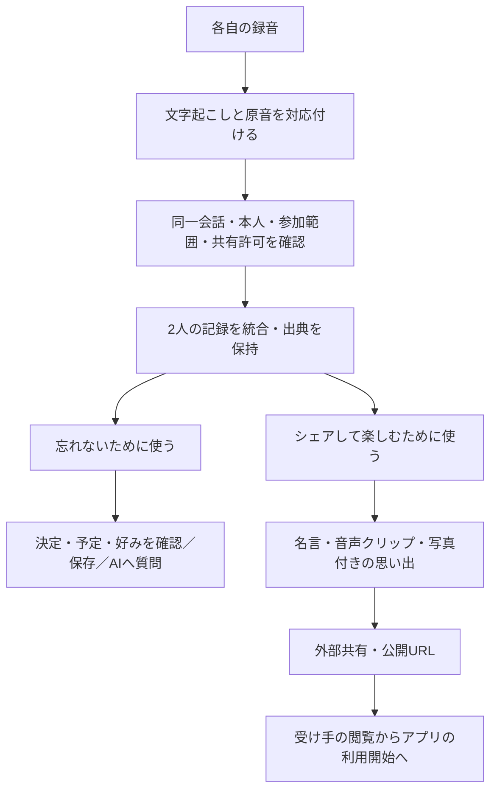

# 手書きユースケースを実装へつなぐ案

2026-09-15更新。状態：**外部共有・公開URLは必須M18として採用。名言/写真/音声は表現候補。WEB対談風・長期保存は不採用、雑音低減はGo君担当のため今回範囲外。製品実装は未着手**。手書き写真 `S__102178818.jpg` を材料として整理し、その後のユーザーの明示判断を優先した。

**参照先：** 採否と必須M18は[MVP_SPEC §2/20](../product/MVP_SPEC.md#external-sharing)、実装順と担当の確認先は[ロードマップ](MULTIPLATFORM_DELIVERY_PLAN.md#additional-use-case-plan)、表現の具体案は本書。変更前の全提案は[履歴](../history/design/USE_CASE_PROPOSAL_BEFORE_SHARING_REQUIRED_20260915.md)に保持する。

**再開時の現行方針：** MVP_SPEC 2.7。[§19の友達/グループ開始](../product/MVP_SPEC.md#friends-groups-sessions)に、M18の外部共有を追加する。2人の図は統合の基準例であり、グループの対象範囲を狭めない。グループAIは各自の本人用ワークスペースとする§19.6を維持し、履歴/上限等の残件を本書で埋めない。

## 機能と候補の台帳（最新の採否）

UCXのIDは過去資料との対応用に維持する。UCX07は正式機能M18へ昇格、UCX01〜03は表現候補。除外したIDを再利用しない。用途は[§2](#use-case-mapping)、実装案は§3〜4、順序は§5、残る判断は[§6](#candidate-decisions)、受入候補は[§7](#candidate-acceptance)。

| ID | 状態・作る成果 | 残る設計と接続先 | 受入 |
|---|---|---|---|
| UCX07 → M18 | **必須採用**。外部共有・公開URLから受け手のアプリ利用開始へつなぐ | 公開する最初の媒体、公開条件/承認、受け手の閲覧と利用開始先、URL/停止/失効。正式仕様は§20 | SP01〜07 |
| UCX01 | 候補。元発言を選ぶ名言・迷言カード。M18の最小媒体として提案 | M06/M12の出典、保存schema、画像生成/編集。プレビュー→M18へ接続。AIの候補選びは後段 | UC-P04/05/06/08/09＋SP |
| UCX02 | 候補。写真1枚付きカード、保持期限内で振り返る旅行log | 写真選択/保存先/圧縮/上限/削除と複数日の構成。M11/M12/M14/M18 | UC-P05/06/07/08/09＋SP |
| UCX03 | 候補。短い原音クリップ、複数区間のラジオ | M06のclip認可/時刻対応/編集。原音と合成番組の形式を判断し、M18に接続 | UC-P05/06/07/08/09＋SP |
| UCX04 | **不採用**。WEB対談風は不要との判断 | 実装順から除外。過去案は履歴へ保持 | 対象外 |
| UCX05 | **今回範囲外**。雑音低減はユーザー申告でGo君が作業中 | こちらで再実装/再割当しない。Go君の成果は必要時に受け渡し確認し、完成済みとは断定しない | 本作業では対象外 |
| UCX06 | **不採用**。長期保存の追加は不要との判断 | 原音7日・文字等原則30日を維持。M15の履歴期限/削除はこの枠内で具体化 | 延長機能は対象外 |

プロジェクト開発、遊びの予定、将来のビジョン、好み/趣味からのプレゼント・誘い、思い出の振り返りは、まずM05/M09〜M15を使う用途として保存する。独立機能や新しいAI役割へ自動で昇格させない。Drive/Notion等の資料連携は既存の追加枠と[PC連携設計案](LOCAL_PROJECT_CONTEXT_DESIGN_20260915.md)へつなぎ、本台帳で別の重複タスクを作らない。

M18の採否と今回の除外は確定として引き継ぐ。公開条件/媒体等の残る判断だけを具体化し、実装担当はロードマップで確認する。プレビューは実装途中の工程であり、M18の完成の代替にしない。

## 1. 整理の軸

目指す体験は「会話を残し、次の行動や、もう一度楽しめる思い出につなげる」。

- **目的：忘れない。** 決めたこと・約束・アイデア・相手の好みを、必要なときに見つけて行動へつなぐ。
- **目的：シェアして楽しむ。** 声の雰囲気、面白い発言、その日の出来事を、見返したくなる形へ編集する。
- **材料：文字と音声。** 両方の目的で使う。文字は内容の確認・整理、音声は言い方や笑い声の振り返りに使える。二つの独立した記録にせず、同じ発言・時刻へ戻れるようにする。
- **利用者を増やす必須機能：外部共有・公開URL。** 共有された成果にアプリの説明と利用開始への入口を持たせる。写真との組合せは表現候補として扱う。

この図は共有会話の流れ。本人の未共有記録を見返す経路も維持し、共有前に相手の情報を使わない。録音開始時に「仕事／遊び」等の選択を必須にせず、残した後に使い道を選ぶ。

## 2. 紙の内容と機能の対応

紙の「名言（迷言）作成」等を以下に対応付ける。除外した項目は上の台帳と履歴に残す。相対負担は設計上の見積りで、工数や実現性の実測ではない。

| 紙のアイデア | 利用者が得るもの | 初期の取り込み方 | 現行との関係・追加負担 |
|---|---|---|---|
| プロジェクト開発 | 決定、理由、保留、次にやることを思い出せる | 会話の整理と、ルームAIで「何が決まり、何が残っている？」。本人が必要な作業をToDoへ採用 | M05/M10/M15につながる。AI会話の未完成部分が前提。プロジェクト管理・資料連携は別の拡張 |
| 遊びの予定／カレンダー | 約束を予定として使える | 「行きたい」と「決まった」を分けて予定候補にし、M09の確認・登録経路へ | M09として採用済み、当日の追加枠。G3とカレンダー接続は未実装/未接続。外部連携分の負担あり |
| 将来のビジョンの話 | そのとき大切にした考えを振り返れる | 発言保存＋自分のメモ、ルームAIで目標を確認 | M12/M15につながる。保持期限内の利用とし、保存期間の延長や独立した目標管理を追加しない |
| 好きな物・趣味 | 相手が実際に話した好みを思い出せる | 記録を選び「好きだと言っていたものは？」と質問し、日付・原文を添える | M15の質問用途。自動人物プロフィールは作らず、本人の発言とAIの推測を分ける |
| プレゼント・誘い | 好みを次の行動に活かせる | 上の根拠を確認して「この話を踏まえたプレゼントや誘い方の案」をAIへ質問 | M15での利用候補。発言の事実と新しい提案を区別。商品検索・購入・本人への送信は別機能 |
| ラジオ | 楽しいやり取りを音で聞き直せる | 最初は本人が選んだ短い原音クリップを、タイトル付きで試聴する案 | M06の出典再生を基礎にするが、共有clipは未接続。選択・書出し・複数区間編集は新規。合成音声の番組化はさらに後段 |
| 名言／迷言作成 | 面白い一言を残して見せられる | 原文から一言を選んでカードの下書きにする。AI推薦はその次 | 保存M12を流用しやすい新規表現。ただし現行保存APIは本人Sourceのみ。共有発言の保存/カードは契約拡張が必要 |
| 思い出 | 日付や出来事から楽しい場面へ戻れる | 発言保存・日付から振り返る・ルームAIでの回想 | M11/M12/M14/M15につながる。日次は本人用であり、その結果をそのまま相手へ共有する機能ではない |
| 写真と統合／シェアの際 | 一言と写真を一枚にまとめられる | 本人が写真を1枚選び、選んだ発言カードに添える案 | 写真は現行で後続。添付・保存・削除・外部出力を追加。自動で全写真を読むことは初期案に含めない |
| 写真と統合／旅行のlog | 景色と、その場で話したことを一緒に振り返れる | 記録に写真を手動で対応付け、日ごとに並べる | 写真付きカードの次段階。複数日まとめ・アルバムは新規。現行G5の日次を無断で複数日に拡張しない |
| 外部共有・公開URL | 共有の受け手が本アプリを知り、自分も使い始められる | 選択した成果→共有URL→受け手の閲覧→利用開始導線 | 必須M18。公開条件/媒体/具体的な配布先は詳細設計で決める |

## 3. 現在のアプリへどう置くか

### 3.1 最初はルームのAIを共通の入口にする

現行の「録音／ルーム」2タブ、相手のルームの「記録／AI」を維持する。用途ごとの独立タブ・専用AIを増やす前に、U17の質問例として次を試す案が適している。

- 「決まったことと、まだ決まっていないことは？」
- 「次の約束は？」
- 「好きだと言っていたものは？」
- 「思い出に残るやり取りを振り返りたい」

質問例は入力を助けるもの。押しただけで予定登録・保存・相手への送信を実行しない。参照する記録は現行M15の会話ごとの選択に従い、根拠へ戻れる回答にする。回答に使える記録がなければ確認できないと表示する案とし、具体的なM15の未決定へ接続する。

「好きな物」も、対象記録内でその人が話した内容を確認する用途にとどめる。話者が不明なら相手の好みと断定しない。別の日の希望を確定済み予定にしたり、現在も同じ好みだと決めつけたりしない。

### 3.2 保存と成果物作成を記録の近くに置く

U03/U06の発言→既存の「保存」。楽しむ表現を採用する場合は、発言メニューから「この発言でカードを作る」「この部分を聞く」へ進み、M18の共有へ接続する案。画面配置は小さな見本で確認する。

作成の流れは「元発言を選ぶ→下書き→表示名や写真等を確認→保存/共有」。AIが新しく書いた表現は「AIがまとめた文章」と分かるようにし、元の逐語引用を装わない。手動で選んだ一言だけなら新しい生成モデル呼出しは不要で、カードのテンプレート表示から試せる。

### 3.3 共有の意味を分ける

1. **会話参加者への通常共有：** 既存の双方許可・参加範囲に従う。グループ所属だけで通常記録を共有しない。
2. **本人用の下書き：** 自分の閲覧可能範囲から作成する。これだけでは他者に公開されない。
3. **外部共有・公開URL：** 必須M18として採用。公開する成果への許可を設計し、元の相手との共有許可を第三者への再共有許可へ自動で読み替えない。

完成範囲は公開URLの共有、受け手の閲覧、アプリの利用開始先への到達まで。最初にプレビューを作っても、そこで完了にしない。誰へ・どの発言/声/写真を公開し、必要な承認をどう取るかを設計する。本人用AI会話やメモは勝手に付け足さない。

## 4. 実装を共通化する案

| 層 | 既存の基礎 | 追加候補 |
|---|---|---|
| 入力と根拠 | Recording/Source、元文字と時刻、ContextView | 2入力の時間対応・共有Contextを完成させ、発言の版と許可範囲を各出力へ引き継ぐ |
| 内容整理 | G1、G2、G5、設計中のM15 | 当面は既存の質問/整理を利用。用途ごとのモデルや自律エージェントを必須にしない |
| 本人用の保存 | SavedItem、本人ToDo | 保存対象が共有発言/整理の場合の正式契約と実処理を完成させる |
| 楽しむための表現 | 元発言、原音再生への参照 | 引用カード・原音クリップをM18の出力へ接続する候補 |
| メディア処理 | 録音/非公開Storage/worker | 写真添付/区間書出しの処理案。失敗しても元文字の閲覧を止めない |
| 外部共有・受け手 | 新規設計が必要 | M18の公開用データ/API、受け手Webページ、アプリの説明と利用開始導線。元記録のAPIとは認可を分ける |

新しい派生物に必要となる情報の案は、作成者・形式・元発言ID/版/範囲・入力全体の依存情報・本文/媒体参照・本人用/共有先・状態・期限。これは正式schemaではなく、K01で採否を決める設計メモである。保存済みToDoや個人メモを入れる汎用の人物データベースへ広げない。

公開前と取得時に権限・版・期限と公開条件を検査する。画像/音声に変換しても失効を回避させず、AIに渡した背景も依存情報に含める。原音は音声期限後に提供できない。公開URLの停止と外部保存済みコピーの回収を分け、詳細はMVP_SPEC §20で具体化する。

### 現行コードとの照合

- [contexts.py](../../services/backend/app/contexts.py)は個人Contextと入力全体の依存情報を扱う。[generation.py](../../services/backend/app/generation.py)の対応役割はG1/G2/G5。共有Context・M15・新しいカード生成が完成しているわけではない。
- [personal.py](../../services/backend/app/personal.py)の保存対象は現在、本人のSource。[actions.py](../../services/backend/app/actions.py)には本人によるToDo採用と根拠失効の処理がある。今回再テストはしていない。
- [EvidenceSheet.tsx](../../apps/client/src/screens/EvidenceSheet.tsx)は人工デモの出典シート。[backendの実装範囲](../../services/backend/README.md)では共有clip・G3/G4・カレンダー等が未実装/未接続。既存画面の存在を、共有音声の実再生・書出しの成功とは扱わない。
- 取り込み済みコードに残る旧同意前提と現行仕様との差は[復元記録](RESTORE_INTEGRATION_20260915.md#implementation-gaps)に従う。本案を追加する際に、旧前提を新仕様へコピーしない。

### 技術の接続候補

写真を本人に選んでもらう入口は[Expo ImagePicker](https://docs.expo.dev/versions/latest/sdk/imagepicker/)、iOS/Androidから画像や音声ファイルを他アプリへ渡す入口は[Expo Sharing](https://docs.expo.dev/versions/latest/sdk/sharing/)を候補にできる。後者はファイルを渡す仕組みであり、カード画像の作成や送信完了の保証は別。Webは同じローカルURI共有を使えず、対応確認と別の経路が必要。両ライブラリは現在のclient依存に含まれていない。

上記は2026-09-15に公式資料とローカル依存を確認した接続候補であり、導入・録音処理・実機動作の検証は行っていない。

## 5. 推奨する実装順

| 段階 | 利用者に見せる成果 | 対応・前提 |
|---|---|---|
| 1. 必須の土台と共有設計 | 友達/グループの記録→統合→根拠付きAI。併せてM18の最小媒体・公開条件を設計 | 現行工程とM15の残件を継承。M18の採否は確定としてK01/K02/K04/K06/K09へ分割 |
| 2. 共有する成果 | 最小媒体のプレビューを作る。一言カードUCX01を候補として推奨 | 引用/話者/出典の整合、公開用データを設計。プレビューだけで必須機能を完成にしない |
| 3. 外部で見て使い始める | 公開URLを外部に共有→受け手が閲覧→アプリの利用開始先へ | M18の必須工程。SP01〜07を具体化し、送る側/受け手側の両方で通し確認 |
| 4. 表現と既存付加価値 | 写真付きカード/旅行log、原音/ラジオ、ToDo/予定/日次 | 個別の採用範囲で追加。写真/音声の保存・編集条件を確認し、M18の媒体を広げる。保持期限の延長を前提にしない |

M18の最小媒体として一言カードを推奨し、外部共有と受け手の利用開始導線までを一つの成果として扱う。媒体の採否は残件だが、外部共有を「余裕があれば」に戻さない。趣味や将来の話はAIへの質問と期限内の根拠付き保存で価値を試せる。

デモ案：2人の旅行相談→AIで決定を確認→一言の共有成果を作る→公開URLを別の受け手環境で開く→「自分も会話を残す」から利用開始先へ進む。録音は現行の各5分以内。人工データ/ローカル見本と、実際の外部到達・新規利用者獲得を区別する。

## 6. 実装前に残る判断

| 判断 | 推奨・影響 | 判断者／依存する機能 |
|---|---|---|
| 最初に共有する成果 | 一言カードを提案。文字/画像/音声のどれを最初に提供し、どの項目を編集/公開できるか決める | 企画者。M18の媒体契約と表示 |
| 公開の条件と利用開始先 | M18は必須。公開対象、必要な相手の承認、受け手の登録要否、URLの停止/期限、利用開始先を具体化する | 企画者/実装担当。MVP_SPEC §20の残件に集約 |
| ラジオの意味 | 「録った声の抜粋」を最初の候補とする。「AIが原稿を再構成して読み上げる番組」は声/原稿/費用/処理先が増える | 企画者＋音声担当。音声生成・編集方式が依存 |
| 写真との結び付け | 最初は本人の手動選択。撮影時刻の近さだけで同じ出来事や共有先と断定しない | 企画者。保存先・共有・削除を含む写真機能が依存 |

M18の採否と今回の除外は再確認しない。残る詳細を[MVP_SPEC](../product/MVP_SPEC.md#external-sharing)で確定し、担当・依存・提出物を[ロードマップ](MULTIPLATFORM_DELIVERY_PLAN.md#additional-use-case-plan)へ反映する。Go君の作業を重複して割り当てない。

## 7. 受入候補と測定

以下のUC-Pは本提案内の識別子で、正式な受入条件への追加・達成ではない。

| ID | 場面 | 期待する結果 |
|---|---|---|
| UC-P01 | 日時の決定と「いつか行きたい」が同じ会話にある | 決定と希望を分け、予定/ToDoはM09/M10の条件で扱う。元発言へ戻れる |
| UC-P02 | 同じ会話が2台に記録されている | 統合の対応情報で重複を扱い、ToDoや候補を二重作成しない。対応不明なら保留 |
| UC-P03 | 好みを聞くが対象発言の話者は不明 | 相手の好みだと断定しない。根拠なしを作話で補わない |
| UC-P04 | 名言カードで本人が一言を選ぶ／AIが要約する | 引用は有効な元文字・版へ対応する。AIの要約や創作を実際の逐語発言として表示しない |
| UC-P05 | 通常共有の途中参加者向けにカード/音声を作る | 参加前の内容を入力/引用/音声へ含めない。M18の外部公開はSP03の公開条件を別に検査し、通常共有の権限を自動で拡張しない |
| UC-P06 | 生成中に訂正・共有取消・期限切れが起きる | 古い本文/画像/音声の提供を止める。権限と文字・音声それぞれの期限を再判定する |
| UC-P07 | 写真選択を取り消す／音声加工が失敗する | 保存/共有成功と表示しない。元記録の閲覧は維持し、失敗した操作だけ再開できる |
| UC-P08 | 作成した下書きを開く | それだけで相手へ送信・公開されない。AI会話/個人メモも勝手に付加されない |
| UC-P09 | 保存済みの原音が7日、文字が30日を超える | アプリ管理下の該当内容と派生物を提供しない。保存/URL発行を理由に期限を延長しない |

M18は[SP01〜07](../product/MVP_SPEC.md#external-sharing)も具体化し、送信/閲覧/利用開始への到達を確認する。正常・境界・失敗の人工ケースの後、許可された条件で両OS/受け手の実経路を確認。操作数、引用の正しさ、共有→閲覧→利用開始への移動、費用/容量を観測し、実測前に増加や品質を保証しない。実データは[音声利用条件](VALIDATION.md#音声の利用処理条件)に従う。

## 8. 根拠と今回の確認範囲

- 製品方針：[PRODUCT_CORE](../product/PRODUCT_CORE.md) D03/D13/D17/S03/S04と外部共有の追加決定。正本は[MVP_SPEC](../product/MVP_SPEC.md#external-sharing)。AC/C/A、M15とSPの関連を整理したもので、受入完了ではない。
- 既存資料のプロジェクト連携は[PC連携設計案](LOCAL_PROJECT_CONTEXT_DESIGN_20260915.md)と別の未採用候補。今回の「プロジェクト開発」を理由に外部資料アクセスを追加しない。
- 初回の[整理記録](../history/WORKFLOW_20260915.md#handwritten-use-case-proposal)と、最新の[必須化/除外の記録](../history/WORKFLOW_20260915.md#external-sharing-required)を分けて保持する。実装方式の資料確認と製品の動作証拠は別に扱う。
- 製品実装、契約/fixture/manifestの変更、録音処理/外部送信、外部書込/公開、実モデル・実機・費用/性能測定、独立レビューは本依頼の対象外であり、実施していない。
