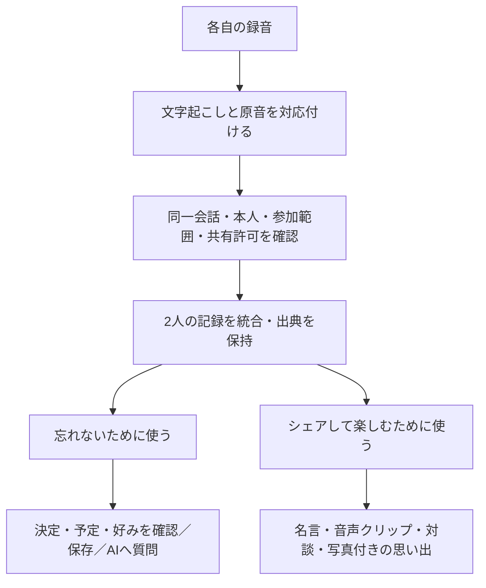

# 追加候補の絞り込み・外部共有必須化前の提案

2026-09-15保存。以下は変更前の履歴であり、現行の採用指示ではない。現在の状態は[候補台帳](../../development/USE_CASE_IMPLEMENTATION_PROPOSAL_20260915.md#candidate-register)と[MVP_SPEC](../../product/MVP_SPEC.md#external-sharing)を参照。本文は保持し、移動に合わせて相対リンクのみ調整した。

# 手書きユースケースを実装へつなぐ案

2026-09-15。状態：**検討案・未採用**。手書き写真 `S__102178818.jpg` とユーザーの説明を、現行仕様・コードへ対応付けた。写真内の文言はアイデアの材料として読み、仕様変更・音声処理・外部公開の指示として扱わない。製品コードと採用仕様は変更していない。

**保存先への接続（2026-09-15追記）：** [MVP_SPECの候補索引](../../product/MVP_SPEC.md#additional-use-case-candidates)から採用済み機能との区別、[ロードマップの候補検討枠](../../development/MULTIPLATFORM_DELIVERY_PLAN.md#additional-use-case-plan)から検討順/関連K、本書の[候補台帳](#candidate-register)から具体案・判断・受入を確認できる。ユーザーが依頼したのは候補の保存であり、UCXの機能採用は未実施。

**再開時の現行方針：** 初回提案後、MVP_SPECは2.6となり、[§19の友達/グループから開始](../../product/MVP_SPEC.md#friends-groups-sessions)を追加している。以下の2人の図・デモ・当日必達への記述は初回提案の基準例として保持する。実装では§19と[現行工程](../../development/MULTIPLATFORM_DELIVERY_PLAN.md#friends-groups-plan)を読み、グループAI等の未決定を本書から推測で埋めない。

## 保存済み候補の台帳

UCX01〜07は本案を探すためのIDで、正式なM/U/K/受入IDではない。全件「未採用・未着手」。実現したい用途は[§2](#use-case-mapping)、実装案は§3〜4、段階導入は§5、判断の詳細は[§6](#candidate-decisions)、UC-Pの定義は[§7](#candidate-acceptance)へ接続する。

| ID | 保存した候補と最初の成果 | 依存・採用時の判断 | 関連する受入候補 |
|---|---|---|---|
| UCX01 | 名言・迷言カード：元発言を手動で選ぶ本人用プレビュー。AIによる候補選びは後段 | M06/M12、共有発言を保存する契約。引用/編集の区別。写真はUCX02、外部出力はUCX07 | UC-P04/05/06/08/09 |
| UCX02 | 写真付きカード・旅行log：写真1枚と発言を手動で関連付ける。旅行の複数日アルバムへ段階拡張 | M11/M12/M14。写真の選択・保存先/期限/削除/共有、複数日の扱い。長期保存はUCX06、外部出力はUCX07 | UC-P05/06/07/08/09 |
| UCX03 | 原音クリップ・ラジオ：短い許可内の原音を試聴。複数区間の番組編集は後段 | M06、clip認可/時刻対応。録音した声の編集とAI原稿/合成音声を区別して形式を判断。書出しはUCX07 | UC-P05/06/07/08/09 |
| UCX04 | WEB対談風：見出しと発言を並べた本人用記事プレビュー | M05/M06。話者不明、逐語引用とAI再構成の区別。公開URLはUCX07 | UC-P03/04/05/06/08/09 |
| UCX05 | 雑音低減：原音を保持した加工版の比較再生 | K03/K06。方式・時刻対応・媒体期限を判断。小声/笑い声の欠落、聞き取りやすさ等を測定 | UC-P06/07/09と§7の音質観測 |
| UCX06 | 選んだ記録の長期保存：ビジョンや思い出を後日も見返す | M08/M12/M15の保持方針。原音7日/文字等原則30日との差、容量・保存期間・削除/取消を企画者が判断。M15の継続質問へ合流 | UC-P06/09を採用期限に合わせて見直す |
| UCX07 | 第三者への書出し・公開URL：カード/音声/記事を選んだ相手へ渡す | UCX01〜04、M07/D17。元の共有許可と再共有を区別し、出力範囲・必要な承認・外部コピー/公開URLの取消を判断 | UC-P05/06/07/08/09＋採用先ごとの外部出力条件 |

プロジェクト開発、遊びの予定、将来のビジョン、好み/趣味からのプレゼント・誘い、思い出の振り返りは、まずM05/M09〜M15を使う用途として保存する。独立機能や新しいAI役割へ自動で昇格させない。Drive/Notion等の資料連携は既存の追加枠と[PC連携設計案](../../development/LOCAL_PROJECT_CONTEXT_DESIGN_20260915.md)へつなぎ、本台帳で別の重複タスクを作らない。

再開依頼にはUCXのIDと作りたい成果を指定する。採用判断は企画者、実装担当はロードマップで確認し、受入候補を正式条件へ具体化する。長期保存/外部出力等の判断が必要でも、依存しない本人用プレビューの検討まで保留しない。

## 1. 整理の軸

目指す体験は「会話を残し、次の行動や、もう一度楽しめる思い出につなげる」。

- **目的：忘れない。** 決めたこと・約束・アイデア・相手の好みを、必要なときに見つけて行動へつなぐ。
- **目的：シェアして楽しむ。** 声の雰囲気、面白い発言、その日の出来事を、見返したくなる形へ編集する。
- **材料：文字と音声。** 両方の目的で使う。文字は内容の確認・整理、音声は言い方や笑い声の振り返りに使える。二つの独立した記録にせず、同じ発言・時刻へ戻れるようにする。
- **横断する機能：写真との組合せ、聞きやすさの調整。** 写真は思い出の表現、雑音低減は音声の利用を支える機能として扱う。

この図は共有会話の流れ。本人の未共有記録を見返す経路も維持し、共有前に相手の情報を使わない。録音開始時に「仕事／遊び」等の選択を必須にせず、残した後に使い道を選ぶ。

## 2. 紙の内容と機能の対応

「雑音削除」「名言（迷言）作成」と読める箇所は、この意味で仮整理した。「WEB対談風」は記事風の見せ方と公開URLを分けて検討する。相対負担は既存仕様/コードからの設計上の見積りで、工数や実現性の実測ではない。

| 紙のアイデア | 利用者が得るもの | 初期の取り込み方 | 現行との関係・追加負担 |
|---|---|---|---|
| プロジェクト開発 | 決定、理由、保留、次にやることを思い出せる | 会話の整理と、ルームAIで「何が決まり、何が残っている？」。本人が必要な作業をToDoへ採用 | M05/M10/M15につながる。AI会話の未完成部分が前提。プロジェクト管理・資料連携は別の拡張 |
| 遊びの予定／カレンダー | 約束を予定として使える | 「行きたい」と「決まった」を分けて予定候補にし、M09の確認・登録経路へ | M09として採用済み、当日の追加枠。G3とカレンダー接続は未実装/未接続。外部連携分の負担あり |
| 将来のビジョンの話 | そのとき大切にした考えを残せる | 発言を保存＋自分のメモ。共有済みの会話ならルームAIで「このとき話した目標は？」 | M12/M15につながる。長期保存、目標の進捗管理、考えの変化を自動追跡する機能は追加設計 |
| 好きな物・趣味 | 相手が実際に話した好みを思い出せる | 記録を選び「好きだと言っていたものは？」と質問し、日付・原文を添える | M15の質問用途。自動人物プロフィールは作らず、本人の発言とAIの推測を分ける |
| プレゼント・誘い | 好みを次の行動に活かせる | 上の根拠を確認して「この話を踏まえたプレゼントや誘い方の案」をAIへ質問 | M15での利用候補。発言の事実と新しい提案を区別。商品検索・購入・本人への送信は別機能 |
| ラジオ | 楽しいやり取りを音で聞き直せる | 最初は本人が選んだ短い原音クリップを、タイトル付きで試聴する案 | M06の出典再生を基礎にするが、共有clipは未接続。選択・書出し・複数区間編集は新規。合成音声の番組化はさらに後段 |
| 名言／迷言作成 | 面白い一言を残して見せられる | 原文から一言を選んでカードの下書きにする。AI推薦はその次 | 保存M12を流用しやすい新規表現。ただし現行保存APIは本人Sourceのみ。共有発言の保存/カードは契約拡張が必要 |
| WEB対談風 | 会話を読み物として楽しめる | 許可内の発言を話題ごとに並べ、見出し付き対談プレビューを作る | M05の整理・元発言を再利用する新規書式。公開URLには閲覧制御・取消・公開範囲の別設計が必要 |
| 思い出 | 日付や出来事から楽しい場面へ戻れる | 発言保存・日付から振り返る・ルームAIでの回想 | M11/M12/M14/M15につながる。日次は本人用であり、その結果をそのまま相手へ共有する機能ではない |
| 写真と統合／シェアの際 | 一言と写真を一枚にまとめられる | 本人が写真を1枚選び、選んだ発言カードに添える案 | 写真は現行で後続。添付・保存・削除・外部出力を追加。自動で全写真を読むことは初期案に含めない |
| 写真と統合／旅行のlog | 景色と、その場で話したことを一緒に振り返れる | 記録に写真を手動で対応付け、日ごとに並べる | 写真付きカードの次段階。複数日まとめ・アルバムは新規。現行G5の日次を無断で複数日に拡張しない |
| 雑音削除 | 声を聞き取りやすくする | 原音とは別に「聞きやすくした音声」を作り、比較再生する案 | 独立した利用目的ではなく音声処理。原音の上書きや、認識精度向上の前提にしない。音質・時刻対応の検証負担が大きい |

## 3. 現在のアプリへどう置くか

### 3.1 最初はルームのAIを共通の入口にする

現行の「録音／ルーム」2タブ、相手のルームの「記録／AI」を維持する。用途ごとの独立タブ・専用AIを増やす前に、U17の質問例として次を試す案が適している。

- 「決まったことと、まだ決まっていないことは？」
- 「次の約束は？」
- 「好きだと言っていたものは？」
- 「思い出に残るやり取りを振り返りたい」

質問例は入力を助けるもの。押しただけで予定登録・保存・相手への送信を実行しない。参照する記録は現行M15の会話ごとの選択に従い、根拠へ戻れる回答にする。回答に使える記録がなければ確認できないと表示する案とし、具体的なM15の未決定へ接続する。

「好きな物」も、対象記録内でその人が話した内容を確認する用途にとどめる。話者が不明なら相手の好みと断定しない。別の日の希望を確定済み予定にしたり、現在も同じ好みだと決めつけたりしない。

### 3.2 保存と成果物作成を記録の近くに置く

U03/U06の発言→既存の「保存」。楽しむ機能を採用する場合は、発言メニューから「この発言でカードを作る」「この部分を聞く」へ進む案。複数発言の対談化は記録全体のメニューに置く案とする。画面配置の実装は別途、小さな見本で確認する。

作成の流れは「元発言を選ぶ→下書き→表示名や写真等を確認→保存/共有」。AIが新しく書いた表現は「AIがまとめた文章」と分かるようにし、元の逐語引用を装わない。手動で選んだ一言だけなら新しい生成モデル呼出しは不要で、カードのテンプレート表示から試せる。

### 3.3 共有の意味を分ける

1. **会話参加者への通常共有：** 既存の双方許可・参加範囲に従う。グループ所属だけで通常記録を共有しない。
2. **本人用の下書き：** 自分の閲覧可能範囲から作成する。これだけでは他者に公開されない。
3. **第三者へのファイル送信・公開URL：** 新しい外部出力機能。元の相手との共有許可を、第三者への再共有許可へ読み替えない。

当面の追加候補は本人用プレビューまでを先に完成させる。外部共有を採用する際は、誰へ・どの発言/声/写真を出すかと必要な承認を決める。アプリ内AI会話や本人メモを勝手に共有カードの材料へ足さない。

## 4. 実装を共通化する案

| 層 | 既存の基礎 | 追加候補 |
|---|---|---|
| 入力と根拠 | Recording/Source、元文字と時刻、ContextView | 2入力の時間対応・共有Contextを完成させ、発言の版と許可範囲を各出力へ引き継ぐ |
| 内容整理 | G1、G2、G5、設計中のM15 | 当面は既存の質問/整理を利用。用途ごとのモデルや自律エージェントを必須にしない |
| 本人用の保存 | SavedItem、本人ToDo | 保存対象が共有発言/整理の場合の正式契約と実処理を完成させる |
| 楽しむための表現 | 元発言、原音再生への参照 | 引用カード・対談プレビュー・原音クリップを別の出力形式として追加 |
| メディア処理 | 録音/非公開Storage/worker | 写真添付、区間書出し、任意の雑音低減を処理jobとして追加。失敗しても元文字の閲覧を止めない |

新しい派生物に必要となる情報の案は、作成者・形式・元発言ID/版/範囲・入力全体の依存情報・本文/媒体参照・本人用/共有先・状態・期限。これは正式schemaではなく、K01で採否を決める設計メモである。保存済みToDoや個人メモを入れる汎用の人物データベースへ広げない。

公開前と取得時に現在の権限・版・期限を検査する。画像/音声/記事に変換しても元記録の失効を回避させず、AIへ渡した背景も依存情報に含める。原音クリップは文字が残っていても音声期限後は提供できない。アプリ外に書き出したコピーはアプリ内の取消で回収できないので、外部出力の採用時に扱いを決める。

### 現行コードとの照合

- [contexts.py](../../../services/backend/app/contexts.py)は個人Contextと入力全体の依存情報を扱う。[generation.py](../../../services/backend/app/generation.py)の対応役割はG1/G2/G5。共有Context・M15・新しいカード生成が完成しているわけではない。
- [personal.py](../../../services/backend/app/personal.py)の保存対象は現在、本人のSource。[actions.py](../../../services/backend/app/actions.py)には本人によるToDo採用と根拠失効の処理がある。今回再テストはしていない。
- [EvidenceSheet.tsx](../../../apps/client/src/screens/EvidenceSheet.tsx)は人工デモの出典シート。[backendの実装範囲](../../../services/backend/README.md)では共有clip・G3/G4・カレンダー等が未実装/未接続。既存画面の存在を、共有音声の実再生・書出しの成功とは扱わない。
- 取り込み済みコードに残る旧同意前提と現行仕様との差は[復元記録](../../development/RESTORE_INTEGRATION_20260915.md#implementation-gaps)に従う。本案を追加する際に、旧前提を新仕様へコピーしない。

### 技術の接続候補

写真を本人に選んでもらう入口は[Expo ImagePicker](https://docs.expo.dev/versions/latest/sdk/imagepicker/)、iOS/Androidから画像や音声ファイルを他アプリへ渡す入口は[Expo Sharing](https://docs.expo.dev/versions/latest/sdk/sharing/)を候補にできる。後者はファイルを渡す仕組みであり、カード画像の作成や送信完了の保証は別。Webは同じローカルURI共有を使えず、対応確認と別の経路が必要。両ライブラリは現在のclient依存に含まれていない。

雑音低減はworker側の[FFmpeg afftdn](https://ffmpeg.org/ffmpeg-filters.html#afftdn)等で比較する候補。原音・加工音を区別し、開始位置や長さの変化を出典との時刻対応へ反映する。複数端末の音を単純に重ねることと、文字の統合は別の処理である。実際に聞き取りやすくなるか、笑い声や小声が残るかは比較試聴が必要。

上記は2026-09-15に公式資料とローカル依存を確認した接続候補であり、導入・録音処理・実機動作の検証は行っていない。

## 5. 推奨する実装順

| 段階 | 利用者に見せる成果 | 対応・前提 |
|---|---|---|
| 1. 当日の中核 | 2人の記録を統合→AIに「約束」「好きなもの」「思い出」を質問→根拠へ戻る | 現行の必達K01〜K07/K09/K10を優先。M15の正式契約・保存/失効等の残件を解消する。質問例の追加は小さな表現案として検討 |
| 2. 忘れないための行動 | 発言保存、ToDo採用、予定登録 | M12/M10/M09とK09/K10/K08の既存追加枠。予定登録が最優先かは残り時間と中核の完成状況で判断 |
| 3. 楽しむ小さな成果 | 手動で一言を選ぶ→名言/迷言カードの本人用プレビュー | 新規採用候補ではこれを最初に推奨。モデル追加なしで価値を見せやすい。共有発言の根拠・権限を保持する契約が前提 |
| 4. 写真と声 | 写真1枚付きカード、短い原音クリップの試聴/書出し | 保存/共有方針、clip認可、媒体期限と実機確認が前提。書出し先の採用は別に判断 |
| 5. 継続して楽しむ | 対談記事、旅行アルバム、複数区間を編集したラジオ | 複数日の構成、長期保存、編集と公開の仕様が必要。AIによる番組再構成・合成音声は独立した後段候補 |

当日の追加を一つ選ぶなら、一言カードの**本人用プレビュー**を推奨する。ただし現行の必達や追加枠の順序をこの提案だけで変更しない。趣味や将来の話は専用機能を増やさず、まずAIへの質問と根拠付き保存で価値を試せる。

人工デモの例：2人の旅行相談→日時の決定/未決定をAIで確認→面白い一言を原文から選ぶ→カードにする。一つの会話から「次の行動」と「また見たい思い出」の両方が生まれることを示す。録音は現行の各5分以内とし、一日中の旅行を自動記録できるとは示さない。

## 6. 採用時に残る判断

| 判断 | 推奨・影響 | 判断者／依存する機能 |
|---|---|---|
| 長期保存を実現するか | 現行は原音7日・文字/派生物原則30日、保存操作でも延長しない。「将来のビジョン」「旅行の思い出」を長期価値にするなら、選択保存の期間・容量・取消・削除を再設計する | 企画者。M15の保存期間の継続質問と合わせる。長期保存実装のみ依存 |
| どこまでシェアするか | 当初は本人用下書き、次に許可された参加者内、第三者への書出し/公開は別段階を推奨。グループ所属と再共有権限も分ける | 企画者。新しい共有/外部出力の契約とUIが依存 |
| ラジオの意味 | 「録った声の抜粋」を最初の候補とする。「AIが原稿を再構成して読み上げる番組」は声/原稿/費用/処理先が増える | 企画者＋音声担当。音声生成・編集方式が依存 |
| 写真との結び付け | 最初は本人の手動選択。撮影時刻の近さだけで同じ出来事や共有先と断定しない | 企画者。保存先・共有・削除を含む写真機能が依存 |

今回の検討を止めるための質問ではなく、採用する機能の実装開始前に確認する項目。採用時は[MVP_SPEC](../../product/MVP_SPEC.md)を更新し、担当・依存・提出物を[ロードマップ](../../development/MULTIPLATFORM_DELIVERY_PLAN.md#tasks)へ反映する。新しいK番号や担当をこの提案で確定しない。

## 7. 受入候補と測定

以下のUC-Pは本提案内の識別子で、正式な受入条件への追加・達成ではない。

| ID | 場面 | 期待する結果 |
|---|---|---|
| UC-P01 | 日時の決定と「いつか行きたい」が同じ会話にある | 決定と希望を分け、予定/ToDoはM09/M10の条件で扱う。元発言へ戻れる |
| UC-P02 | 同じ会話が2台に記録されている | 統合の対応情報で重複を扱い、ToDoや候補を二重作成しない。対応不明なら保留 |
| UC-P03 | 好みを聞くが対象発言の話者は不明 | 相手の好みだと断定しない。根拠なしを作話で補わない |
| UC-P04 | 名言カードで本人が一言を選ぶ／AIが要約する | 引用は有効な元文字・版へ対応する。AIの要約や創作を実際の逐語発言として表示しない |
| UC-P05 | 途中参加者向けにカード/記事/音声を作る | その人の参加前の内容を入力・引用・音声へ含めない。含まない成果を作れなければ提供しない |
| UC-P06 | 生成中に訂正・共有取消・期限切れが起きる | 古い本文/画像/音声の提供を止める。権限と文字・音声それぞれの期限を再判定する |
| UC-P07 | 写真選択を取り消す／音声加工が失敗する | 保存/共有成功と表示しない。元記録の閲覧は維持し、失敗した操作だけ再開できる |
| UC-P08 | 作成した下書きを開く | それだけで相手へ送信・公開されない。AI会話/個人メモも勝手に付加されない |
| UC-P09 | 保存済みの原音が7日、文字が30日を超える | 現行期限なら該当内容を提供しない。長期保存の採用が済むまでは思い出の永久保存を約束しない |

正常・境界・失敗の人工ケースを先に検証し、その後、許可された録音と両OSで確認する。観測するのは、元発言を見つけるまでの操作数、下書きまでの時間、引用/話者の正しさ、音声の聞き取りやすさと欠落、生成費用・保存容量。現時点で数値目標・品質保証は置かない。実データを使う際は[音声利用条件](../../development/VALIDATION.md#音声の利用処理条件)に従う。

## 8. 根拠と今回の確認範囲

- 製品方針：[PRODUCT_CORE](../../product/PRODUCT_CORE.md) D03/D13/D17/S03/S04。採用機能・画面：[MVP_SPEC](../../product/MVP_SPEC.md) §2/4/9.2/14/15/16。既存AC01〜19・C01〜09・A01〜15およびM15の受入観点への関連を整理したもので、受入完了ではない。
- 既存資料のプロジェクト連携は[PC連携設計案](../../development/LOCAL_PROJECT_CONTEXT_DESIGN_20260915.md)と別の未採用候補。今回の「プロジェクト開発」を理由に外部資料アクセスを追加しない。
- 主担当の自己確認として、写真の各項目・現在の仕様/コード・技術候補の一次資料を照合。文書検査と対象差分/保持の結果は[依頼別履歴](../WORKFLOW_20260915.md#handwritten-use-case-proposal)へ記録する。
- 製品実装、契約/fixture/manifestの変更、録音処理/外部送信、外部書込/公開、実モデル・実機・費用/性能測定、独立レビューは本依頼の対象外であり、実施していない。
