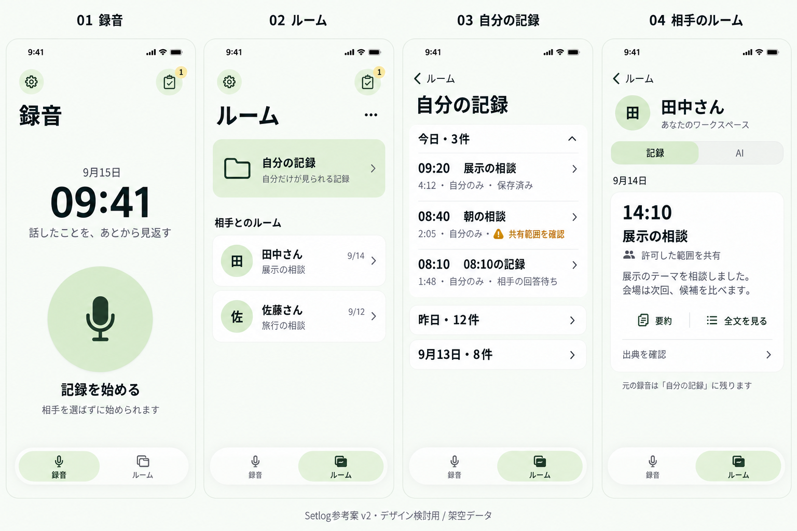
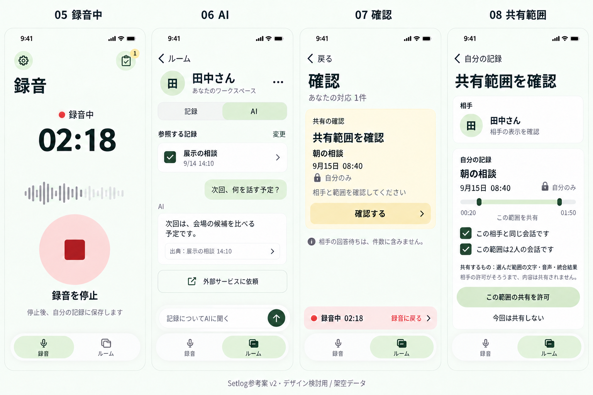

# Setlog参考案：画面画像 v2

2026-09-15。ユーザーの「変更があった分の画像のページは作り直して」に対応した、架空データによるデザイン検討用の静止画。既存MVPの画面とは別に管理する。

[個人記録の一覧整理方針](../../SETLOG_RECORDS_LIST.md)を反映した。本文はKosugi Maru Regular（400）、見出し・記録名はNoto Sans JP SemiBold（600）を指定して再生成した。書体変更が全8画面に関わるため、既存の2枚構成を維持して両方をv2に更新した。

## 録音の動く見本

現在の画像提案：[C / DREAM TAPE](recording-dream-tape-v1/README.md)。ユーザーがCのカセットを選択し、夢やワクワクする要素を追加。白・淡いミント・丸い操作を土台に、透明なケース内へ星・雲・朝焼けを閉じ込めた。具体表現は検討案で、現在の動く見本は保持する。[3案の比較v2](recording-pop-concepts-v2/README.md)と[先行案v1](recording-pop-concepts-v1/README.md)は検討履歴として残す。

2026-09-15追加：[声でゆれる立体の見本](recording-motion-v1.html)。疑似音量3段階、開始・停止・保存・失敗・中断を操作できる。本文と見出しは同梱の実フォントで表示する。[起動手順・画面画像・確認結果](recording-motion-v1/README.md)を参照。以下の画像v2は比較用に保持する。

## 既存の画像v2

### 01〜04：録音・ルーム・自分の記録・相手のルーム



### 05〜08：録音中・AI・確認・共有範囲



## 変更点

| 画面 | 変更 |
|---|---|
| 全8画面 | 本文を丸みのある通常ウェイト、タイトル・見出し・記録名をはっきりした書体へ |
| 03 自分の記録 | 大きい個別カードを2行のコンパクトな一覧へ。今日3件を展開し、昨日12件・9月13日8件を折りたたむ |
| 05 録音中 | 追加指示で残り時間を削除。経過時間・波形・停止操作を表示する |
| 07 確認 | 一覧の要対応レコード「9月15日 08:40 朝の相談」と表示を統一 |
| 08 共有範囲 | 同じ個人記録を表示。範囲例を00:20〜01:50とし、録音時間2:05内に収める |

一覧の例は09:20「展示の相談」（保存済み）、08:40「朝の相談」（本人の確認が必要）、08:10「08:10の記録」（相手待ち）。「今日」の表示3件と要対応1件を区別する。設計メモ中の時刻とは異なる架空データであり、仕様変更ではない。

AIが参照するのは前日の共有済み「展示の相談」（9/14 14:10）。未共有の今日の記録をAIの共有参照や相手のルームへ移さない。共有範囲画面は本人が2つの確認項目を選択した例であり、初期チェック状態を決めるものではない。

録音とルームの2タブ、相手を選ばない録音開始、本人の元記録の保持、本人待ちと相手待ちの区別を維持した。検索・ピン留め・フィルタ・フォルダ／タグ・AI分類は追加していない。

## 生成方法と確認

内蔵imagegenの編集モードを使用。第1ボードは旧版01を編集対象、第2ボードは旧版02を編集対象・新版01を書体と見た目の補助参照とした。続く「残り時間っていらないよね？」を反映し、第2ボードから残り時間の表示を削除した。録音上限のルールは変更していない。入力画像を目視してから編集し、生成物の内容・日本語・日付と件数の整合を目視確認した。

- 出力：上記PNG各1536×1024。生成原本とプロジェクトへ保存したファイルの一致を確認。
- 旧版：[v1の画像と生成指示](history-v1.md)に保存。v2の2画像は更新版として維持する。
- 書体：画像内の字形は生成モデルによる近似であり、実フォントによる組版を保証するものではない。実装時の指定は本文Kosugi Maru 400、見出しNoto Sans JP 600。
- 限界：静止画の自己確認。実アプリの開閉操作、文字拡大、タッチ領域、音声処理・共有認可の動作検証は含まない。アプリコード・公開API／型・既存MVP仕様は変更していない。

作業結果は[WORKFLOW](../../../development/WORKFLOW.md)に記録する。

## 使用したプロンプト全文

### 01-main-screens-v2.png

```text
Use case: ui-mockup
Mode: precise edit of the supplied four-screen Japanese app design board.
Input image: edit target. Preserve the overall four-screen composition, screen outlines, pale green palette, icons, spacing style, recording and room navigation, and all functional meaning except the changes specified here. Deliver a complete revised board, not a before/after collage. Make every Japanese character crisp and legible.

Global typography change on ALL FOUR SCREENS:
Page titles, section headings, partner names and record titles: Noto Sans JP SemiBold 600, clearly defined straight-edged Japanese sans serif, noticeably crisper than the body, not overly heavy black.
Body copy, summaries, subtitles, metadata and helper explanations: Kosugi Maru Regular 400, softly rounded terminals, friendly natural Japanese body text, no bold simulation. Body around 17-18pt equivalent with comfortable line height, dark charcoal for readability.
Keep the current time numerals and navigation icon geometry. Do not round the titles into Kosugi Maru. Distinguish crisp headings from rounder regular body text.

CRITICAL LAYOUT CHANGE: SCREEN 03, "自分の記録".
Replace the THREE large cards with ONE COMPACT grouped LIST. Do not preserve the previous big record cards. Keep the back arrow "ルーム", page title, background and bottom two-tab navigation. No search icon, no search box, no pin icon, no filter chips, no folders or tags, no new features.
Below title, a flat date header "今日 · 3件", with upward chevron at right to show the group is open.
Below that, exactly THREE compact 2-line record rows with thin separators. Each row about 76pt high, not a tall card; subtle white continuous list surface, no individual pill backgrounds. Contents:
Row 1 line 1: "09:20  展示の相談", right chevron.
Row 1 line 2: "4:12 · 自分のみ · 保存済み".
Row 2 line 1: "08:40  朝の相談", right chevron.
Row 2 line 2: "2:05 · 自分のみ · 共有範囲を確認".
Row 3 line 1: "08:10  08:10の記録", right chevron.
Row 3 line 2: "1:48 · 自分のみ · 相手の回答待ち".
The second row's required-confirmation phrase may use a muted ochre text color with a tiny attention symbol, never an oversized yellow action button. Row 3 waiting text stays neutral gray, not an action badge. Keep all three "自分のみ" labels and durations legible. No summary previews or repeated dates in individual rows.
Below the rows, two generous flat CLOSED group headers "昨日 · 12件" with right chevron and "9月13日 · 8件" with right chevron. No contents under those closed groups. Leave empty breathing room below. Today 3 means exactly 3 visible rows. Group counts count recordings, not tasks. Do not render the groups as folder-creation controls.

SCREEN 01:
Keep idle recording UI, 9月15日, central 09:41 clock, large green microphone control, "記録を始める", "相手を選ばずに始められます", top settings and required-confirmation badge 1, bottom 録音 selected. Apply typography change only.

SCREEN 02:
Keep ルーム list with 自分の記録 prominent at top, followed by existing partner rooms 田中さん and 佐藤さん. Preserve the settings, confirmation badge 1 and overflow menu. Keep 9/14 展示の相談 under 田中さん and 9/12 旅行の相談 under 佐藤さん. No unshared recordings assigned to partner rooms. Apply typography change only.

SCREEN 04:
Keep 田中さん, あなたのワークスペース, segmented 記録 selected / AI unselected, 9月14日 14:10 展示の相談 shared conversation card, "許可した範囲を共有", summary, 要約 / 全文を見る / 出典を確認, and private-original preservation note. Apply typography change only.

Keep top board captions exactly "01 録音", "02 ルーム", "03 自分の記録", "04 相手のルーム".
Small outside footer "Setlog参考案 v2 · デザイン検討用 / 架空データ".
No product name/logo added. Do not alter consent, privacy, navigation or record retention. The single confirmation badge remains 1 because only today's 08:40 record needs the viewer's action.
```

### 02-ai-sharing-states-v2.png：初回生成

次の初回生成後、末尾の追加入力で残り時間を削除した。掲載画像は追加入力後の最終版。

```text
Use case: ui-mockup
Mode: precise edit of a four-screen Japanese mobile app design board.
Input image 1: EDIT TARGET, original screens 05 to 08. Preserve its four-screen composition, phone outlines, pale mint colors, rounded controls, navigation and all functional meaning except typography and the exact fictional record corrections below.
Input image 2: SUPPORTING STYLE REFERENCE ONLY, revised screens 01 to 04. Match its heading/body distinction, background, spacing and visual finish; do not duplicate its screens into this board.
Deliver one complete revised four-screen board, no before/after collage, all Japanese text crisp and legible.

GLOBAL TYPOGRAPHY, all four screens:
Page titles, section headings, partner names and record titles: Noto Sans JP SemiBold 600, clearly defined straight-edged Japanese sans serif, distinctly crisper than the body, not excessively heavy black.
Body explanations, summaries, AI message text, subtitles and helper text: Kosugi Maru Regular 400, softly rounded terminals, natural friendly Japanese text, no bold simulation, dark charcoal with comfortable line height.
Keep time numerals and navigation icon geometry. Do not use the rounded body face for page titles.
Keep the same minimalist palette and layout as the supplied references. Do not add product names, logos, search, pinning, folders, tags or filter chips.

SCREEN 05, caption "05 録音中":
Preserve recording in progress, top title 録音, top settings and confirmation badge 1, red dot with 録音中, 02:18 elapsed time, 残り 02:42, waveform, large pale-red circle with red square stop button, 録音を停止, 停止後、自分の記録に保存します.
Bottom two tabs 録音 selected and ルーム. Apply typography only. Do not show saved-success or a finished recording.

SCREEN 06, caption "06 AI":
Keep back ルーム, partner 田中さん, subtitle あなたのワークスペース, overflow menu, 記録 / AI segmented control with AI selected.
Keep 参照する記録 and 変更; selected reference is the already-shared previous-day record 展示の相談, 9/14 14:10.
Keep user question 次回、何を話す予定？
Keep AI answer 次回は、会場の候補を比べる予定です。
Keep source link 出典：展示の相談 14:10.
Keep 外部サービスに依頼 entry and AI input 記録についてAIに聞く. This is the viewer's AI workspace, never a DM. Do not show an external request as sent or completed. Do not change which shared record is referenced.
Bottom two tabs 録音 and ルーム selected.

SCREEN 07, caption "07 確認":
Keep back 戻る, title 確認, subtitle あなたの対応 1件.
Keep one pale-yellow card with 共有の確認 and main heading 共有範囲を確認.
REPLACE the old sample September 14 17:40 with the same record as revised list screen 03:
Title 朝の相談
Metadata 9月15日 08:40
Keep lock 自分のみ, explanatory 相手と範囲を確認してください, button 確認する.
Below keep 相手の回答待ちは、件数に含みません.
Keep bottom pink ongoing-recording strip 録音中 02:18 and 録音に戻る.
Bottom tabs 録音 and ルーム selected.
Only this 08:40 record requires the viewer's action. Do not list the other-party-waiting record as another required action.

SCREEN 08, caption "08 共有範囲":
Keep back 自分の記録, page title 共有範囲を確認.
Keep partner card 相手, 田中さん, 相手の表示を確認. Partner account identity is visible, but no partner recording content.
Own-record section 自分の記録 with title 朝の相談 and metadata 9月15日 08:40, lock 自分のみ.
Update range slider endpoint labels to EXACTLY 00:20 and 01:50, within this own recording's 2:05 duration. Keep この範囲を共有.
Keep two checked declaration controls as the illustrated user's already-selected state: この相手と同じ会話です and この範囲は2人の会話です. They are not instructions about checkbox defaults.
Keep explanation 共有するもの：選んだ範囲の文字・音声・統合結果.
Keep note 相手の許可がそろうまで、内容は共有されません.
Keep action この範囲の共有を許可 and secondary 今回は共有しない. Consent has not yet completed. No partner transcript, no partner summary, no whole-original-record sharing.
Bottom tabs 録音 and ルーム selected.

Small outside footer exactly: Setlog参考案 v2 · デザイン検討用 / 架空データ.
Do not change sharing semantics, retention rules, navigation, or introduce any new features. All times and record labels must match the requested text.
```

### 02-ai-sharing-states-v2.png：残り時間を削除した最終編集

```text
Use case: ui-mockup
Mode: precise single-element deletion in the supplied completed Japanese app board.
Input image: EDIT TARGET, screens 05 録音中, 06 AI, 07 確認, 08 共有範囲.
Remove ONLY the text line "残り 02:42" beneath the big elapsed timer "02:18" on SCREEN 05 (the leftmost phone). Fill that small text area seamlessly with the existing pale mint-white background. Preserve the empty breathing room; do not insert replacement text or move other elements.
Everything else must remain unchanged: all 4 screen positions, all other Japanese text, current fonts, exact 02:18 elapsed timer, 録音中 label, waveform, stop button, top badge 1, AI screen, 08:40 record identity and dates, 00:20 to 01:50 sharing range, checkboxes, selected tabs, bottom pink recording strip, footer and image dimensions.
No remaining-time display anywhere. Do not alter the actual recording duration rules; this edit only removes the displayed countdown.
Return one complete final board with all four screens, not a crop.
```

## 構成・書体と旧版への参照

[構成案](../../SETLOG_UI_STRUCTURE.md)、[一覧整理](../../SETLOG_RECORDS_LIST.md)、[実フォントの見本](kosugi-maru-body.html)、[フォントとライセンス](fonts/README.md)、[v1の画像・生成指示](history-v1.md)を同じリポジトリ内に保持する。現在の画面案は本ページのv2。
