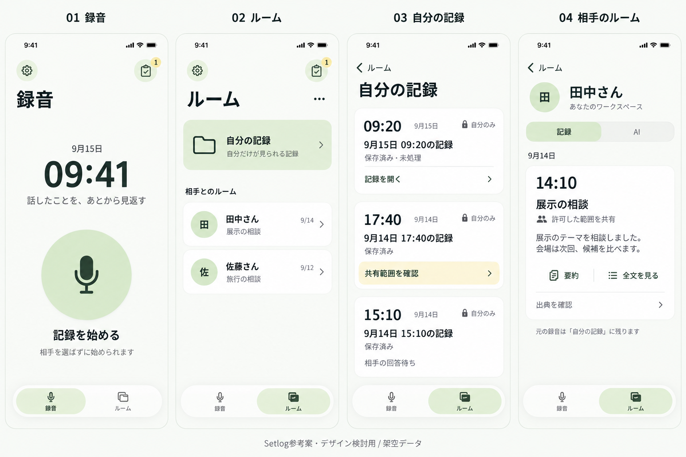
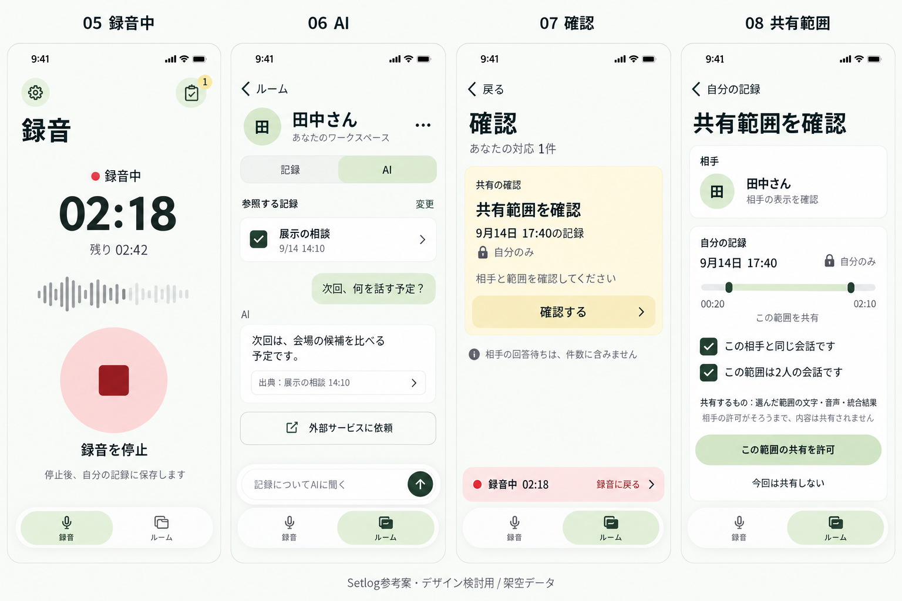

# Setlog参考案：画面画像v1の履歴

2026-09-15。[Setlog参考のUI構成案](../../SETLOG_UI_STRUCTURE.md)を画像化した静止画。既存案の画像は隣の design-directions に保持し、別フォルダで管理する。すべて架空データで、実装画面・実機検証の結果ではない。

本文はKosugi Maru Regular（400）、タイトルはNoto Sans JP SemiBold（600）を採用した。[実フォントの書体見本](kosugi-maru-body.html)で組合せを確認し、本文の文章・文字サイズ・行間を変更できる。以下の画像は選定前のまま保持し、採用書体の正確な字形を示す資料とはしない。配布元・同梱ファイルは[フォントの記録](fonts/README.md)を参照。

| 画像 | 収録した画面 |
|---|---|
| [01 メイン画面](01-main-screens-v1.png) | 録音開始前／ルーム一覧／自分の記録／相手のルームの記録 |
| [02 AI・録音中・共有確認](02-ai-sharing-states-v1.png) | 録音中／相手のルームのAI／確認一覧と共通録音帯／共有範囲の確認 |

## メイン画面



「自分の記録」はルーム一覧の先頭。共有手続きなし・本人の確認待ち・相手待ちを別の表示にする。相手のルームでは許可範囲の共有会話を表示し、元の個人記録は保持する。

## AI・録音中・共有確認



AI画面は本人が参照記録を1件選んだ状態の例で、初期選択やAI履歴の仕様を決めるものではない。共有範囲のチェックも本人が確認して選択した例で、接続コードによる自動確認を意味しない。相手の本文は表示していない。確認件数1件と一覧1件を一致させ、相手待ちは数えない。

各画面は独立した表示例。録音中の時間02:18と残り02:42は既存の5分上限に合わせた人工値。外部サービスへの依頼ボタンは入口のみで、送信・登録・処理成功の例ではない。

## 見た目と確認範囲

白に近い背景、淡いグリーン、大きな時刻、丸い操作を配色・配置の候補として表現。操作を要する確認は淡い黄、録音中・停止は赤で補助し、文字も併記した。色・寸法・書体・Glassの表現は最終的な実装値ではない。

主担当が2枚を実見し、日本語の主要ラベル、録音／ルームの2タブ、自分のみ、共有前後、本人待ち／相手待ち、AIと本人DMの区別、出典、録音への戻りを照合した。独立レビュー、操作領域・文字拡大・読み上げ・実機・実APIは未検証。空・失敗・期限切れの画像は未展開。

## 生成方法と指示

内蔵 imagegen を使用。CLI・外部APIキーは使用していない。01は新規生成、02は01を見た目の参照画像として新規生成した。生成元のファイルは保持し、このフォルダに最終画像をコピーした。


<details>
<summary>01 の生成指示全文</summary>

```text
Use case: ui-mockup
Asset type: Japanese iOS app design study, one landscape board containing FOUR full-height mobile app screenshots aligned in one horizontal row.
Primary request: Visualize the approved Setlog-inspired structure for a personal conversation recording app. Create realistic, polished, implementable product UI with exceptional Japanese typography and generous spacing. Setlog-inspired friendly daily-log feeling; original app, not a Setlog clone. This is the first board: recording, room list, private records, partner room records.
Composition: four equally sized portrait screens, each with a 390:844 aspect ratio, on a very pale gray-green background. No physical phone hardware, no perspective, no hand, no photography. Thin subtle borders, 28px rounded corners, minimal shadows. Entire screens visible including iOS status bar at 9:41 and bottom tabs. Outside screens small headings exactly: "01 録音", "02 ルーム", "03 自分の記録", "04 相手のルーム". Small footer outside screens: "Setlog参考案 · デザイン検討用 / 架空データ". Produce a high resolution wide image so all Japanese text is crisp.
Shared style: almost-white warm background #FAFBF8, charcoal #26332D text, pale pistachio/mint #DAEACD primary surfaces, dark green #46603C icons, muted warm gray metadata. Restrained pale butter accents only for required confirmation. Large medium-weight time numerals; Japanese sans serif similar to Hiragino Sans, 17pt equivalent body, 30pt page titles. Large rounded cards with 24pt padding, 48pt minimum action targets. No gradients, no purple, no decorative illustrations, no excessive pills, no mock code. Bottom navigation is a subtle light translucent rounded capsule with exactly two destinations "録音" (microphone) and "ルーム" (two rounded cards); selected item in pale green.
SCREEN 1 / recording idle:
Top left circular settings gear. Top right circular clipboard-check icon with a small badge "1". Large title "録音". Middle upper area has small date "9月15日". Centered giant charcoal time "09:41". Under it, simple helper "話したことを、あとから見返す". Large pale green circular record button about 152pt diameter with a dark microphone glyph. Directly below, bold "記録を始める". Under that tiny gray "相手を選ばずに始められます". Spacious calm screen with no record feed. Bottom tab 録音 selected. This is idle: no red live indicator, no elapsed timer, no saved-success status.
SCREEN 2 / rooms:
Top left settings, top right the same confirmation icon badge "1"; title "ルーム", overflow ellipsis aligned right below top icons.
At the very top of content, prominent pale mint rounded full-width tile with outlined folder icon, title "自分の記録", subtitle "自分だけが見られる記録", right chevron. Do not bury this tile in partner list.
Below a small section caption "相手とのルーム".
Two roomy white horizontal partner rows only, circles with initials (not real portraits): "田中さん", subtitle "展示の相談", right date "9/14"; "佐藤さん", subtitle "旅行の相談", date "9/12". These are existing authorized shared conversations. No online status, message notifications, DM unread counts, add friend buttons, or automatic matching. Bottom ルーム selected.
SCREEN 3 / private recordings:
Back arrow labeled "ルーム", title "自分の記録". Three big stacked cards, each has time, date, title, lock icon + "自分のみ", and "保存済み".
Card 1: large "09:20", date "9月15日", title "9月15日 09:20の記録", short metadata "保存済み · 未処理". No attention badge, no partner name, no guessed title. Small secondary text action "記録を開く".
Card 2: large "17:40", date "9月14日", title "9月14日 17:40の記録", "保存済み", pale butter action row "共有範囲を確認" with chevron. This is the one action-required record.
Card 3: large "15:10", date "9月14日", title "9月14日 15:10の記録", "保存済み", neutral text "相手の回答待ち". Do NOT use the butter action styling or badge on this one. No other person's transcript, summary, dates or identity here. Bottom ルーム selected.
SCREEN 4 / partner room record view:
Back arrow "ルーム". Small initial circle, title "田中さん", small subtitle "あなたのワークスペース".
Segmented control "記録" selected, "AI" unselected.
Date "9月14日". One large white rounded shared-conversation card, time "14:10", title "展示の相談", small shared icon and text "許可した範囲を共有". Two lines of fictional summary: "展示のテーマを相談しました。" and "会場は次回、候補を比べます。".
Two small clear actions "要約" and "全文を見る". Quiet text row "出典を確認" with chevron.
Under card a modest gray note "元の録音は「自分の記録」に残ります". Ample empty space below. Bottom ルーム selected.
Important: never display an unshared recording in a partner room. Never imply all original audio was shared. No actual DM composer in these four screens. Exactly four screens, not extra tiles or diagrams. Preserve all essential Japanese labels verbatim.
```

</details>

<details>
<summary>02 の生成指示全文</summary>

```text
Use case: ui-mockup
Asset type: second board of Japanese iOS app screen designs; FOUR full-height portrait app screenshots in a horizontal row on a landscape canvas.
Input image: the provided image is a STYLE REFERENCE ONLY for colors, typography, screen dimensions, corner radii, bottom navigation and spacing. Create four NEW screens that match its product design. Do not copy its screen content.
Primary request: Continue the Setlog-inspired personal conversation recording app study with recording active, personal AI workspace, required confirmations, and sharing scope confirmation. Realistic shippable-quality design, crisp correct Japanese, restrained and spacious.
Composition: four portrait screens at 390:844 proportions, entire screens visible, status bar 9:41, no phone hardware or perspective. Same white #FAFBF8, pale pistachio #DAEACD surfaces, charcoal #26332D text, muted gray metadata, pale butter for required confirmation. Thin borders and almost no shadow. 17pt equivalent body. Bottom navigation always has exactly "録音" and "ルーム" with outline icons in rounded translucent white capsule. Small headings above screens exactly "05 録音中", "06 AI", "07 確認", "08 共有範囲". Footer outside screens exactly "Setlog参考案 · デザイン検討用 / 架空データ". These are separate illustrative states, not four simultaneous states of one recording. No purple, no gradients, no busy backgrounds.
SCREEN 5: active recording.
Top left gear, right clipboard-check icon small badge "1". Large title "録音". Center small red dot + "録音中". Giant tabular elapsed time "02:18". Small "残り 02:42". Small neutral audio waveform below. Broad whitespace. Large pale red circular STOP control, dark red square icon, clear label "録音を停止". Below "停止後、自分の記録に保存します". Do not show saved-success or processing success during live recording. Bottom 録音 selected.
SCREEN 6: partner room AI, personally selected one record.
Back "ルーム". Small initial avatar "田", large "田中さん", subtitle "あなたのワークスペース". Segmented control "記録" unselected / "AI" selected.
Compact flat reference area heading "参照する記録", right "変更". One selected checkbox row "展示の相談" and date "9/14 14:10". This is a record personally selected for this example, not a default-selection rule.
One subtle pale green user message "次回、何を話す予定？". Beneath, small "AI" label and white answer card with precise response "次回は、会場の候補を比べる予定です。". Small bordered source chip "出典：展示の相談 14:10" with chevron.
Below spacious small secondary outlined button "外部サービスに依頼". No provider logos, no sent/done status.
Bottom above tabs: rounded composer with placeholder "記録についてAIに聞く" and dark green up-arrow send control. This sends to AI, not the actual partner. Do not depict typing status from partner or DM delivery/read status. Bottom ルーム selected.
SCREEN 7: confirmations list.
Back "戻る". Large title "確認", modest subtitle "あなたの対応 1件".
One large pale-butter and white card with category "共有の確認", title "共有範囲を確認", metadata "9月14日 17:40の記録", lock icon "自分のみ". Short helper "相手と範囲を確認してください". Prominent rounded action "確認する" with chevron.
Below a quiet flat note "相手の回答待ちは、件数に含みません". Do not create other task cards or numbers. Spacious remainder.
Above bottom navigation show the cross-screen active recording strip in pale red: red dot "録音中 02:18", right "録音に戻る" with chevron. It is clearly separate from confirmation card and from tabs. Bottom ルーム selected.
SCREEN 8: self-side sharing scope confirmation, all displayed content belongs to the viewer, and the other person's transcript is still hidden.
Top back "自分の記録". Title "共有範囲を確認".
White participant row "相手" with initial avatar "田" and name "田中さん". Small neutral text "相手の表示を確認".
White rounded own record card heading "自分の記録", "9月14日 17:40", lock icon "自分のみ". Horizontal minimal selected audio range bar, endpoint texts "00:20" and "02:10". Caption "この範囲を共有".
Two selected checkboxes with legible text "この相手と同じ会話です" and "この範囲は2人の会話です". Treat as a hypothetical state where the viewer has already checked these. Do not infer that from a connection code.
Compact neutral explanation "共有するもの：選んだ範囲の文字・音声・統合結果". Smaller second line "相手の許可がそろうまで、内容は共有されません".
One pale green full-width rounded primary button "この範囲の共有を許可". Secondary text button "今回は共有しない".
No other's time range, audio preview, recording title, utterance or summary. Do not display a shared-success badge or finished merged text. Bottom ルーム selected.
Constraints: exactly four screens. Consistent typography and polished visual rhythm. Buttons and labels readable. No implementation IDs or API details in product UI. No extra unsanctioned automation or partner DM functionality.
```

</details>

## 現在の版

このページはv1作成時の履歴。現在の画像は[画面画像v2](README.md)、個人記録の一覧は[一覧整理](../../SETLOG_RECORDS_LIST.md)を参照する。
