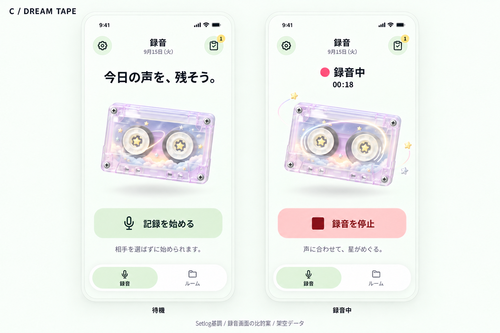

# C / DREAM TAPE：小さな空を閉じ込めたカセット

2026-09-15。ユーザーが[比較案v2](../recording-pop-concepts-v2/README.md)のCを選び、「夢やワクワクするような要素」を追加するよう指定したことを受けた発展案。カセットの方向は選択済み。この星空の具体表現は今回の画像提案であり、動作実装やMVP仕様の採用ではない。



Setlogの白・淡いミント・丸い操作を土台に、透明なケースの内側へ小さな空を閉じ込めた。月のような乳白のリール、星形の軸、雲、朝焼け、細い光の軌道で、声を入れると小さな世界が目を覚ます印象を狙う。

- 待機：ケースの中に星と雲が静かに収まり、光の軌道が小さく巻かれる。
- 録音中：リールの回転を示す光と広がる軌道、外側へ少し浮かぶ星で、声への反応を表す。
- 画面：録音状態・経過時間・開始／停止・2タブ・設定・確認を維持。残り時間は表示しない。録音中の補助文は「声に合わせて、星がめぐる。」へ変更した。

実際に動かす場合の演出は今後の具体化対象。今回は静止画の提案として保存し、[既存の動く見本](../recording-motion-v1.html)とアプリコード・公開API／型・既存MVP仕様は変更していない。

## 生成・確認

内蔵imagegenの編集モードで[旧C画像](../recording-pop-concepts-v2/c-mini-tape.png)を編集対象に指定した。入力を目視した後、中央のカセットと補助文・案名を更新。生成後に待機／録音中、操作配置、日本語、Setlog基調、残り時間なしを目視確認した。PNG 1536×1024、保存コピーと生成原本のSHA-256が一致した。

本文Kosugi Maru 400、見出しNoto Sans JP 600を指定したが、画像内の字形は生成モデルによる近似。実フォントによる組版・実操作・実機・演出効果の検証ではない。

[Setlog画像一覧](../README.md) / [作業記録](../../../../development/WORKFLOW.md)

## 生成指示全文

```text
Use case: ui-mockup.
Mode: precise edit of the supplied C / MINI TAPE two-screen board.
Input image: EDIT TARGET. Preserve the two large front-facing phones, all Setlog-inspired UI backgrounds, generous white space, pale mint selection and button, pale coral stop button, black headings, top settings and confirmation badge 1, date, elapsed time, bottom two tabs, border geometry and layout. User chose C and now wants a sense of dreams, wonder and anticipation INSIDE THE CASSETTE.

Core concept: a tiny dreamlike universe sealed inside a transparent cassette. It must remain instantly readable as a compact audio cassette with two reels, a clear rectangular shell with softly rounded corners, corner screws and the lower tape edge. Keep it at approximately the same size and placement as the source. Retain its tactile, beautifully made, realistic miniature 3D object quality.

Change the cassette hero in BOTH screens:
- A crystal-clear milky-lilac resin shell, pale-mint edges, delicate pearlescent reflections, softly rounded polished edges.
- Inside the shell is a miniature sky with a subtle pastel dawn gradient, very soft lavender and peach light, a tiny bank of translucent clouds along the lower edge, and a few sharply crafted tiny silver and buttery-yellow star shapes suspended in its depth. These belong INSIDE the object, not stickers laid over the screen.
- Two functional circular tape reels are the central focus, with pearl-white moonlike faces and small star-shaped central hubs. Dark tape is largely softened into silver-gray so the object feels light and inviting. Reels must still look like cassette reels, not eyes or a face.
- A very fine opalescent strand representing the recorded voice curves around the reels like a planetary orbit. Give this transparent object believable depth and a magical inner glow, with light only around the hero. Sophisticated and joyful, like holding a pocket-sized dream, not a child's toy illustration.

State contrast:
LEFT IDLE: the tiny stars are resting inside, reels clear and still, a restrained pale peach/lilac dawn behind them, one fine short orbit strand curled between the reels. Feels like a tiny world waiting to awaken.
RIGHT RECORDING: same cassette at SAME scale and roughly SAME tilt. Reels suggest gentle rotation through subtle arc highlights, inner pastel light brightens a little, the fine orbit strand opens and curves through the reels toward the top shell edge. Exactly three tiny points of star light can drift just beyond the cassette, within the hero area only. This should make speaking feel like bringing the little sky to life. Keep the shell stable and recognizable. No spectacular explosion, excessive sparkle confetti or dominant purple backdrop.

Preserve all functional text, except update the recording helper to exact Japanese "声に合わせて、星がめぐる。"
Left main heading stays "今日の声を、残そう。"
Left button "記録を始める", helper "相手を選ばずに始められます。"
Right red dot "録音中", elapsed time "00:18", stop square "録音を停止".
Both phone headers "録音", date "9月15日（火）", bottom tabs "録音" selected and "ルーム".
Heading style Noto Sans JP SemiBold 600; body Kosugi Maru Regular 400, rounded terminals. Keep Japanese sharp and accurate.
Replace only the outside top-left concept label with "C / DREAM TAPE".
Outside state captions "待機" and "録音中".
Footer "Setlog基調 / 録音画面の検討案 / 架空データ".

At least 80 percent of each screen remains quiet near-white or pale mint. Keep the same usable UI hierarchy with unchanged control positions. No remaining time, countdown, playback controls, music player interface, score, streak, reward mechanic, additional tabs or new functional widgets. No black night sky, space-themed app background, giant moon outside the cassette, dark mode, neon bloom or heavy outlines.
Deliver one refined landscape 3:2 image, two complete large screens as in the source, all tabs visible. The only visually adventurous area is the small dream-world cassette.
```
