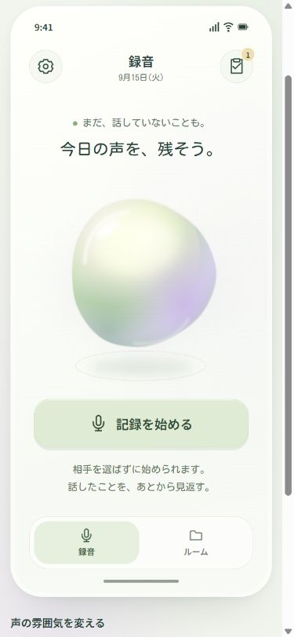
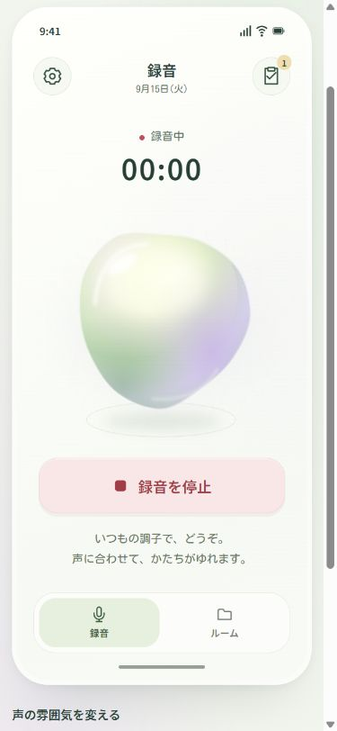
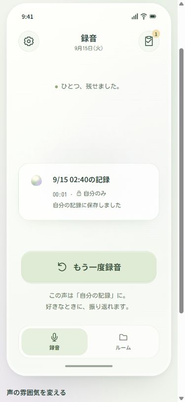

# 声でゆれる立体：録音の旧状態比較見本 v1

2026-09-15。Setlog案の録音画面を、疑似音量で操作できる独立した見本にした。実アプリ・録音機能には接続しない。

**現在の実装指示ではない。** カセット方向の採用後の見た目/動作は[MVP_SPEC §18.5/18.6](../../../MVP_SPEC.md#cassette-design)へ統一した。この見本は状態遷移の比較履歴。立体の呼吸/変形、300ms後の疑似開始、900ms後の疑似保存成功、700msのカードmorphをカセットや実録音の成功判定へ移植しない。

## 開く

[動く見本](../recording-motion-v1.html)は同梱フォントを使う。リポジトリルートで次を実行し、表示されたURLを開く。ポートは空いているものを自動選択する。

```sh
node docs/product/prototypes/setlog-ui/serve-recording.mjs
```

HTML/CSS/インラインSVG/JavaScriptのみで実装。追加ライブラリなし。サーバーは127.0.0.1に限定し、見本・フォント・指定した参考資料だけを配信する。マイクやカメラを禁止するPermissions-Policyと、外部通信・メディア取得を禁止するCSPを付ける。

## 操作と演出

- 待機中は約5秒周期の呼吸。輪郭、乳白色の光、ミントとラベンダーの陰影で立体を表現する。
- 「記録を始める」を押すと軽く沈み、300ms後から経過時間と疑似音量への反応を表示。画面外の「静か／ふつう／にぎやか」で強さを変更できる。初期値は「ふつう」。
- 停止すると経過時間を固定し、900msの保存中表示を経て成功へ。立体が約700msで記録カードの小さな印になる。開始／停止ボタンは標準文字サイズの同じ位置に置く。
- 画面外の「ほかの状態も試す」から、次の保存失敗・録音中断・5分直前への移動・動き低減を試せる。失敗は再試行、中断は待機へ戻れる。失敗指定は1回で解除される。
- 5分で疑似録音を自動停止し、その理由を保存中と保存後に表示。残り時間は表示しない。経過時間は描画回数に依存せず、単調時計から計算する。
- ルームタブには見本内の自分の記録への入口を置き、録音中は共通帯から戻れる。設定・確認アイコンは説明ダイアログを開く。録音開始・停止や実データの変更を伴わない。
- 動き低減では呼吸、輪郭変形、浮遊、移動を止め、短いフェードと静止状態で示す。OSの動き低減設定も尊重する。音と振動は出さない。

本文はKosugi Maru Regular 400、見出しはNoto Sans JP 600。保存カードは直近の架空の1件だけをメモリ内に保持し、再読み込みでリセットする。日時は見本を開始した端末の日時。実音声、MediaRecorder、音声再生、ストレージ、API、外部送信は使わない。

## 画面画像

実ブラウザの画面を撮影した。画像生成による近似ではなく、同梱フォントとSVGの描画結果。画像は静止状態であり、揺れ方は動く見本で確認する。

| 待機 | 録音中 | 保存後 |
|---|---|---|
|  |  |  |

## 確認結果

主担当によるローカルブラウザの自己確認。実機・実録音・本番APIの検証ではない。

| 確認 | 結果 |
|---|---|
| 開始→停止→保存成功→再開始 | 成功。開始中／保存中は操作を重複させない。連打時も録音中に到達 |
| 保存失敗→再試行 | 成功。失敗時は成功カードを出さず、再試行で復帰 |
| 中断・ルーム・共通帯 | 成功。中断後の未保存表示、ルームから録音へ戻る操作を確認 |
| 5分上限 | 見本の時刻移動から05:00で自動停止。理由と保存カードの05:00を確認 |
| 幅390px／320px | 横スクロールなし。本文・操作のはみ出しなし |
| 文字200% | ブラウザ検証用に文字サイズだけを拡大。390px／320pxで横スクロールや本文の欠落なし。Enterキーで開始・停止・保存まで操作。検証後は再読み込みして拡大を解除 |
| 動き低減 | 浮遊transformと輪郭が静止し、経過時間と操作を維持。OS設定のエミュレーションでも適用され、検証後に解除 |
| 疑似音量 | 各5.5秒の観測で大きさの変化幅は静か約2.8%、ふつう約6.7%、にぎやか約12.2%。このPC上の描画観測であり性能保証ではない |
| フォントと通信 | 実フォント2種の読込成功。再読込後の通信はlocalhostのHTML＋フォント2件のみ。ブラウザ警告・エラーなし |

文書・差分・既存ファイル保持の確認結果は[WORKFLOW](../../../../development/WORKFLOW.md)へ記録する。[Setlog画像一覧](../README.md)のv1/v2画像と既存のアプリコードは保持する。
