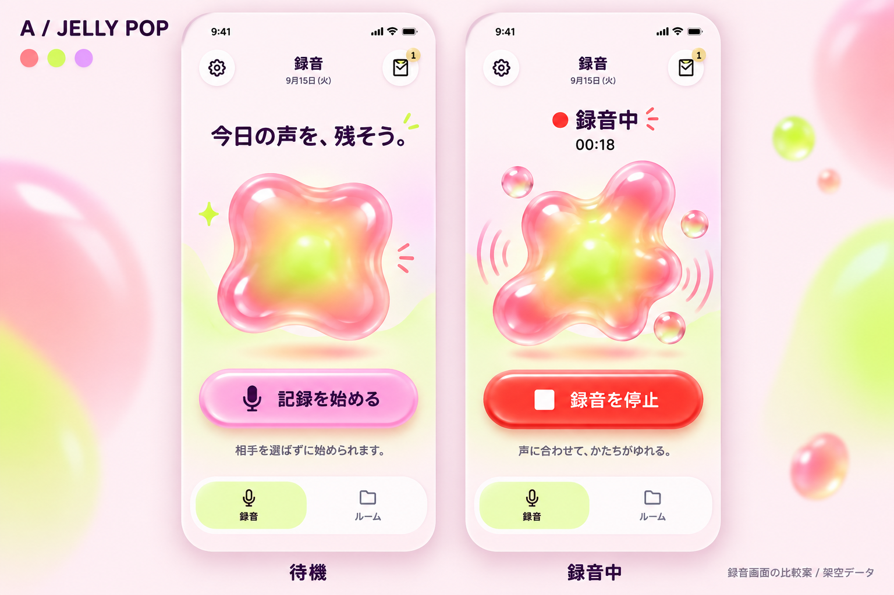
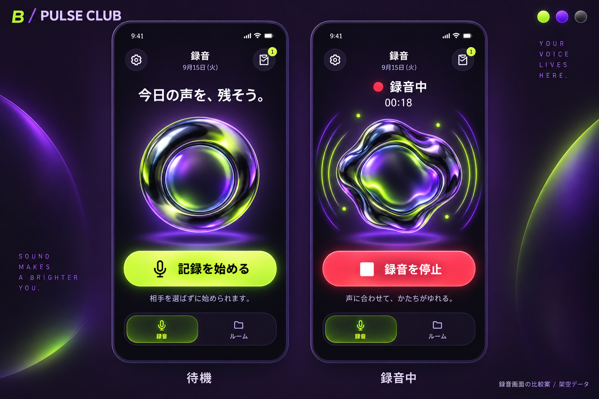
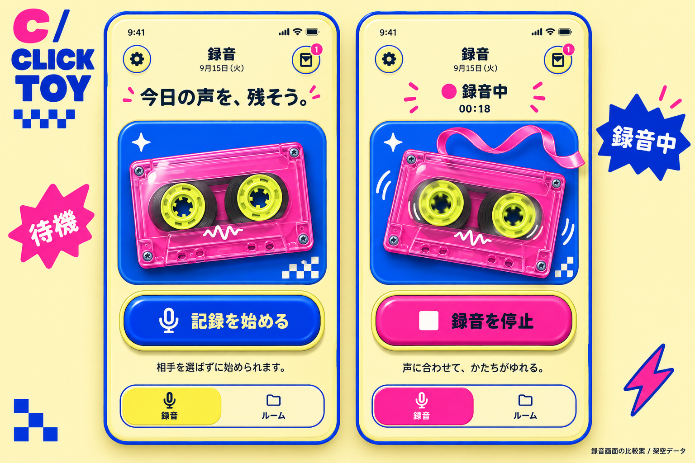

# 録音画面：ポップな比較案 v1

ユーザーの「setlogのデザインは基調にして」を受け、[Setlog基調のv2](../recording-pop-concepts-v2/README.md)へ更新。以下は先行検討の履歴。

2026-09-15。「画像でいくつか提案して」という追加依頼に対し、色・触感・即座の反応を強めた3方向を制作。各画像の左が待機、右が録音中。各名称は比較用の案名であり、製品名ではない。

[これまでの動く見本](../recording-motion-v1.html)を機能配置の参考にし、見た目を別案として作った。3案とも未採用。以下の演出は画像から想定した提案であり、動作実装はしていない。

| 案 | 見た目の狙い | 押す・話す・保存の演出案 |
|---|---|---|
| **A / JELLY POP** | コーラルピンク、ライム、透明なゼリー。触って変形させたくなる質感 | 押すとぷにっと沈む → 声で輪郭と小さな粒が跳ねる → 粒が集まり記録カードの印になる |
| **B / PULSE CLUB** | 黒紫、ライム、クローム。音楽を感じさせる光と反射 | 押すと反射光が一周 → 声でディスクの膜と輪郭が波打つ → 光が収束して記録になる |
| **C / CLICK TOY** | バターイエロー、コバルト、ホットピンク。トイカメラやポケット機器のような操作感 | キーがカチッと沈む → 声でリールやリボンが動く → カセットが小さな記録カードになる |

**推奨はA。** 現在の「声でゆれる立体」の考え方を保ちながら、触感・色・形の変化を強められるため。Bは暗い背景と反射光、Cは機器のような質感という別の好みを比較するために用意した。対象層への訴求効果は未検証であり、提案者のデザイン上の判断。

## A / JELLY POP



## B / PULSE CLUB



## C / CLICK TOY



## 保持する機能と確認範囲

- 設定、本人の確認1件、録音／ルーム、相手を選ばずに開始、経過時間、開始／停止操作を維持。残り時間・文字起こし・スコア・報酬などの機能を追加していない。
- CのカセットとBのディスクは録音の視覚表現。音楽再生、カメラ、撮影、物理メディアの操作機能を意味しない。演出案は視覚上の変化であり、効果音・振動の採用ではない。
- 本文Kosugi Maru 400、見出しNoto Sans JP 600に寄せる生成指示を使用。生成画像の字形は近似。既存フォントの採用判断は変更していない。
- Bの暗色は比較候補であり、明るい現行見本や全画面の配色を変更する決定ではない。画像外の英語や装飾は提示用であり、製品のコピーとして採用しない。
- 内蔵imagegenを使用。3画像を生成後に目視し、2状態、録音操作、時間表示、2タブが読めることを確認。保存コピーは生成原本とSHA-256一致。日本語の描画・配色・タッチ領域・演出は、実装時に別途検証する。
- アプリ、動く見本、既存v1/v2画像、共有条件、API／型は変更していない。

## 使用した生成指示

各呼出しは以下の「共通指示」と該当する「追加指示」を連結した。入力は、これまでの見本の待機画面1枚を機能配置の参照として使用した。

### 共通指示

```text
Use case: ui-mockup.
Primary request: boldly redesign the supplied Japanese recording app into an expressive, high-energy visual concept that is immediately tactile, playful, memorable and fun to press. The user wants much stronger visual excitement than the calm current screen.
Input image: existing app screenshot used ONLY as the functional layout reference. Reinterpret its visual style completely. Do not reproduce its browser scrollbar or external test controls.
Create a polished landscape 3:2 presentation image with exactly TWO complete, large, front-facing mobile UI screens side by side: LEFT idle, RIGHT recording. Show the entire bottom navigation on both. No hands, devices on a table, photographic scene or extra screens.
Invariants on both: top-left settings icon, top-center 録音 and small 9月15日, top-right confirmation/check icon with tiny badge 1, bottom tabs 録音 selected and ルーム. One dominant interactive object in the center. A large clearly labeled action button in a fixed position below it. No countdown, remaining time, progress-to-time-limit ring, live transcript, scores, streaks, loot boxes, social feed, reward counters, or extra features. No product name or logo.
LEFT IDLE exact copy: headline "今日の声を、残そう。", primary action "記録を始める" with microphone icon, small body "相手を選ばずに始められます。"
RIGHT RECORDING exact copy: a clear red recording indicator and "録音中", elapsed time "00:18", primary action "録音を停止" with a clear solid stop-square icon, small body "声に合わせて、かたちがゆれる。"
Time is secondary to the tactile object; buttons and words remain sharply legible. The object changes shape between idle and recording to communicate the intended voice-reactive effect.
Japanese headings and operation labels use crisp Noto Sans JP SemiBold-like shapes; body copy uses softer Kosugi Maru Regular-like shapes, no faux bold body. Do not make everything rounded display lettering. Realistic deployable app UI proportions, minimal copy, clear functional hierarchy despite expressive material treatment. Avoid generic business dashboard styling. Frame captions outside the screens "待機" and "録音中".
Small outside footer: "録音画面の比較案 / 架空データ". Text only as specified plus the concept title.
```

### Aの追加指示

```text
CONCEPT A — outside board title exactly "A / JELLY POP".
Art direction: juicy hyper-tactile jelly pop, electric coral pink + chartreuse lime + milky lilac, with deep eggplant typography. A distinctive giant sculpted jelly blob, almost a soft four-lobed pillow or irregular gummy, semi-transparent, wet candy-glass highlights, a delightful sense of squish and weight. Not a ball with a face, no mascot eyes. Idle blob is coral-pink/cantaloupe with a luminous lime core; recording blob visibly squashes and sprouts a few rounded lobes with tiny translucent droplets, like voice making gelatin dance. Extremely polished 3D material rendering integrated INTO the app.
Phone backgrounds are soft almost-white peach/lilac with a restrained acid-lime color-block near the bottom, a few tiny clean sparkle marks or soft ripple outlines beside the object. Large bubblegum-pink or saturated chartreuse molded button with clear dark lettering, tactile beveled rim and convincing soft contact shadow; recording stop button maintains excellent red/charcoal contrast.
Make this vivid, cheeky and collectible-looking, akin to a beautiful contemporary designer gummy toy, but not childish clip art or baby pastel. Keep the app clean and usable. The two screen states share the exact same layout and button position.
Outside board background is an understated very pale blush with tiny lime/coral swatches. Main attraction is the phone UI, not a marketing poster.
```

### Bの追加指示

```text
CONCEPT B — outside board title exactly "B / PULSE CLUB".
Art direction: a sleek, visually electrifying handheld music object, black-plum canvas with hot acid-lime, electric violet and chrome, high contrast and a strong central silhouette. Dramatically different from candy pastels. This is an alternative dark visual concept for comparison, not a new feature or a global setting.
Each app screen is dark ink #171321 with a faint purple radial glow, crisp off-white typography, clean luminous lime navigation selection. The dominant central object is a hovering sculptural CHROME torus/disc with a soft liquid membrane through its center: iridescent reflective black-silver with violet edges and intense lime reflected highlights. No face. It should look touchable and premium, like a futuristic music instrument, not an AI chatbot orb or corporate audio visualizer.
Left idle: polished circular sculptural disc hovering over a faint soft pool of violet light. The disc's center is calm.
Right recording: the disc ripples into a wavy elliptical form, three or four bold volumetric wave contours expand around it, small lime luminous accents imply beats, the membrane visibly flexes with voice. The glow must not interfere with text.
Idle CTA is a huge acid-lime pill with dark text and microphone. Recording CTA is an opaque dark-magenta or coral pill with white text and a clearly recognizable stop-square. Equal button geometry, fixed position, no tiny controls.
Screen captions, concept title and a few tiny lime-violet swatches outside phones on a dark desaturated plum presentation background. Clean album-art-like visual confidence, very legible actual app screens. Avoid excessive neon grids, cyberpunk city imagery, glitch text, explosions, or any implication of a timer limit around the disc.
```

### Cの追加指示

```text
CONCEPT C — outside board title exactly "C / CLICK TOY".
Art direction: bold collectible TOY RECORDER with the satisfying industrial design of a colorful 2000s toy camera or pocket cassette player. Butter-yellow / cobalt-blue / hot-pink with inky near-black outlines and a little polished silver. A tactile, humorous, fashionable object, playful but not babyish. Clearly different from both jelly blobs and futuristic neon.
App screen background warm pale butter #fff5cd, large crisp dark ink text, a cobalt inset panel around the central recording object with softly rounded chunky corners. Tactile embossed hardware-like borders, restrained tiny sticker accents (one spark, one checker strip), generous breathing room.
Dominant central object is a large translucent hot-pink CASSETTE, slightly tilted 5 degrees, with two chunky lime-yellow reels, visible clear acrylic thickness, small screw details, a silver glint and one simple abstract sound-wave motif. It is purely a decorative voice-recording metaphor, no playback buttons, no camera or photo functionality, no music-song metadata, no new controls.
On LEFT idle the pink cassette rests in a pristine cobalt display bay, with neat tape and still reels. On RIGHT recording the same cassette is tilted the other way and the reel spokes plus short curved motion marks imply gentle rotation; a single playful thick wavy ribbon of pink tape arcs above it as if moving with voice. Do not make a messy broken cassette. The recording red dot and elapsed 00:18 remain clear and unoccluded.
Primary CTA is a large cobalt-blue tactile rounded rectangular key with a rounded pale-yellow border and clear white or pale-yellow lettering, with a short offset dark contact shadow to suggest a satisfying mechanical click. Recording CTA is opaque hot-pink with dark lettering and white stop-square. Keep identical geometry and position.
Bottom navigation is light butter, outlined cobalt, with a strongly filled yellow or pink selection behind 録音. Tasteful checker or sticker details remain outside the text.
Outside board background a pale warm yellow with two small cobalt/pink graphic cutouts and the concept title. Strictly TWO large actual app screens, no giant extra device outside them, no slogans or unrequested copy.
```
