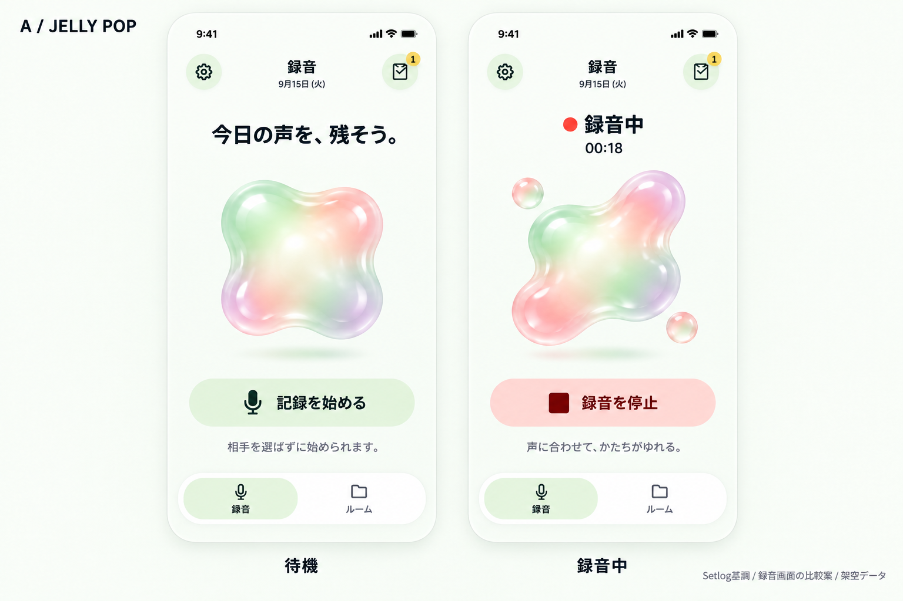
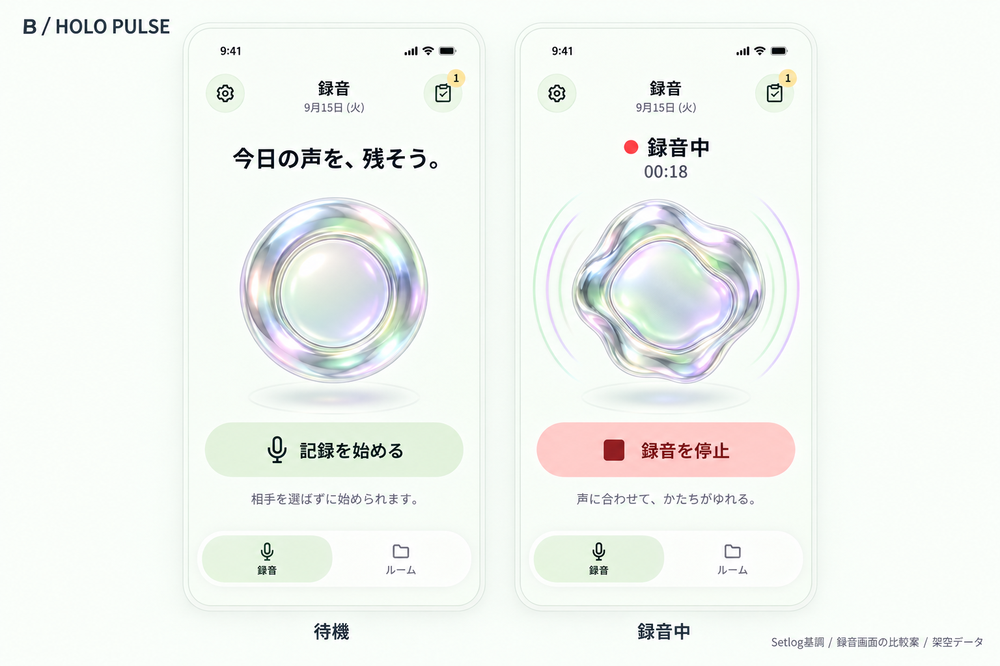
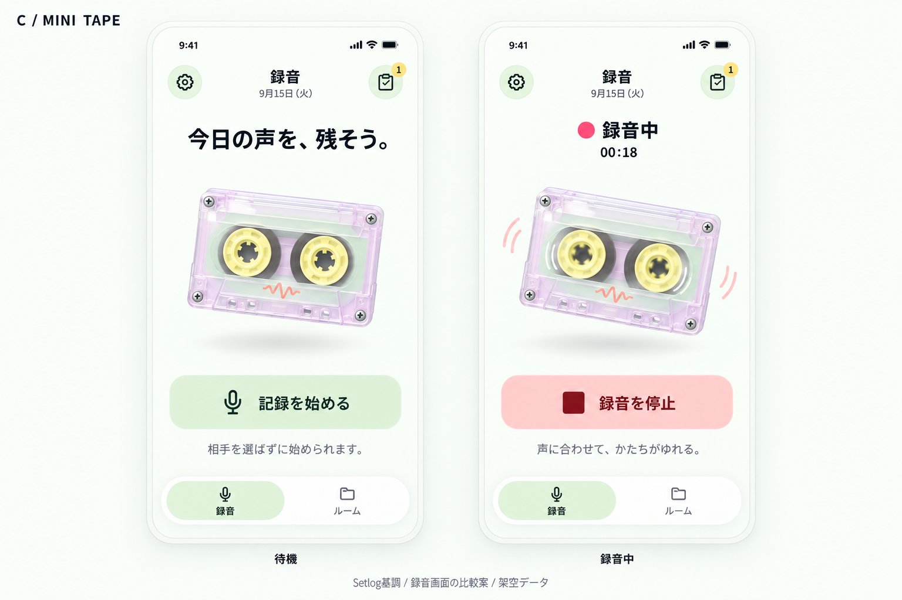

# Setlog基調の録音画面：比較案 v2

**現在の方向：ユーザーがCを選択。** 夢やワクワクする要素を加えた[発展案DREAM TAPE](../recording-dream-tape-v1/README.md)を制作。以下は3案比較時点の記録。

2026-09-15。ユーザーの「setlogのデザインは基調にして」を反映した画像提案。白・淡いミント・余白・丸い操作を土台に、録音の立体だけで遊び心を出す。各画像の左が待機、右が録音中。名称は比較用であり製品名ではない。

比較時点ではAを推奨した。「声でゆれる立体」を自然に発展させ、透明感と押したくなる質感を加えられるため。Bは光の美しさ、Cは小さな道具を触る楽しさを重視する方向。対象ユーザーへの効果は未検証。

| 案 | 見た目 | 動かす場合の演出案 |
|---|---|---|
| A / JELLY POP | ミント・乳白・薄いコーラルの透明なゼリー | 押すと沈み、声でぷにっと変形。保存で小さな印にまとまる |
| B / HOLO PULSE | 淡い虹色が反射する真珠色のリング | 声で内側の膜がゆれ、淡い波紋が広がる。保存で小さな輪にまとまる |
| C / MINI TAPE | 乳白・ミント・薄いラベンダーの小さなカセット | 声に合わせてリールと波形が動く。保存でテープの印になる |

演出は画像から想定した提案であり、実装していない。白い背景と操作位置を揃え、録音中の状態・経過時間・停止ボタンを共通にした。残り時間は表示しない。録音／ルームの2タブ、設定、確認の入口を維持する。

## A / JELLY POP



## B / HOLO PULSE



## C / MINI TAPE



## 保存・確認

- 内蔵imagegenの編集モードで生成。PNG各1536×1024。生成原本とのSHA-256一致、2状態の構成・操作・表示文言・Setlog基調を自己確認した。
- 本文Kosugi Maru 400、見出しNoto Sans JP 600を指定。画像中の字形は生成モデルによる近似であり、実フォントの組版ではない。
- アプリコード・公開API／型・既存MVP仕様と[動く見本](../recording-motion-v1.html)は変更していない。今回は静止画の提案で、実操作・アクセシビリティ・実機の確認は対象外。
- [先行案v1](../recording-pop-concepts-v1/README.md)は検討履歴として保存。[既存のSetlog画像一覧](../README.md)とはファイルを分ける。
- 文書検証と保持確認の結果は[WORKFLOW](../../../../development/WORKFLOW.md)に記録。

## 使用した参照画像とプロンプト全文

各生成指示は、次の共通指示と対応する個別指示を連結したもの。3枚の入力の役割を分けた。

1. [Setlogのメイン画面v2](../01-main-screens-v2.png)：配色・余白・操作の見た目の基準。
2. [録音の動く見本の待機画面](../recording-motion-v1/01-idle.jpg)：録音画面の配置の基準。
3. 対応する先行案v1の画像：中央オブジェクトの素材表現だけを参照。背景や操作の色は引き継がない。

### 共通指示

```text
Use case: ui-mockup, precise visual redesign.
User correction: SETLOG'S VISUAL FOUNDATION MUST REMAIN. Explore delight only inside the central recording visualization. Do NOT reskin the whole app into a candy poster, club app, or toy device.
Input image 1: PRIMARY UI STYLE reference, the existing Setlog-inspired four-screen board. Preserve its off-white/light-mint backgrounds, quiet mint selected tabs, fine gray borders, dark charcoal headings, restrained pastel accents, clean generous spacing and rounded functional controls.
Input image 2: PRIMARY RECORDING LAYOUT reference, current moving-prototype idle screenshot. Preserve its small centered 録音 header with date, settings left, confirmation badge 1 right, central object, lower fixed button, and bottom two tabs.
Input image 3: OBJECT MATERIAL REFERENCE ONLY from an earlier louder concept. Ignore its phone colors, background, typography treatment, button colors, border thickness, decorations, captions and surrounding artwork. Borrow only the central visual metaphor.
Deliver one landscape 3:2 image with exactly TWO large front-facing app screens, left idle and right recording. Both screens should clearly belong to the exact same app as input 1. No browser controls or test panel from input 2. Complete bottom tabs visible. Neutral off-white presentation background, small dark concept title outside, no oversized branding or colored poster decoration.
At least 80 percent of each UI must remain quiet off-white / very pale mint. Colorful material is contained within the central object; no full-screen colorful gradient, dark mode, neon glow, sticker bursts, heavy outlines or hardware skin.
Both screens: settings circle left, centered small "録音" heading and "9月15日", confirmation circle right with tiny pastel yellow badge 1. Bottom white pill bar has two tabs "録音" selected on light mint, "ルーム" unselected neutral gray.
Heading style Noto Sans JP SemiBold 600; body Kosugi Maru Regular 400 with rounded terminals, clearly regular not bold. UI text in dark charcoal. All Japanese crisp.
LEFT: "今日の声を、残そう。" above the object. Large flat-soft pale-mint button with dark microphone icon and exact "記録を始める". Small text "相手を選ばずに始められます。"
RIGHT: small red dot with "録音中", secondary elapsed time "00:18". Same central-object area with a changed silhouette indicating response to voice. Same size/position button, soft pale-coral background with dark red stop square and "録音を停止". Small text "声に合わせて、かたちがゆれる。"
Keep buttons, tab bar, spacing, hierarchy consistent across the two states and concepts. No remaining time, countdown, transcript, score, reward, streak, playlist, music playback, camera, extra controls or new features.
Small outside state captions "待機" and "録音中". Footer "Setlog基調 / 録音画面の比較案 / 架空データ". No other copy.
```

### a-jelly-pop.png

```text
A — outside concept title "A / JELLY POP".
Within the otherwise quiet Setlog UI, a semi-transparent four-lobed jelly object floats softly. It is a delightful mint-and-soft-coral gummy with a pearl-white core, a subtle lilac edge, clear specular highlights and convincing jelly thickness. Gentle color concentration only in this object. Left is rounded and slightly plump; right has a lightly stretched, squished outline with TWO tiny translucent detached droplets, as if a spoken syllable makes it bounce. No eyes or cartoon face. No external sparkle stickers.
The current calm sphere evolves into a playful squishable jelly without changing the app's visual identity. Preserve clean white breathing room around the object, quiet shadows, and restrained mint CTA. This is an attractive usable app screen, not a promotion banner.
```

### b-holo-pulse.png

```text
B — outside concept title "B / HOLO PULSE".
Evolve the earlier neon disc into a PEARL-WHITE iridescent sculptural ring on the existing WHITE Setlog background. The object alone has soft mint, lilac, pink and silver reflected edges. Absolutely no dark screen, acid-lime neon button, club lighting or poster styling.
The hovering object is a thick polished opalescent ring with a thin liquid membrane across its center, about the same footprint as the jelly object in concept A. It has bright white/silver material rather than black chrome. Left idle is a calm circular ring; right recording ring has a visibly soft wavy outline with the membrane gently flexing and TWO faint mint/lilac concentric sound ripples. The ripples are decorative response-to-voice, never a progress meter.
Playfulness comes from surprising liquid reflections and gentle responsive geometry, with crisp silhouette and material depth, not overwhelming glow. Rest of both screens retains the quiet mint controls, white panels, black headings and readable regular body of Setlog.
```

### c-mini-tape.png

```text
C — outside concept title "C / MINI TAPE".
Turn the previous loud toy-camera-like treatment into ONE small, beautifully made pastel cassette object floating in an otherwise unchanged Setlog screen. No cobalt panel, no yellow phone casing, no poster stickers, no heavy device borders. The screen and buttons must have the same restrained white/mint appearance as concepts A and B.
The central cassette is a collectible translucent milky-lilac and pale-mint acrylic miniature, with subtle clear thickness, creamy yellow circular reels, tiny silver details and a modest coral-pink waveform symbol. It should feel like a desirable tactile desk toy. Object size about 260px wide relative to a 390px mobile screen, with generous empty space. A very soft contact shadow below, no colored compartment.
LEFT idle: the cassette is softly tilted by 3 degrees, reels still and neat.
RIGHT recording: the same cassette tilts 3 degrees in the other direction, the spokes of the reels and TWO small curved marks suggest gentle spinning in response to voice. Keep tape entirely INSIDE the cassette, no spilling or broken ribbon. A small faint pastel wave near the object can suggest voice response; no live transcript.
The only playful variations are inside the object. Maintain clean regular body copy, clear dark headings, normal pale-mint CTA and pale-coral stop button, white pill bottom tabs exactly as the base Setlog design.
```
